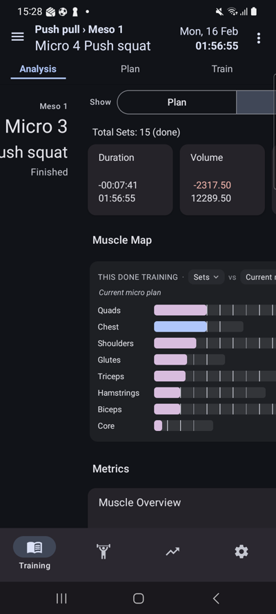
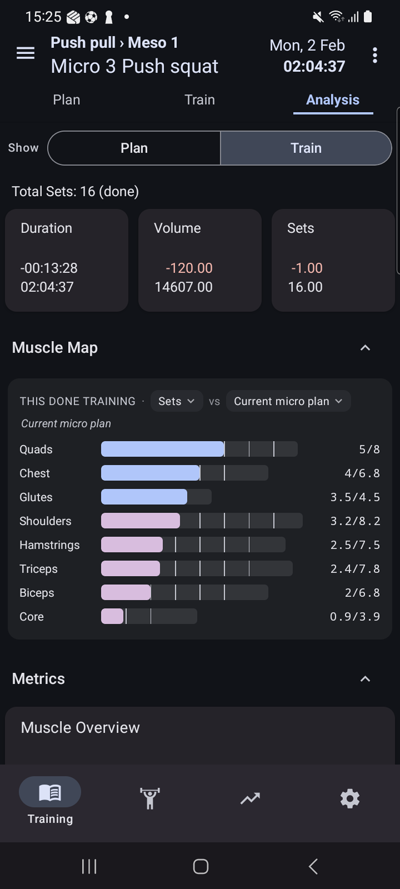
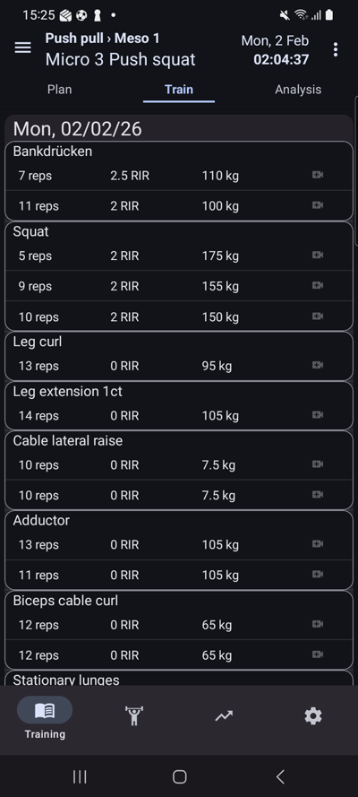
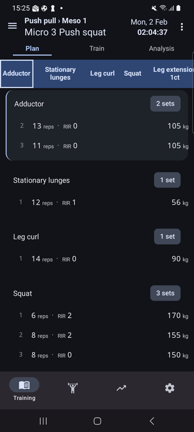
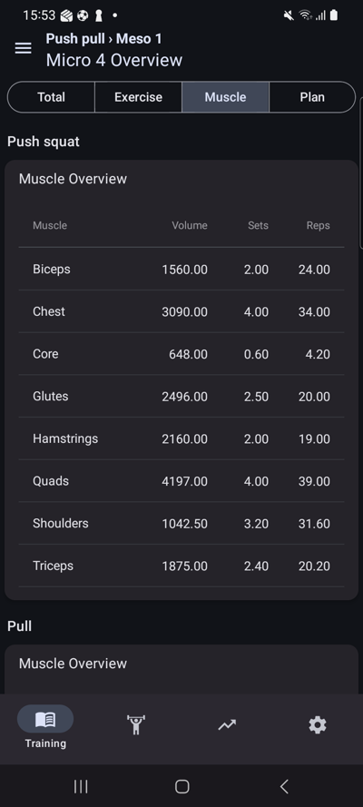

# PERF-003 – Trainings-Tab flüssiger: Wischen zwischen den Micros und Klicks auf die Knopfleisten

Umsetzung + Messung am echten Gerät (Release-Build, echte Nutzerdaten). Baut auf der Messmethode aus PERF-001
(`docs/perf/device-measurement.md`, PR #463) auf; die Skripte liegen – erweitert – unter `docs/perf/perf003/tools/`.

## 1. Ergebnis in Kürze

| | vorher (PERF-001 / hier neu gemessen) | nachher |
|---|---|---|
| Wisch Micro 3 ↔ 4: längster Frame (Median) | 56 / 56 / 60 ms (Train / Plan / Analysis) | **15 / 16 / 15 ms (Train / Plan / Analysis)** |
| Wisch: Frames > 33 ms (Median pro Wisch) | 1 | **0** |
| Wisch: „beschäftigt“ nach PERF-001-Definition (Median) | 183 / 278 / 276 ms | **57 / 104 / 100 ms** |
| Wisch: Gesamtarbeit des JS-Threads pro Wisch (Median) | 199 / 289 / 288 ms | **63 / 110 / 106 ms** |
| Plan öffnen + auf anderes Micro: Speicher / Views | +144 MB / +1002 Views | **+88 MB (-39 %) / +614 Views (-39 %)** |
| Knopfleisten: gewählter Knopf sichtbar (Median) | 219 – 488 ms (außer Home: 39 ms) | **36 – 41 ms; Home 35 ms** |

Drei Dinge tragen das Ergebnis:

1. **Nachbar-Panes bauen ihren Inhalt nicht mehr auf.** Nur das aktuelle Micro und das eben verlassene tragen ihren Inhalt;
   die übrigen Panes zeigen einen leichten Platzhalter (Meso, Micro, Trainingsname, Status + Reiterleiste). Der Inhalt eines neu
   erreichten Micros wird kurz vor dem Einrasten in fünf kleinen Schritten aufgebaut (`ProgressiveMount`).
2. **Das eben verlassene Micro bleibt gemountet** (Zurückwischen kostet nichts, Eingaben/Scrollposition bleiben erhalten) und
   die Panes sind `memo`isiert.
3. **`RangeSwiper` sortiert seine Panes nicht mehr um.** Bisher wechselte die DOM-Reihenfolge bei jedem Wisch, Android hängte die
   Pane-Views ab und wieder an und zeichnete den ganzen Inhalt neu (17–20 ms Zeichnen → der 40–55-ms-Frame aus PERF-001). Jetzt
   stehen die Panes fest in der Reihenfolge oben/mitte/unten und werden per `translateX` in ihren Slot geschoben.

Für die Knopfleisten: der gewählte Knopf wird in einem eigenen, winzigen Commit markiert (`useOptimistic` in einer Transition,
nur die Leiste selbst rendert), der Inhalt folgt direkt dahinter – bei den schweren Ansichten in Stufen, damit kein 100-ms-Frame entsteht.

**Ehrliche Einschränkungen gleich vorweg** (Details in Abschnitt 6):

* Beim **ersten Besuch** eines Micros (Wischen „in eine Richtung“) sinkt die JS-Gesamtarbeit nur um etwa ein Drittel
  (siehe 3.3), der Inhalt ist dafür **später** komplett (nach dem Einrasten, nicht schon während der Animation).
  Die dramatische Verbesserung gilt für das in Szenario 3 gemessene Hin-und-Her-Wischen und für die Frame-Zeit in beiden Fällen.
* Bei den Leisten **Reiter (Plan/Train/Analysis)** und **Micro-Overview** ist der *Inhalt* nach dem Umschalten nicht schneller
  fertig als vorher (bei der Overview ca. +112 ms später), sondern gleichmäßiger aufgebaut; gewonnen ist die sofortige
  Rückmeldung und der um Größenordnungen kleinere Ruckler.

## 2. Messaufbau

| | |
|---|---|
| Gerät | Samsung SM-G986B (Galaxy S20+ 5G), Android 13, <phone-serial>, Override 720×1600, 60 Hz, USB |
| Build vorher | die ursprünglich installierte App = `assembleRelease` von master `0ef9ef2e` (versionName 0.172 / versionCode 7), SHA-256 der `base.apk` `d08b2db4…` (identisch zu PERF-001). Die PERF-001-Werte ließen sich reproduzieren (Train 183 ms, Plan 278 ms, Analysis 276 ms beschäftigt; Speicher 214 → 358 MiB, Views 273 → 1275). |
| Build nachher | `assembleRelease -PreactNativeArchitectures=arm64-v8a` (nur arm64, das Gerät ist arm64) der Änderungen auf master `0ef9ef2e`, gleicher Debug-Key, per `adb install -r` über die App gelegt. Release-Nachweis: `pkgFlags=[ HAS_CODE ALLOW_CLEAR_USER_DATA ]` (nicht `DEBUGGABLE`), SHA-256 der `base.apk` auf dem Gerät = lokale `app-release.apk` (`checks/dumpsys-package-final.txt`). Der Release-Key liegt nicht im Worktree; für den Build wurde – wie in `docs/memory/agent-memory.md` beschrieben – lokal `signingConfig` von `release` auf `debug` gestellt und **nicht committet**. |
| Methode | PERF-001: `dumpsys gfxinfo reset` → Perfetto (ftrace sched + atrace view/gfx/input/am/wm/res + Frame-Timeline) → scripted `adb shell input` mit festen Pausen → Auswertung pro Geste (`gestures.py`). Kein Metro, kein Dev-Modus. |
| Datenbestand | 381 Trainings (364 abgeschlossen), 82 Übungen, 4 Pläne, 11 461 Sätze (Export, `counts.py`) |

### Definitionen

* **beschäftigt (PERF-001-Kette)** = `settle_ms` aus PERF-001: ab Fingerabheben werden JS-Bursts ≥ 10 ms verkettet, solange die Lücke < 150 ms ist.
  **Achtung:** Arbeit, die später als 150 ms nach dem Loslassen passiert, zählt nicht mehr dazu. Weil der neue Code den Inhalt erst
  nach dem Einrasten aufbaut, wäre diese Zahl allein irreführend – deshalb wird immer auch die
* **JS-Gesamtarbeit** angegeben (`js_busy_ms`: Laufzeit des JS-Threads von Wischbeginn bis zur nächsten Geste, also *alles*, was die Geste auslöst).
* **längster Frame** = längster Frame der Frame-Timeline (App-Start bis Präsentation) im Fenster der Geste; **Frames > 33 ms** = Anzahl davon.
* **gewählter Knopf sichtbar** = Fingerabheben → Ende des Frames, der den ersten echten Mount-Batch (≥ 0,45 ms, Ripple-/Animations-Ticks sind ~0,3 ms) danach zeigt. Bei
  der alten Implementierung ist das der eine große Commit mit Zustand *und* Inhalt, bei der neuen der kleine optimistische Commit davor.
* **Inhalt komplett** = Ende des letzten Mount-Batches ≥ 1 ms bis 1,5 s nach dem Fingerabheben.
* Alle Werte: Median [min–max]; n = Anzahl Gesten. Rohdaten (`gestures.json` je Serie, Traces) im Run-Verzeichnis, aggregiert in `summary-perf003.json`.

## 3. Teil 1 – Wischen zwischen den Micros

### 3.1 Ursachen

* Jede Micro-Änderung rendert `TrainingsPlanTab` neu und damit **alle drei** `TrainingsPlanNode`-Panes komplett (nicht memoisiert) –
  auch die zwei, die nicht sichtbar sind. Das Recycling des dritten Panes tauscht dessen ganzen Inhalt aus.
* Die Panes werden nach Position sortiert gerendert; jede Drehung verschiebt Views im Row → Neuzeichnen des kompletten Inhalts (Trace: `REMOVE`/`INSERT` 8 ms + `Record View#draw()` 17 ms).
* Alle drei Panes halten den vollen Inhalt (≈ 1 000 Views, ≈ 140 MB) vor.

### 3.2 Änderungen

* `RangeSwiper`: dritter Parameter `isActivePane` für `nodeFunction` (auch am Rand des Bereichs, wo Nachbar und aktives Pane denselben Wert haben);
  feste DOM-Reihenfolge + `translateX` statt Umsortieren; exportierte Konstante `SWIPE_SETTLE_MS` (90 % der Animationsdauer).
* `TrainingsPlanTab`: `bodies` = Micros, die Inhalt rendern dürfen (max. 2: aktuelles + eben verlassenes). Das ankommende Pane bekommt seinen Inhalt
  `SWIPE_SETTLE_MS` nach dem Loslassen (war es schon gemountet – Zurückwischen – passiert nichts). Stabile Callbacks, `isActive` = „trägt Inhalt“ (kein Flip beim Hin-und-Her).
  Beim Wegwischen wird ein offener Plan-Bearbeitungsmodus dieses Panes beendet.
* `TrainingsPlanNode`: `React.memo`, Prop `renderContent` (Platzhalter statt Inhalt, der State – Reiter, gewählte Übung – bleibt am Node),
  jeder Reiter-Inhalt in einem `ProgressiveMount` (fünf Stufen à 16 ms).
* `MicroPanePlaceholder`: Meso, „Micro N“, Trainingsname, Status; der Titel steht zweimal (am linken **und** am rechten Rand, die zweite Kopie ist für
  Accessibility/Touch versteckt) – ein Nachbar kommt je nach Wischrichtung von der einen oder der anderen Seite.
* `ProgressiveMount` / `Stage` / `useProgressiveLimit` (`app/components/common/ProgressiveMount.tsx`) und Stufen in `TrainingsOverview`, `MicroOverview`,
  `MicroPlanOverview`, `MicroExerciseOverview`, `MuscleView`, `MetricsOverviewForWorkouts`, `MuscleInvolvementCard`, `WorkoutDoneList`, `PlanReadList`.
  Außerhalb eines `ProgressiveMount` ist die Stufe „unendlich“: alle anderen Screens und alle bestehenden Tests rendern wie bisher alles auf einmal.

### 3.3 Ergebnis (Kriterium: Median + min/max, ≥ 20 Wischer je Reiter)

**Szenario 3 aus PERF-001** (Micro 3 ↔ 4 „Push squat“, je 24 Wischer je Reiter; beide Micros sind abgeschlossen):

| Reiter | Build | n | beschäftigt, PERF-001-Kette (ms) | JS-Gesamtarbeit pro Wisch (ms) | längster Frame (ms) | Frames > 33 ms |
|---|---|---|---|---|---|---|
| Train | vorher | 24 | 183 [168–482] | 199 [181–497] | 56 [13–94] | 1 [0–2] |
| Train | **nachher** | 24 | **57 [39–75]** (-69 %) | **63 [48–297]** (-68 %) | **15 [13–38]** | **0 [0–1]** |
| Plan | vorher | 24 | 278 [258–597] | 289 [270–620] | 56 [40–87] | 1 [1–2] |
| Plan | **nachher** | 24 | **104 [86–117]** (-63 %) | **110 [93–325]** (-62 %) | **16 [13–31]** | **0 [0–0]** |
| Analysis | vorher | 24 | 276 [257–593] | 288 [271–611] | 60 [49–91] | 1 [1–3] |
| Analysis | **nachher** | 24 | **100 [87–115]** (-64 %) | **106 [93–307]** (-63 %) | **15 [12–28]** | **0 [0–0]** |

* **Kein Frame > 33 ms im Median** (0 statt 1 pro Wisch), längster Frame im Median 15–16 ms statt 56–60 ms.
* **Beschäftigt-Dauer mindestens halbiert – nach beiden Definitionen** (Kette und JS-Gesamtarbeit).
* Die Ausreißer im Maximum („nachher“ ~300 ms) sind der jeweils erste Wisch einer Serie: das noch nicht gemountete Nachbar-Micro wird zum ersten Mal aufgebaut.

**Erster Besuch** (der Fall, den Szenario 3 nicht abdeckt, weil dort das Nachbar-Micro nach dem ersten Wisch schon gemountet ist): ab „Next Training“ (Micro 7) sechsmal zurückwischen, jeder Wisch landet auf einem noch nicht gezeigten, abgeschlossenen Micro (3 Läufe × 5 Wischer, der erste Wisch aus dem leeren Micro 7 ist nicht enthalten):

| Build | n | beschäftigt, Kette (ms) | JS-Gesamtarbeit (ms) | längster Frame (ms) | Frames > 33 ms | neu erzeugte Views | Inhalt komplett nach Fingerabheben (ms) |
|---|---|---|---|---|---|---|---|
| vorher | 15 | 384 [277–487] | 406 [304–502] | 76 [46–90] | 2 [1–2] | 659 [457–922] | 429 [323–548] |
| **nachher** | 15 | **65 [45–76]** | **288 [267–299]** (-29 %) | **33 [24–39]** | **0 [0–1]** | **280 [261–298]** | **747 [718–769]** |

Hier ist die Frame-Zeit klar besser (kein Frame > 33 ms im Median), die JS-Gesamtarbeit sinkt um etwa ein Drittel – **aber der Inhalt ist erst nach dem Einrasten komplett** (die Animation dauert 500 ms, der
Aufbau beginnt bei 450 ms und braucht ca. 290 ms). Vorher stand er schon während der Animation da – mit einem 76-ms-Ruckler. Das ist die bewusste Abwägung
„erkennbar während des Wischens (Platzhalter), vollständig kurz nach dem Einrasten“ aus dem Ticket.

### 3.4 Speicher und Views („Plan öffnen + auf anderes Micro wechseln“)

`mem3.sh`: Kaltstart → Training Home → „Next Training“ (Plan, Micro 7) → 3 Wischer (Micro 4) → 8 weitere Wischer (Micro 3 ↔ 4); `dumpsys meminfo`, 5 Durchläufe, Median [min–max], PSS in MiB, „Views“ = `dumpsys meminfo`-Zähler.

| Schritt | PSS vorher | Native Heap vorher | Views vorher | PSS nachher | Native Heap nachher | Views nachher |
|---|---|---|---|---|---|---|
| Kaltstart (Training Home) | 214 [214–223] | 114 | 273 | **222** [212–222] | 123 | **273** |
| Plan geöffnet („Next Training“, Micro 7) | 287 [286–289] | 175 | 448 | **280** [276–280] | 175 | **404** |
| nach 3 Wischern auf Micro 4 | 358 [356–358] | 227 | 1275 | **310** [306–311] | 200 | **887** |
| nach weiteren 8 Wischern (Micro 3 ↔ 4) | 380 [372–381] | 243 | 1279 | **326** [324–327] | 208 | **887** |

Plan öffnen + auf ein anderes Micro wechseln kostet **+88 MiB / +614 Views** statt +144 MiB / +1002 Views (-39 % / -39 %; PERF-001: +138 MB / ~1 000 Views).
Der Zähler „Views“ von `dumpsys meminfo` zählt allokierte, noch nicht vom GC eingesammelte View-Objekte, deshalb sinkt er nicht sofort nach dem Wegwischen.
Ohne das Behalten des eben verlassenen Micros wäre der Speicher niedriger, dafür müsste jedes Zurückwischen den Inhalt neu aufbauen (nicht gemessen).

### 3.5 Verhalten nach dem Umbau – Maestro-Flow mit Screenshots

> Historisch: Der Flow `perf003_micro_swipe.yaml` wurde mit GH-584 ohne Ersatz gelöscht (Perf-Evidence). Dass ein Micro-Swipe den Reiter beibehält, prüft heute `__tests__/e2e/maestro/flows/micro_overview_compare.yaml`.

`perf003_micro_swipe.yaml` (gelöscht) – **rein lesend** (kein `clearState`, kein Import): Training Home → „Next Training“ → auf Micro 4 zurückwischen → je Reiter (Analysis, Train, Plan):
Micro 4 → wischen → **Micro 3** → wischen → **Micro 4** zurück. Nach jedem Wisch wird der Inhalt des angekommenen Micros **über Werte** geprüft
(Analysis: `Total Sets: 15 (done)` / `16 (done)`; Train: Datum `16/02/26` / `02/02/26`; Plan: Beinbeuger `95, kg` / `90, kg`) und mit `assertNotVisible` gegen den Wert des anderen Micros abgesichert.
Der Flow lief **vor und nach dem Umbau** grün (`checks/maestro-swipe-before.log`, `checks/maestro-swipe-after.log`), je 16 Screenshots (`screenshots/maestro-before/`, `screenshots/maestro-after/`).
**Die 16 Screenshot-Paare sind pixelgleich** (Anteil abweichender Pixel: 0,000 % bei allen, Statusleiste ausgenommen; `checks/maestro-before-after-image-diff.txt`) – auch die „as-arrived“-Aufnahmen direkt nach dem Wisch, die
zeigen, dass auch das (pfadabhängige) Reiter-Verhalten des angekommenen Panes unverändert ist.

**Screenshot mitten im Wisch:** `screenshots/final-01-midswipe-previous-micro-placeholder.png` – Finger liegt auf dem Display, das aktuelle Micro 4 (Analysis) ist ca. 300 px nach rechts geschoben; links
kommt das Nachbar-Micro herein und nennt sich: „Meso 1 · Micro 3 · Push squat · Finished“ (Platzhalter, noch ohne Inhalt). `screenshots/final-00-analysis-micro4.png` und `final-02-back-on-micro4.png` zeigen davor/danach.
Aufgenommen mit `input motionevent DOWN/MOVE` (Finger gehalten) auf dem Analysis-Reiter, ohne etwas zu bestätigen.

## 4. Teil 2 – Klicks auf die Knopfleisten

### 4.1 Alle Umschalt-Knopfleisten im Trainings-Tab

| # | Leiste | Wo | Komponente | gemessen |
|---|---|---|---|---|
| 1 | Volume / Sets / Time | Training Home, Micro-Karte | `MicroHeroCard` | ja |
| 2 | Plan / Train / Analysis | oben in jedem Micro | `TrainingModeTabs` | ja |
| 3 | Show: Plan / Train | Analysis-Reiter | `AnalysisDataToggle` | ja |
| 4 | Total / Exercise / Muscle / Plan | Micro-Overview (Drawer → Overview) | `MicroOverviewTraining` | ja |
| 5 | Sortierung Trainingsreihenfolge / Datum | Micro-Overview → Exercise | `MicroExerciseOverview` | ja |
| 6 | Micro ‹ / › | Drawer | `TrainingsPlanDrawer` | ja (Aktionsknöpfe, „gewählt“ = neues Micro sichtbar) |
| 7 | Trainingsauswahl im Kalender (mehrere Trainings am Tag) | Drawer → History | `TrainingHistoryCalendar` | **nein** – erscheint nur bei ≥ 2 Trainings am selben Tag; in den echten Daten gibt es keinen solchen Tag (Auswertung des Exports) |

Nicht als „Leiste“ gezählt: die Einzel-Umschalter (1RM, Bereichsplanung) in `AddWorkoutSet` / `PlanEditList`.
Messung: je Leiste 12 Taps (Overview 16), 2,6 s Abstand, Release-Build, Perfetto, Ablauf `bar_*` in `scenarios3.sh`.

### 4.2 Vorher / nachher

„Gewählter Knopf sichtbar“ = Fingerabheben → Frame mit dem ersten Mount-Batch (Definition Abschnitt 2); „beschäftigt“ = PERF-001-Kette; „JS gesamt“ = JS-Thread bis zur nächsten Geste; „Inhalt komplett“ = letzter Mount-Batch.

| Leiste | Build | n | gewählter Knopf sichtbar (ms) | beschäftigt, Kette (ms) | JS gesamt (ms) | Inhalt komplett (ms) | längster Frame (ms) |
|---|---|---|---|---|---|---|---|
| Training Home: Volume / Sets / Time | vorher | 12 | 39 [31–62] | 26 [15–35] | 12 [11–31] | 33 [24–56] | 11 [9–32] |
|  | **nachher** | 12 | **35 [30–56]** | **20 [0–33]** | **12 [10–19]** | **28 [23–51]** | **10 [8–27]** |
| Reiter Plan / Train / Analysis | vorher | 11 | 307 [126–420] | 249 [172–490] | 238 [168–487] | 286 [204–501] | 60 [50–79] |
|  | **nachher** | 11 | **37 [28–50]** | **327 [259–430]** | **228 [200–357]** | **373 [256–442]** | **34 [27–57]** |
| Analysis: Show Plan / Train | vorher | 12 | 326 [280–368] | 212 [189–233] | 207 [185–222] | 297 [256–340] | 123 [94–145] |
|  | **nachher** | 12 | **38 [29–53]** | **140 [124–163]** | **132 [119–157]** | **185 [161–218]** | **28 [14–83]** |
| Micro-Overview: Total / Exercise / Muscle / Plan | vorher | 16 | 487 [330–772] | 328 [216–464] | 310 [217–451] | 452 [301–703] | 154 [36–310] |
|  | **nachher** | 16 | **41 [27–49]** | **542 [391–700]** | **395 [237–507]** | **564 [400–642]** | **63 [41–111]** |
| Micro-Overview (Exercise): Sortierung Trainingsreihenfolge / Datum | vorher | 12 | 219 [204–237] | 194 [176–209] | 186 [174–192] | 204 [188–220] | 20 [18–22] |
|  | **nachher** | 12 | **36 [30–57]** | **156 [139–176]** | **145 [133–158]** | **165 [156–184]** | **13 [12–14]** |
| Drawer: Micro ‹ / › | vorher | 12 | 488 [461–518] | 442 [433–574] | 450 [436–465] | 530 [506–563] | 121 [93–155] |
|  | **nachher** | 12 | **189 [149–231]** | **357 [312–412]** | **218 [209–234]** | **348 [318–409]** | **45 [22–71]** |

### 4.3 Änderungen

* `useInstantSelection` (`app/utils/useInstantSelection.ts`): `useOptimistic(value)` + `useTransition`; beim Tippen wird zuerst der gewählte Wert gesetzt (eigener, winziger Commit), danach `onChange(next)` als Transition. Fällt der Besitzer auf einen
  anderen Wert zurück, fällt die Leiste mit zurück. Der Hook lebt in einer kleinen Komponente, die *nur* die Leiste enthält – sonst würde der optimistische Render den langsamen Inhalt mitziehen.
* Angewendet auf 2 (`TrainingModeTabs`), 3 (`AnalysisDataToggle`), 4 (`MicroOverviewTraining`) über `InstantSegmentedButtons`, 5 (`SortToggle` in `MicroExerciseOverview`).
  Home (1) war schon bei 39 ms und blieb unverändert; 6 (Drawer) profitiert davon, dass beim Micro-Wechsel nur noch ein Pane statt drei neu aufgebaut wird.
* Die schweren Inhalte (Sub-Tab-Inhalte, alle Ansichten der Micro-Overview) bauen sich über `ProgressiveMount` in Stufen auf – das drückt den längsten Frame (Overview 154 → 63 ms, Analysis-Toggle 123 → 28 ms).

### 4.4 Bewertung gegen die Kriterien

* **Gewählter Knopf im Median < 100 ms:** erfüllt für 2–5 (36–41 ms) und 1 (39 → 35 ms, im Rauschen). Leiste 6 (Drawer, kein „gewählt“-Zustand) zeigt das neue Micro nach 189 ms statt 488 ms.
* **Jede Leiste, die vorher > 150 ms brauchte, ist deutlich schneller:** der *Zeitpunkt, zu dem der Tap sichtbar quittiert wird*, ist bei 2, 3, 4, 5 um den Faktor 6–12 schneller (307/326/487/219 → 37/38/41/36 ms).
* **Wo der Inhalt nicht schneller fertig ist – Begründung:** bei **Reitern (2)** und **Micro-Overview (4)** steckt die Arbeit im Aufbau der Ansicht selbst (300–1 000 native Views; die Gesamtarbeit des JS-Threads ist mit oder ohne Umbau
  gleich hoch bzw. durch die Stufen leicht höher: jede Stufe rendert ihre Verbraucher neu). Der Umbau verteilt sie über mehrere Frames statt sie in einen 60–150-ms-Frame zu packen; dadurch endet der Inhalt bei der Overview etwas später
  (+112 ms). Wer das nicht will, kann `ProgressiveMount` dort wieder herausnehmen (eine Zeile pro Ansicht) und behält die sofortige Rückmeldung des gewählten Knopfes.

## 5. Datensicherheit

* **Vor jeder Installation** (16 erfolgreiche Installationen, 18 Exporte – ein Installationsversuch scheiterte an einem Tippfehler im Skript, bevor `adb` etwas änderte) wurde per In-App-Export (Einstellungen → Export Data) gesichert; jeder Export wurde byte-genau mit dem ersten verglichen – **immer identisch** (1 492 351 Byte, Sicherungen im Run-Verzeichnis `backup/`).
* Nie deinstalliert, nie `pm clear`, nie importiert. Alle Installationen per `adb install -r` mit demselben Debug-Key; die Signatur wurde nie abgelehnt.
* **Es wurden keine Trainings oder Sätze angelegt** – alle Messungen sind rein lesend (Wischen, Umschalten, Öffnen). Es gibt also nichts zurückzubauen.
* **Ein Vorfall, transparent:** bei einem Versuch, mitten im Wisch ein Bild aufzunehmen, wurde ein sehr langsamer `adb input swipe` im Train-Reiter eines abgeschlossenen Trainings als Druck auf eine Satz-Zeile gewertet und öffnete deren Eingabefelder (Leg extension). Es wurde nichts bestätigt; die App wurde sofort per
  `force-stop` beendet (nichts wird ohne das ✓ gespeichert). Der nächste Export war byte-identisch mit dem Ausgangs-Export.
* Abschluss: Export nach der letzten Installation gegen den ersten Export – **byte-identisch** (SHA-256 `dca91b6d…`), Zählwerte und Fingerabdrücke gleich (`checks/data-integrity-final.txt`). Die Paket-Signatur ist unverändert (`51ed3f60`).
* Eigene Exportdateien aus `/sdcard/Download` wurden am Ende wieder gelöscht (19 Dateien; Kopien im Run-Verzeichnis), ebenso `ui.xml`. Am Ende ist die Endfassung als normaler Release-Build installiert und läuft.

## 6. Einschränkungen und Verhaltensänderungen

* **Erster Besuch vs. Hin-und-Her:** der große Gewinn bei der JS-Arbeit (−60 … −70 %) gilt, wenn das Nachbar-Micro schon gemountet ist (Szenario 3, Zurückwischen). Beim ersten Besuch eines Micros sind es ca. −30 %;
  der Frame wird in beiden Fällen deutlich kürzer.
* **Inhalt erscheint nach dem Einrasten** (beim ersten Besuch ~240 ms nach dem Ende der Animation), während des Wischens sieht man den Platzhalter mit Titel. Das entspricht dem Ticket („mindestens erkennbar, welches Micro kommt; spätestens direkt nach dem Einrasten der vollständige Inhalt“),
  ist aber eine sichtbare Änderung.
* **Zustand:** das verlassene Micro behält seinen Zustand (Reiter, gewählte Übung, Scrollposition, getippte Werte) – wie bisher. Ein Micro, von dem man zwei Micros weggewischt hat, verliert seinen Inhalt (vorher wurde dessen Pane für ein neues Micro recycelt, der Zustand war ebenfalls weg).
* **Plan-Bearbeitungsmodus:** wer im Plan-Reiter im Bearbeitungsmodus (`fullEdit`/`quickEdit`) wischt, verlässt ihn für dieses Pane. Vorher blieb das Pane im Modus, während der Header schon zum neuen Micro gehörte.
* **`isActive`** (unterdrückt KI-Aufrufe in nicht sichtbaren Panes): ein behaltenes, gerade verlassenes Pane gilt jetzt als aktiv, damit sich das Flag beim Hin-und-Her nicht ändert (sonst rendert sich der ganze Inhalt neu). Es löst dort nur etwas aus, wenn sich dessen eigene Daten ändern – das passiert im Hintergrund-Pane nicht.
* **Gemessen mit** `assembleRelease` nur für arm64 (Gerät); die Bar-, Speicher- und Wischmessungen der Endfassung stammen aus einem gemeinsamen Lauf (`fin-*`). Zwischenstände (`after1`…`final7`, `ab-*`) liegen im Run-Verzeichnis mit; sie zeigen u. a., dass ein zusätzlicher Prop, der sich bei jedem
  Wisch an den Platzhalter-Panes ändert, die JS-Arbeit beim ersten Besuch um ~60 ms erhöhte – deshalb steht der Titel jetzt statisch an beiden Rändern.
* **Messgrenzen:** USB + Perfetto belasten das Gerät etwas, alle Serien liefen unter denselben Bedingungen. „Frame“ ist die Frame-Timeline-Dauer (bis Präsentation); `settle`/`JS gesamt` messen Arbeit des JS-Threads, keine Pixel.
* `npm test`: 169 von 170 Suites grün (1 744 von 1 754 Tests). Die eine rote Suite `__tests__/tabs/analyse/AIChatTabCancel.spec.tsx` (10 Tests, `Cannot read properties of undefined (reading 'Title')` im Dialog-Mock) schlägt schon auf master `0ef9ef2e` fehl (in PERF-001 dokumentiert) und hat mit diesem Ticket nichts zu tun. Log: `checks/npm-test.log`.

## 7. Rohdaten und Werkzeuge

* `docs/perf/perf003/tools/` – alle Skripte (README dort). Zusammenfassung aller Werte: `summary-perf003.json` (Run-Verzeichnis).
* Run-Verzeichnis `.codex-orchestrator/runs/PERF-003/`: `raw/<serie>/` (je Serie `gestures.json`, `gfxinfo*.txt`, `meminfo.txt`, `trace.pftrace`), `checks/`, `screenshots/`, `backup/` (Exporte).

## 8. Screenshots (Endfassung, Release-Build, echte Daten)

| | |
|---|---|
|  | Mitten im Wisch (Finger gehalten): links kommt das Nachbar-Micro herein und nennt sich – „Meso 1 · Micro 3 · Push squat · Finished“. |
|  | Nach dem Wisch auf Micro 3, Reiter Analysis (`Total Sets: 16 (done)`); pixelgleich mit der Aufnahme vor dem Umbau. |
|  | Micro 3, Reiter Train (`Mon, 02/02/26`). |
|  | Micro 3, Reiter Plan. |
|  | Micro-Overview: „Muscle“ ist gewählt, die Tabellen folgen in Stufen. |
