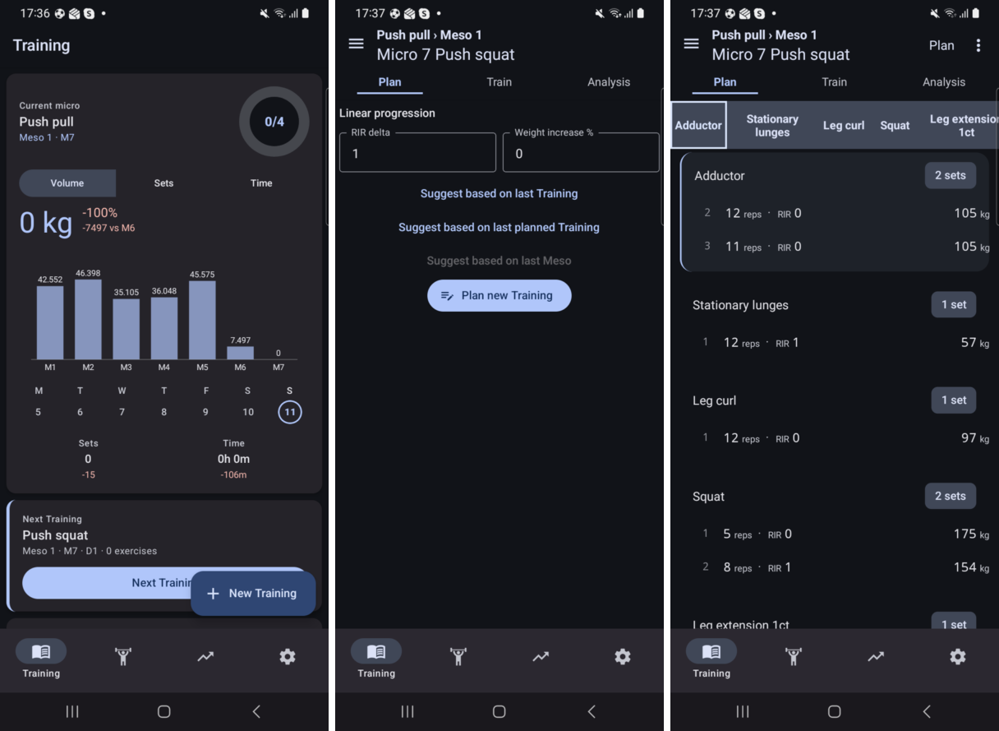
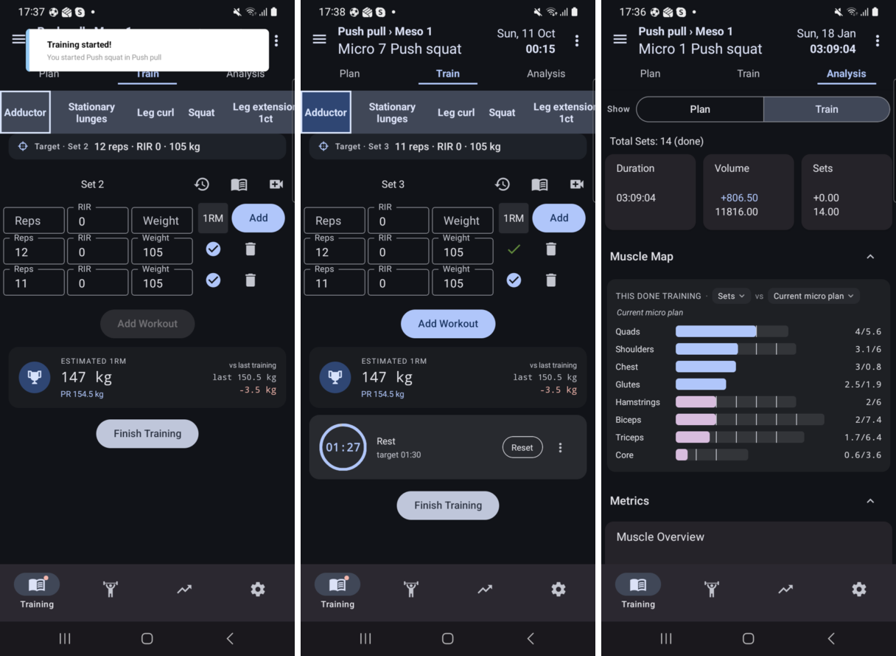
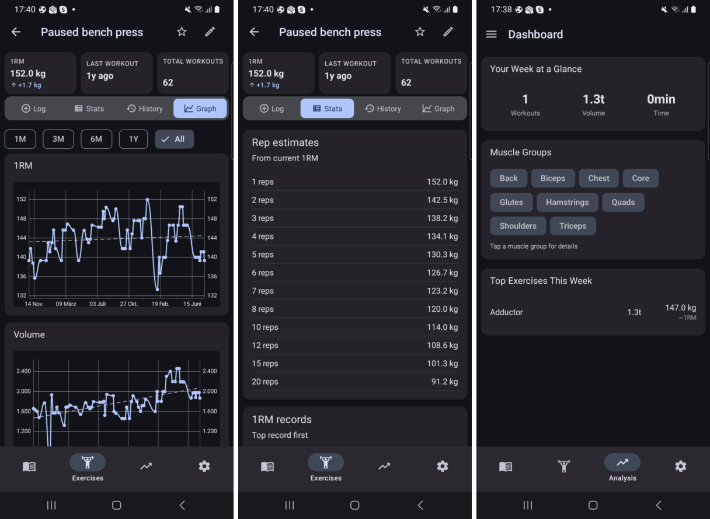
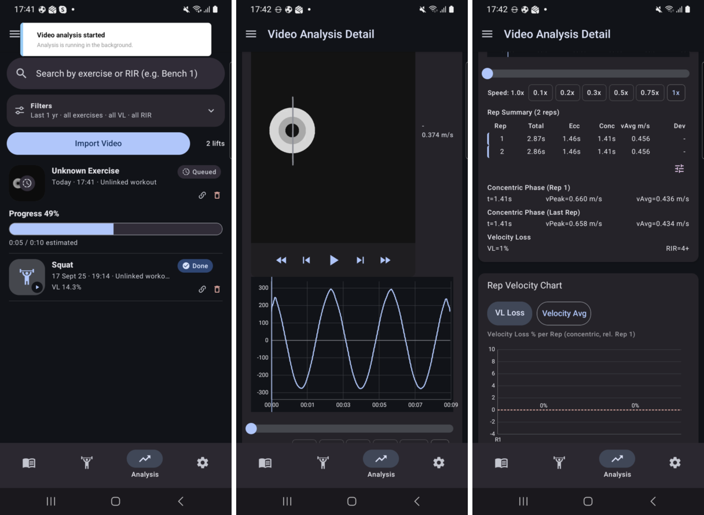
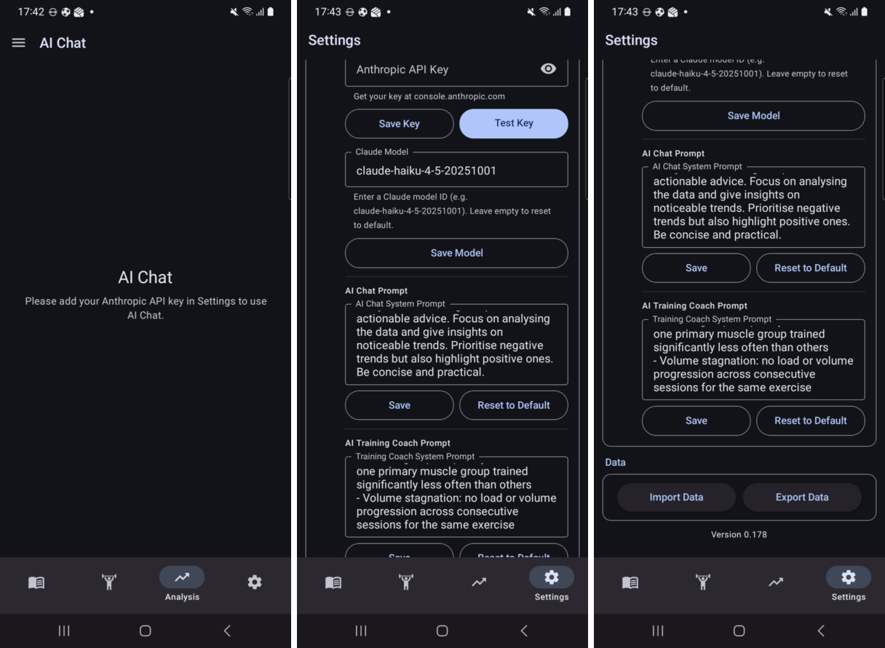

# Marktanalyse & USP – Gainalytics (GH-492)

Stand: 2026-10-11 · App-Stand: master `34b00257`, Android-Debug-APK 0.179 · Recherche: nur lesend (offizielle Websites, Hilfe-Center, App-Store-Listings, Studien). Alle Preise sind, sofern nicht anders angegeben, US-Storefront-Preise vom Abrufdatum 2026-10-11 und können sich ändern.

## Executive Summary

1. Gainalytics ist eine Android-App für fortgeschrittene Kraftsportler, die ohne Konto und ohne Cloud läuft. Sie verbindet Periodisierung (Plan → Meso → Micro), RIR-basiertes Logging, tiefe Analyse und **On-Device-Videoanalyse mit Bar-Path und Velocity-Loss**.
2. Der Markt spaltet sich in zwei Gruppen. Logger und Planer (Hevy, Strong, JEFIT, Alpha Progression, JuggernautAI …) analysieren keine eigenen Hebe-Videos. VBT-Kamera-Apps (Metric, Qwik VBT, WL Analysis) planen kaum oder gar nicht und laufen meist nur auf iOS.
3. Unter 15 geprüften Apps ist keine belegt, die beides in einer App, offline und ohne Konto, auf Android anbietet. Darauf baut der USP auf.
4. **USP-Vorschlag:** *„Gainalytics ist das private Trainingslabor für Kraftsportler: Planung, RIR-Logging, Analyse und Videoanalyse mit Bar-Path in einer App, komplett auf dem eigenen Android-Gerät, ohne Konto und ohne Abo.“*
5. Schwächen: kein iOS, kein Onboarding und keine Vorlagen, kein CSV-Export, keine Auto-Regulation, kein RPE, nur kg, englische UI, keine Wearables, nicht öffentlich verfügbar bzw. das Repo ist privat (Open Source ist bisher nur ein Ziel).
6. Markt: Fitness-App-In-App-Umsatz 2025 laut Sensor Tower 4,5 Mrd. US$ (+13 %) bei stagnierenden Downloads. Medianpreis H&F laut RevenueCat 9,99 $/Monat bzw. 39,94 $/Jahr. Spezialisierte Powerlifting-KI kostet bis 34,99 $/Monat (JuggernautAI).
7. Top-Hebel nach Wirkung/Aufwand: (1) Einstieg mit Vorlagen und Onboarding, (2) CSV-Export, (3) RPE-Option und Dezimal-RIR, (4) Auto-Regulation über die vorhandenen RIR- und Velocity-Daten, (5) Videoanalyse als Schaufenster (Teilen, Vergleich) – Details in Abschnitt 7.

---

## 1. Funktionsinventar Gainalytics (Nutzersicht)

Grundlage: Code-Analyse von master (Stand oben) plus Durchlauf auf dem Testgerät (Samsung SM-G986B, Android 13, installierte APK 0.178 mit dem JS-Bundle von master über Metro) mit importierten Baseline-Testdaten (`__tests__/testdata/1772318214222.gains`). Die Screenshots liegen unter [`screenshots/GH-492/`](../../screenshots/GH-492/) und sind am Ende dieses Abschnitts eingebettet.

### Grundprinzip
- **Android-first, offline-first, kein Konto, keine Cloud-Synchronisation, keine Paywall.** Die Daten liegen lokal (Redux-persist auf MMKV).
- Netzwerk nutzt die App nur für die optionalen KI-Funktionen: Sie ruft Anthropic direkt mit dem **eigenen API-Key des Nutzers** auf (Bring-your-own-key, der Key liegt im Keychain).
- Leitbild laut `PRODUCT_VISION.md`: „privacy-first, offline-first, open and extensible, user owns their data“.

### Kernfunktionen

| Bereich | Was der Nutzer kann | Beleg |
|---|---|---|
| **Planung / Periodisierung** | Pläne mit Mesos, Micros und Trainings anlegen. Mesos benennen, umsortieren und löschen. Pro Training gibt es die Modi Plan / Train / Analysis, zwischen Micros wird gewischt. Geplante Sätze haben Reps, RIR und Gewicht. Lineare Progression (RIR −N oder Gewicht +%), Gewichtsvorschlag aus dem e1RM, „Suggest based on …“ aus Vorgänger-Micros, Übungsalternativen, Plan-Export/-Import | Screenshot `01-planung.png` |
| **Logging** | Reps, RIR und Gewicht pro Satz loggen, mit Plan-vs-Ist-Ziel je Satz. Satz kopieren, Pausentimer mit Ring und Benachrichtigung, Session-Timer, Live-e1RM-Karte, Rekord-Hinweis („New Record!“), Notizen | Screenshot `02-training.png` |
| **Analyse** | e1RM nach RIR-adjustiertem Epley `Gewicht × (1 + (Reps + RIR)/30)`. Metriken Volumen, 1RM, Sätze, Reps, Max-/Ø-Intensität und Frequenz, pro Übung oder Muskel, nach Tag/Woche/Monat/Micro. Dashboard mit Muskel-Heatmap, Micro-vs-Micro-Vergleich, Rekorde, History, Trainingsdauer | Screenshot `03-analyse.png` |
| **Videoanalyse (on-device)** | Video importieren, Hantelscheibe per YOLO-Modell (TFLite, GPU) **auf dem Gerät** erkennen, Bar-Path-Overlay, Geschwindigkeitskurve, automatische Rep-Erkennung, Zeit und Speed je Rep, Velocity-Loss-Chart. Dazu Zeitlupe 0,1–1,0× mit Einzelbild-Schritt, Verknüpfung mit Workout/Satz, Vergleich zweier Analysen und Velocity-Loss → RIR-Insights (je Übung kalibrierbar) | Screenshot `04-videoanalyse.png` |
| **KI (optional)** | AI-Chat mit der Trainingshistorie als Kontext (mit Vorschau, welcher Kontext gesendet wird), Coach-Insight-Karte je Micro, eigenes Modell und System-Prompt einstellbar | Screenshot `05-ki-daten.png` |
| **Daten / Einstellungen** | Vollexport/-import als `.gains` (JSON, ersetzt alles), Themes (Hell/Dunkel, Paletten, eigene Farben), Timer-Standardwerte, KI-Key/-Modell | Screenshot `05-ki-daten.png` |

### Geräte-Screenshots

**Planung** – Home-Dashboard mit dem aktuellen Micro (Volumen je Micro M1–M7), Plan-Tab eines leeren Trainings mit linearer Progression und „Suggest based on …“, Ergebnis „Suggest based on last Training“ mit Reps · RIR · kg je Satz:

**Logging** – laufendes Training mit Ziel-Zeile, vorbelegten Sätzen und Live-e1RM gegen das letzte Training, nach dem Bestätigen eines Satzes mit Pausentimer-Ring, Analyse eines beendeten Trainings mit Muscle Map „done vs. Micro-Plan“:

**Analyse** – e1RM- und Volumen-Verlauf einer Übung über die gesamte Historie mit Trendlinie, Rep-Schätzungen aus dem aktuellen 1RM, Wochen-Dashboard:

**Videoanalyse (on-device)** – Import mit Fortschritt der Hintergrundanalyse, Playback-Overlay mit erkannter Scheibe, Bar-Path und Geschwindigkeitskurve, Rep-Summary (exzentrisch/konzentrisch, vPeak/vAvg) mit Velocity-Loss → „RIR=4+“ und Zeitlupen-Stufen. Hinweis: Der Test-Clip `squat-3reps.mp4` ist synthetisch (Scheiben-Grafik auf Sinusbahn), deshalb die gleichmäßige Kurve.

**KI und Daten** – AI-Chat ohne hinterlegten Schlüssel (die BYOK-Hürde), KI-Konfiguration mit eigenem Anthropic-Key, Modell und System-Prompts, Datenbereich mit Vollimport/-export:

### Was (noch) fehlt – aus Nutzersicht
- Kein iOS (der Ordner existiert, wird aber nicht gebaut), keine Wearables und kein Health Connect.
- Kein RPE (nur RIR), keine Dezimal-RIR, keine Supersätze, keine Rep-Ranges bei der Planung (GH-63 offen).
- Keine Programmvorlagen oder -bibliothek, kein Onboarding. Ein neuer Nutzer startet mit leerer App.
- Export nur als vollständiges `.gains`-JSON (Import ersetzt alles), kein CSV, keine automatischen Backups.
- Imperiale Einheiten sind nur ein Platzhalter (faktisch nur kg), die UI ist nur Englisch.
- Verbreitung: Ein Play-Console-Eintrag existiert (`docs/investigation/media-permission-audit.md`), der öffentliche Store-Status wurde hier nicht geprüft. Das Repo ist derzeit privat, „Open Source“ ist ein Ziel, kein Ist-Zustand.
- Usability-Reibung beim Einstieg „Plan anlegen → planen“ (Bericht GH-436, `docs/usability/GH-436-plan-anlegen-bis-auswerten.md`): unter anderem verschwindet „Done“ beim Planen und „Zurück“ verwirft offene Sätze.

---

## 2. Wettbewerber

Legende: „n. v.“ = auf den geprüften Seiten nicht verifiziert. Herstellerangaben (Nutzerzahlen, Ratings) sind Eigenangaben.

### 2.1 Allgemeine Workout-Logger

**Hevy**
- **Zielgruppe:** breites Gym-Publikum mit Social-Fokus. Eigenangabe „17+ million athletes“ ([hevyapp.com](https://www.hevyapp.com/))
- **Kernfunktionen:** Logging, RPE 6–10 (als „Reps in Reserve“ erklärt) ([Hilfe-Artikel](https://help.hevyapp.com/hc/en-us/articles/34490600233111), [RPE-Seite](https://www.hevyapp.com/features/how-to-calculate-rpe/)), 1RM-Rechner und Charts, Social Feed (folgen, liken, Routinen kopieren), Apple Watch und Wear OS ([hevyapp.com](https://www.hevyapp.com/)). Datenexport unter Settings → Export & Import ([Hilfe-Artikel](https://help.hevyapp.com/hc/en-us/articles/38001424401943)). Laut App Store kann man seit v3.1.16 Workouts „an ChatGPT & Claude senden“ ([App Store](https://apps.apple.com/us/app/hevy-workout-tracker-gym-log/id1458862350)). Periodisierung: n. v.
- **Preis:** Gratis-Tier mit 4 Routinen, 7 eigenen Übungen und 3 Monaten Historie ([Hilfe-Center](https://help.hevyapp.com/hc/en-us/articles/35119778922263-Hevy-Pro-Subscription-How-to-get-Pro-and-What-Does-It-Include)). Pro kostet laut App Store 2,99 $ bzw. 3,99 $/Monat, 23,99 $/Jahr oder 74,99 $ einmalig ([App Store](https://apps.apple.com/us/app/hevy-workout-tracker-gym-log/id1458862350))
- **Plattformen:** iOS, Android, Web

**Strong**
- **Zielgruppe:** Lifter, die einen minimalistischen Logger wollen. Die Homepage nennt sowohl „over 5 million users“ als auch „3M+“ ([strong.app](https://www.strong.app/))
- **Kernfunktionen:** Logging, RPE 6–10 mit RIR-Zuordnung ([Hilfe](https://help.strongapp.io/article/230-about-rpe)), 1RM und Bestleistungen in PRO ([Strong PRO](https://help.strongapp.io/article/132-strong-pro)). CSV-Export nur in eine Richtung, kein Re-Import ([Hilfe](https://help.strongapp.io/article/235-export-workout-data)). Apple Watch auch ohne iPhone ([App Store](https://apps.apple.com/us/app/strong-workout-tracker-gym-log/id464254577)). Periodisierung und Auto-Progression: n. v.
- **Preis:** Die Gratis-Version speichert unbegrenzt Workouts, erlaubt aber nur 3 eigene Routinen. Der App Store listet 4,99 $/Monat, 19,99 $/6 Monate, 23,99 $ bzw. 29,99 $/Jahr und „Forever“ 79,99 $ bzw. 99,99 $. Wegen der doppelten SKUs ist der aktuelle Preis unklar ([App Store](https://apps.apple.com/us/app/strong-workout-tracker-gym-log/id464254577))
- **Plattformen:** iOS, Android, Apple Watch

**JEFIT**
- **Zielgruppe:** Einsteiger bis Fortgeschrittene, die fertige Pläne wollen. Eigenangabe „12M+ members“ und „20M+ downloads“ ([jefit.com](https://www.jefit.com/))
- **Kernfunktionen:** Logging, Mesozyklus-Periodisierung in eigenen Plänen (v17.1.0), „Adaptive Plan“ mit KI-Vorschlag für Gewicht und Wiederholungen, „Adaptive AI Coach“ nur in Elite ([App Store](https://apps.apple.com/us/app/jefit-workout-plan-gym-tracker/id449810000)), 1RM-Charts, Community und Gruppenchats ([jefit.com](https://www.jefit.com/)), Wear OS ([Jefit News](https://www.jefit.com/wp/jefit-news-product-updates/watch-guide-elevate-your-workout-with-jefit-wear-os/)). RPE/RIR: Herstellerseiten widersprechen sich, n. v.
- **Preis:** Gratis-Tier. Elite kostet 12,99 $/Monat oder 69,99 $/Jahr ([App Store](https://apps.apple.com/us/app/jefit-workout-plan-gym-tracker/id449810000)). Laut Boostcamp-Vergleichsseite ist das Gratis-Tier werbefinanziert ([boostcamp.app/vs/jefit](https://www.boostcamp.app/vs/jefit), Wettbewerberquelle)
- **Plattformen:** iOS, Android, Web

**Fitbod**
- **Zielgruppe:** Nutzer, die sich Workouts generieren lassen wollen, statt selbst zu planen. Eigenangabe „15M+ downloads“ ([fitbod.me](https://fitbod.me/))
- **Kernfunktionen:** „AI-Generated Workouts“ und „Adaptive AI“ ([App Store](https://apps.apple.com/us/app/fitbod-gym-fitness-planner/id1041517543)), Progressive-Overload-Algorithmus, Muskel-Recovery-Tracking ([fitbod.me](https://fitbod.me/)), Wear OS auch ohne Telefon ([Hilfe](https://help.fitbod.me/hc/en-us/articles/4406074415383-WearOS-on-Android)), Apple Watch. RPE/RIR und Periodisierung: n. v.
- **Preis:** 15,99 $/Monat oder 95,99 $/Jahr. Das stammt nur aus dem Suchauszug des Hilfe-Center-Artikels ([Hilfe](https://help.fitbod.me/hc/en-us/articles/30542136101527)), die Seite selbst lieferte 403
- **Plattformen:** iOS, Android

**Liftosaur**
- **Zielgruppe:** „Weightlifting tracker app for coders“: Nutzer schreiben ihre Programme in der Skriptsprache Liftoscript ([GitHub](https://github.com/astashov/liftosaur))
- **Kernfunktionen:** Logging, RPE pro Satz, Periodisierung über Wochen, Progressionen (linear, double, sum-of-reps, eigene Logik) ([liftosaur.com](https://www.liftosaur.com/)). Läuft ohne Internet, speichert aber nur mit Konto auf dem Server ([GitHub](https://github.com/astashov/liftosaur)). MCP-Server und REST-API für eigene KI-Assistenten ([Docs](https://www.liftosaur.com/docs)). **Open Source (AGPL-3.0)** ([GitHub](https://github.com/astashov/liftosaur))
- **Preis:** laut App Store 4,99 $/Monat, 39,99 $/Jahr oder 99,99 $ einmalig ([App Store](https://apps.apple.com/us/app/liftosaur/id1661880849)). Was davon gratis ist: n. v.
- **Plattformen:** Web/PWA, iOS und Android als Wrapper

### 2.2 Powerlifting-, Periodisierungs- und Coaching-Apps

**JuggernautAI** (Juggernaut Training Systems)
- **Zielgruppe:** Powerlifter und Powerbuilder, die Erfahrung mit Kniebeuge, Bankdrücken und Kreuzheben haben sollten. Eigenangabe „250,000+“ Nutzer ([juggernautai.app](https://www.juggernautai.app/))
- **Kernfunktionen:** KI-generiertes, personalisiertes Programm mit Phasen (Hypertrophy/Strength/Peaking), das sich „Set to Set … Block to Block“ an Feedback anpasst. Dazu RPE-Rechner, Meet Day Advisor für die Versuchswahl, Warm-ups mit Scheibenrechner ([juggernautai.app](https://www.juggernautai.app/)) und Readiness-Abfrage ([App Store](https://apps.apple.com/us/app/-/id1515756471)). Kamera-VBT gibt es über die separate App **SmartBarbell**: nur iPhone, gratis für JuggernautAI-Nutzer, sonst 4,99 $/Monat ([App Store](https://apps.apple.com/us/app/-/id6479318757))
- **Preis:** 34,99 $/Monat oder 349,99 $/Jahr, 2 Wochen Test ([juggernautai.app](https://www.juggernautai.app/))
- **Plattformen:** iOS, Android

**RP Hypertrophy** (Renaissance Periodization)
- **Zielgruppe:** Hypertrophie-orientierte Lifter vom Einsteiger bis zum Profi, kein Powerlifting-Fokus ([rpstrength.com](https://rpstrength.com/pages/hypertrophy-app))
- **Kernfunktionen:** Mesozyklen und Meso Builder, wöchentliche Auto-Regulation nach Pump, Muskelkater und Workload, Zielgewicht und -wiederholungen werden vorgegeben, 250+ Technikvideos ([rpstrength.com](https://rpstrength.com/pages/hypertrophy-app), [App Store](https://apps.apple.com/us/app/rp-hypertrophy/id1555614554))
- **Preis:** 34,99 $/Monat oder 299,99 $/Jahr, 30 Tage Geld-zurück-Garantie bei Kauf über die Website ([rpstrength.com](https://rpstrength.com/pages/hypertrophy-app))
- **Plattformen:** iOS und Web. Android ist laut Website „shortly“ angekündigt, der aktuelle Stand ist n. v.

**Boostcamp**
- **Zielgruppe:** alle Levels. Bibliothek fertiger Programme bekannter Coaches ([boostcamp.app/pro](https://www.boostcamp.app/pro))
- **Kernfunktionen:** Logging, RPE und RIR, e1RM und PRs gratis. Pro bietet zusätzlich Strength Score, Volumen-Heatmap und „RPE drift across blocks“ ([Pro](https://www.boostcamp.app/pro)). Dazu ein Programm-Builder im Browser ([custom-program](https://www.boostcamp.app/custom-program)) und Sync nach Offline-Sessions ([features](https://www.boostcamp.app/features))
- **Preis:** Gratis-Tier ohne Werbung. Pro kostet 59,99 $/Jahr (7 Tage Test) oder 14,99 $/Monat ([boostcamp.app/pro](https://www.boostcamp.app/pro))
- **Plattformen:** iOS, Android

**Alpha Progression**
- **Zielgruppe:** Kraft- und Muskelaufbau vom Einsteiger bis zum Fortgeschrittenen. Eigenangabe 5M+ Downloads, 4,9 bei 40K+ Bewertungen ([alphaprogression.com](https://alphaprogression.com/en))
- **Kernfunktionen:** unbegrenztes Logging gratis. Pro bietet Plan-Generator, Progressionsempfehlungen, RIR, Periodisierung und Deloads. Offline-Logging, **CSV-Export**, Apple Health und Health Connect ([alphaprogression.com](https://alphaprogression.com/en)). Keine eigene Smartwatch-App ([Hersteller-Blog](https://alphaprogression.com/en/blog/best-advanced-strength-training-apps))
- **Preis:** 12,99 $/Monat oder 79,99 $/Jahr, 14 Tage Test nur im Jahresabo ([alphaprogression.com](https://alphaprogression.com/en))
- **Plattformen:** iOS, Android

**MacroFactor Workouts**
- **Zielgruppe:** Einsteiger bis Fortgeschrittene, Kraft oder Hypertrophie ([macrofactor.com/workouts](https://macrofactor.com/workouts/))
- **Kernfunktionen:** detailliertes Logging (Drop- und Failure-Sets, Myoreps, Supersätze), RIR, anpassbare Periodisierung, regelbasierte Auto-Progression („ausdrücklich keine generative KI“), Datenexport jederzeit, Technikvideos von Jeff Nippard ([macrofactor.com/workouts](https://macrofactor.com/workouts/))
- **Preis:** 11,99 $/Monat, 47,99 $/Halbjahr oder 71,99 $/Jahr, 7 Tage Test. Bundle mit MacroFactor Nutrition für 89,99 $/Jahr ([Preisseite](https://macrofactor.com/workouts/price/))
- **Plattformen:** iOS, Android

**TrainHeroic**
- **Zielgruppe:** Kraft-Coaches und ihre Athleten, dazu ein Programm-Marktplatz ([trainheroic.com](https://www.trainheroic.com/))
- **Kernfunktionen:** Coach-Athlet-Plattform mit Teams, Chat und Video-Review ([Pricing](https://www.trainheroic.com/pricing/)). RPE 0–10 pro Satz ([Support](https://support.trainheroic.com/hc/en-us/articles/42680203186829-Athlete-Pro-Heatmaps)), Planung in Prozent vom Working Max ([Support](https://support.trainheroic.com/hc/en-us/articles/18156690075917)), Working Max aus ≤15 Wiederholungen geschätzt ([Support](https://support.trainheroic.com/hc/en-us/articles/18170920165645))
- **Preis (Coaches):** 9,99 $/Monat für 1 Athlet bis 399,99 $/Monat für 1.000 Athleten, 14 Tage Test ([Pricing](https://www.trainheroic.com/pricing/)). Athleten nutzen die App gratis, wenn ihr Coach den Zugang stellt
- **Plattformen:** iOS, Android, Web

### 2.3 Video- und VBT-Apps (Kamera statt Sensor)

**Metric – Strength Training (Metric VBT / Metric Lift)**
- **Zielgruppe:** ambitionierte Lifter sowie Coaches und Teams ([Subscriptions](https://metric.coach/docs/subscriptions))
- **Kernfunktionen:** Bar-Path für jede Wiederholung, Hantelgeschwindigkeit für 60+ Übungen, Workout-Builder und Templates, Logging, RPE-Charts und RPE-basierte 1RM-Schätzung ([App Store](https://apps.apple.com/us/app/id1595510857)). Gratis: unbegrenzt aufnehmen, 7 Tage Historie, Videos bleiben 24 h. Pro: e1RM, unbegrenzte Historie, Export, Cloud-Videospeicher ([Subscriptions](https://metric.coach/docs/subscriptions))
- **Preis:** Pro 10,99 $/Monat oder 79,99 $/Jahr, Coach-Tiers 19,99–34,99 $/Monat ([App Store](https://apps.apple.com/us/app/id1595510857))
- **Plattformen:** iOS und **Android 12+** (Lift). Jump und Sprint gibt es nur auf iOS ([supported devices](https://metric.coach/user-guide/supported-devices))
- **Validität:** In Renner et al. (PLOS ONE, 2024) erkannte Metric 52 von 589 Wiederholungen nicht und war nur beim Bankdrücken valide ([PMC11575817](https://pmc.ncbi.nlm.nih.gov/articles/PMC11575817))

**Qwik VBT**
- **Zielgruppe:** VBT-orientierte Powerlifter und Gewichtheber
- **Kernfunktionen:** mittlere und Spitzengeschwindigkeit, Velocity-Loss, Bar-Path, Bewegungsumfang, Pausendauer, 1RM-Schätzer, Satz-Logging mit Tags, CSV/JSON-Export, optionales Login mit Cloud-Videospeicher ([App Store](https://apps.apple.com/us/app/qwik-vbt-velocity-and-barpath/id1660094818))
- **Preis:** gratis, „Premium“-In-App-Kauf für 27,99 $ ([App Store](https://apps.apple.com/us/app/qwik-vbt-velocity-and-barpath/id1660094818))
- **Plattformen:** nur iOS (kein Android-Listing gefunden)
- **Validität:** In derselben Studie die beste getestete App, gleichauf mit einem Linear-Transducer, RMSE 0,01–0,04 m/s ([PMC11575817](https://pmc.ncbi.nlm.nih.gov/articles/PMC11575817))

**WL Analysis**
- **Zielgruppe:** Technikanalyse für Gewichtheben, Powerlifting und CrossFit
- **Kernfunktionen:** automatische Hantelerkennung, Bar-Path eingefärbt nach Geschwindigkeit, Leistung oder Kraft, Overlay- und Seit-an-Seit-Vergleich, Einzelbild-Wiedergabe, CSV- und Video-Export. Logging und Planung: nicht gefunden ([App Store](https://apps.apple.com/us/app/-/id1541855037))
- **Preis:** gratis, „Extra features“ als In-App-Kauf für 8,99 $ ([App Store](https://apps.apple.com/us/app/-/id1541855037))
- **Plattformen:** iOS, iPadOS, visionOS, Mac ([Mac-Listing](https://apps.apple.com/us/app/wl-analysis-bar-path-tracker/id1560578588?mt=12)). Android: n. v.

---

## 3. Feature-Matrix

Legende: ✔ belegt · ◐ teilweise/eingeschränkt · ✘ belegt nicht vorhanden · ? nicht verifiziert/nicht gefunden. Quellen siehe Abschnitt 2.

| Funktion | Gainalytics | Hevy | Strong | JEFIT | Fitbod | Liftosaur | Juggernaut­AI | RP Hyp. | Boost­camp | Alpha Progr. | MacroFactor W. | Train­Heroic | Metric | Qwik VBT | WL Analysis |
|---|---|---|---|---|---|---|---|---|---|---|---|---|---|---|---|
| Satz-Logging | ✔ | ✔ | ✔ | ✔ | ✔ | ✔ | ✔ | ✔ | ✔ | ✔ | ✔ | ✔ | ✔ | ✔ | ? |
| RIR | ✔ | ◐¹ | ◐¹ | ? | ? | ? | ? | ? | ✔ | ✔ | ✔ | ? | ? | ? | ? |
| RPE | ✘ | ✔ | ✔ | ? | ? | ✔ | ✔ | ? | ✔ | ? | ? | ✔ | ✔ | ✔ | ? |
| Periodisierung (Meso/Micro) | ✔ | ? | ? | ✔ | ? | ✔ | ✔ | ✔ | ◐² | ✔ | ✔ | ✔ | ◐ | ? | ? |
| Auto-Progression / Auto-Regulation | ◐³ | ? | ? | ✔ | ✔ | ✔ | ✔ | ✔ | ◐² | ✔ | ✔ | ◐ | ? | ? | ? |
| e1RM- / Kraft-Analyse | ✔ | ✔ | ✔ | ✔ | ? | ◐ | ? | ? | ✔ | ✔ | ✔ | ✔ | ✔ | ✔ | ? |
| Volumen pro Muskel / Heatmap | ✔ | ✔ | ? | ? | ◐ | ✔ | ? | ? | ✔ | ? | ? | ✔ | ? | ? | ? |
| Videoanalyse eigener Lifts (Bar-Path) | ✔ | ? | ? | ? | ? | ? | ◐⁴ | ? | ? | ? | ? | ◐⁵ | ✔ | ✔ | ✔ |
| Geschwindigkeit / Velocity-Loss | ✔ | ? | ? | ? | ? | ? | ◐⁴ | ? | ? | ? | ? | ? | ✔ | ✔ | ✔ |
| Velocity → RIR-Schätzung | ✔ | ? | ? | ? | ? | ? | ◐⁴ | ? | ? | ? | ? | ? | ? | ? | ? |
| KI-Coach / Chat | ✔⁶ | ◐⁷ | ? | ✔ | ◐ | ◐⁸ | ◐ | ? | ? | ? | ✘ | ? | ? | ? | ? |
| Nutzung ohne Konto, offline | ✔ | ? | ? | ? | ? | ◐ | ? | ? | ◐ | ◐ | ? | ? | ? | ◐ | ? |
| Datenexport | ◐⁹ | ✔ | ✔ | ◐ | ? | ? | ? | ? | ? | ✔ | ✔ | ? | ✔ | ✔ | ✔ |
| Open Source | ✘¹⁰ | ? | ? | ? | ? | ✔ | ? | ? | ? | ? | ? | ? | ? | ? | ? |
| Social / Coach-Athlet | ✘ | ✔ | ◐ | ✔ | ? | ◐ | ◐ | ? | ? | ◐ | ? | ✔ | ✔ | ? | ? |
| Wearables / Health-Plattform | ✘ | ✔ | ✔ | ✔ | ✔ | ◐ | ? | ? | ◐ | ◐ | ? | ? | ? | ? | ? |
| Programmvorlagen | ✘ | ? | ? | ✔ | ✔ | ? | ✔ | ✔ | ✔ | ✔ | ✔ | ✔ | ✔ | ? | ✘ |
| Android | ✔ | ✔ | ✔ | ✔ | ✔ | ✔ | ✔ | ◐ | ✔ | ✔ | ✔ | ✔ | ✔ | ✘ | ? |
| iOS | ✘ | ✔ | ✔ | ✔ | ✔ | ✔ | ✔ | ✔ | ✔ | ✔ | ✔ | ✔ | ✔ | ✔ | ✔ |
| Einstiegspreis Premium (US) | gratis | 2,99 $/Mo | 4,99 $/Mo | 12,99 $/Mo | 15,99 $/Mo | 4,99 $/Mo | 34,99 $/Mo | 34,99 $/Mo | 14,99 $/Mo | 12,99 $/Mo | 11,99 $/Mo | 9,99 $/Mo (Coach) | 10,99 $/Mo | 27,99 $ (IAP) | 8,99 $ (IAP) |

Fußnoten: ¹ RPE-Skala, die als „Reps in Reserve“ erklärt bzw. auf RIR abgebildet wird. ² Progression folgt der Logik des gewählten Programms. ³ Lineare Progression (RIR/Gewicht) und Gewichtsvorschlag aus dem e1RM, aber keine Anpassung an das tatsächliche Feedback. ⁴ Nur über die separate iPhone-App SmartBarbell. ⁵ Video-Review durch Coaches, keine automatische Analyse belegt. ⁶ Bring-your-own-key (Anthropic), Kontext = eigene Trainingshistorie. ⁷ Export an ChatGPT/Claude. ⁸ MCP-Server/API für eigene KI. ⁹ Vollständiger JSON-Export/-Import, kein CSV. ¹⁰ Als Ziel definiert, Repo derzeit privat.

**Lesart:** Gainalytics ist die einzige App der Matrix, die in der Zeile „Videoanalyse eigener Lifts“ **und** in „Periodisierung“ ein ✔ hat **und** zugleich ohne Konto offline auf Android läuft. Die Lücken liegen in Vorlagen, Wearables, iOS, RPE und Social.

---

## 4. Marktlage

### Größe und Wachstum
| Kennzahl | Wert | Quelle (Datum) |
|---|---|---|
| Fitness-App-Markt (Analystenschätzung) | 12,12 Mrd. US$ (2025) → 33,58 Mrd. US$ (2033), CAGR 13,4 % | Grand View Research via ResearchAndMarkets ([Link](https://www.researchandmarkets.com/reports/5415431/fitness-apps-market-size-share-and-trends), Jan. 2026) |
| Fitness-App-Markt (zweite Schätzung) | 12,1 Mrd. US$ (2025) → 45,45 Mrd. US$ (2035), CAGR 14,15 % | Towards Healthcare ([Link](https://www.towardshealthcare.com/insights/fitness-app-market-sizing), Dez. 2025) |
| Health & Fitness In-App-Umsatz (gemessen) | 4,5 Mrd. US$ 2025 (+13 % ggü. Vorjahr), 3,96 Mrd. Downloads (+0,8 %) | Sensor Tower ([Link](https://sensortower.com/blog/health-and-fitness-apps-ai), Feb. 2026) |

Die Analystenzahlen nutzen breitere Definitionen und sind nicht mit dem gemessenen Store-Umsatz vergleichbar. Gemeinsame Aussage: **Der Umsatz wächst zweistellig, die Downloads stagnieren.** Es wird also mehr pro Nutzer monetarisiert, statt neue Nutzer zu gewinnen.

### Preispunkte und Abo-Kennzahlen (Kategorie Health & Fitness)
Quelle: RevenueCat, *State of Subscription Apps 2026* (Datenjahr 2025, 115.000+ Apps insgesamt), [revenuecat.com/state-of-subscription-apps](https://www.revenuecat.com/state-of-subscription-apps/), abgerufen 2026-10-11.

| Kennzahl | Median H&F |
|---|---|
| Monatspreis | 9,99 $ |
| Jahrespreis | 39,94 $ |
| Download → Trial | 6,9 % |
| Trial → Paid | 37,7 % (oberes Quartil > 51,4 %) |
| Umsatz pro Installation, Tag 14 / Tag 60 | 0,48 $ / 0,66 $ |

Im Vorjahresbericht ([State of Subscription Apps 2025](https://www.revenuecat.com/state-of-subscription-apps-2025/)) entfallen 67 % der verkauften H&F-Abos auf Jahrespläne, und die Refund-Rate liegt bei 4,71 %. Lifetime-Pläne sind laut Bericht 2026 in H&F am seltensten, und Apps mit Lifetime als Hauptplan erzielen einen geringeren Umsatz pro Installation (Tag 60: 0,24 $).

**Preisbänder im Wettbewerb (Abschnitt 2):**
- Massen-Logger: 2,99–4,99 $/Monat bzw. 23,99–39,99 $/Jahr (Hevy, Strong, Liftosaur)
- Planer mit Auto-Progression: 11,99–15,99 $/Monat bzw. 59,99–95,99 $/Jahr (MacroFactor, Alpha, Boostcamp, JEFIT, Fitbod)
- Premium-KI-Coaching für Powerlifting und Hypertrophie: 34,99 $/Monat (JuggernautAI, RP)
- Video-/VBT-Spezialisten: In-App-Kauf 8,99 $ (WL Analysis) bzw. 27,99 $ (Qwik VBT) oder 10,99 $/Monat (Metric)

### Trends
- **KI überall:** KI-Begriffe stehen in 28 % der H&F-Store-Listings (Q4 2024: 19 %), und Sensor Tower schreibt der KI einen Teil des Umsatzwachstums zu ([Sensor Tower, Feb. 2026](https://sensortower.com/blog/health-and-fitness-apps-ai)). KI-Apps erzielen laut RevenueCat 41 % mehr Umsatz pro Zahler, verlieren ihre Nutzer aber 30 % schneller (kategorieübergreifend, [RevenueCat 2026](https://www.revenuecat.com/state-of-subscription-apps/)). Gegenpositionierung gibt es auch: MacroFactor Workouts wirbt ausdrücklich mit „keine generative KI“ ([macrofactor.com/workouts](https://macrofactor.com/workouts/)).
- **VBT per Smartphone-Kamera wird Mainstream im Kraftsport:** Juggernaut bündelt SmartBarbell mit JuggernautAI ([App Store](https://apps.apple.com/us/app/-/id6479318757)), und Metric gibt es inzwischen auch für Android ([Metric](https://metric.coach/user-guide/supported-devices)). Die Validität schwankt stark zwischen den Apps ([PLOS ONE 2024](https://pmc.ncbi.nlm.nih.gov/articles/PMC11575817), [NSCA](https://www.nsca.com/education/articles/nsca-coach/the-use-of-mobile-apps-to-measure-barbell-velocity/)). Genauigkeit wird damit zum Unterscheidungsmerkmal.
- **Wearables:** Laut ACSM-Umfrage unter ca. 2.000 Fachleuten ist „Wearable technology“ der Top-Trend 2026 ([ACSM Worldwide Fitness Trends 2026](https://acsm.org/top-fitness-trends-2026)).
- **Datenschutz als Sorge:** Laut Surfshark teilen 80 % von 15 untersuchten Top-Fitness-Apps Trackingdaten mit Dritten ([TechRadar](https://www.techradar.com/computing/cyber-security/beware-80-percent-of-the-most-popular-fitness-apps-are-selling-out-your-privacy)). Im Januar 2026 sammelte eine App im Schnitt rund 12 Datentypen ([Surfshark](https://surfshark.com/research/chart/fitness-apps-privacy)). Laut Incogni sind 72,9 % der erhobenen Datenpunkte nicht optional ([Incogni](https://blog.incogni.com/fitness-apps-privacy-research)). Einschränkung: Alle diese Studien beruhen auf den Selbstauskünften der Store-Datenschutzlabels. Eine harte Quelle dafür, dass „local-first“ ein *Markttrend* ist, wurde nicht gefunden. Das ist eine Ableitung aus den Datenschutzsorgen.

### Monetarisierungsmodelle (mit Beispielen)
| Modell | Beispiele |
|---|---|
| Freemium + Abo (Limits im Gratis-Tier) | Hevy, Strong, Boostcamp, Alpha Progression, JEFIT |
| Abo + Lifetime-Option | Hevy (74,99 $), Strong, Liftosaur (99,99 $) |
| Premium-Abo ohne Gratis-Tier, mit Trial | JuggernautAI, RP Hypertrophy, MacroFactor Workouts |
| In-App-Freischaltung statt Abo | WL Analysis, Qwik VBT (laut Listing In-App-Kauf; ob einmalig, n. v.) |
| B2B / Coach-Tiers (Preis pro Athletenzahl) | TrainHeroic, Metric Coach |
| Werbung im Gratis-Tier | JEFIT (laut Wettbewerberquelle Boostcamp) |
| Bündelung mit anderem Produkt | MacroFactor (Nutrition + Workouts), Juggernaut (AI + SmartBarbell) |

---

## 5. USP

> **Gainalytics ist das private Trainingslabor für Kraftsportler: Planung, RIR-Logging, Analyse und Videoanalyse mit Bar-Path und Velocity-Loss in einer App – komplett auf dem eigenen Android-Gerät, ohne Konto und ohne Abo.**

**Warum das für die Zielgruppe zählt (fortgeschrittene Powerlifter und Kraftsportler, die selbst planen):**
1. **Ein Werkzeug statt zwei.** Heute braucht man für Planung und Log eine App (Alpha, Boostcamp, Juggernaut) und für Bar-Path/VBT eine zweite (Metric, Qwik, WL Analysis), meist ohne Datenverbindung. In Gainalytics ist die Analyse mit dem Satz verknüpft. Velocity-Loss und RIR stehen nebeneinander, und die Geschwindigkeit wird zur RIR-Schätzung genutzt. Diese Verknüpfung ist bei keinem der 14 Wettbewerber belegt (Matrix, Zeile „Velocity → RIR“).
2. **Android-Lücke.** Qwik VBT und WL Analysis gibt es nur für iOS, SmartBarbell nur fürs iPhone, und RP Hypertrophy kündigt Android erst an. Android-Nutzer mit Video-Ambitionen haben wenig Auswahl (aktuell vor allem Metric).
3. **Privatsphäre bei Videos.** Trainingsvideos zeigen Gesicht, Körper und Gym. Gainalytics analysiert sie auf dem Gerät, ohne Upload, und braucht kein Konto. Die gemessenen Datenschutzsorgen (Abschnitt 4) machen das zu einem glaubwürdigen Argument, auch wenn „local-first“ als Kaufkriterium nicht belegt ist.
4. **Kostenvorteil.** Die Kombination aus Planer (≈12–35 $/Monat) und VBT-App (≈11 $/Monat oder Einmalkauf) kostet schnell über 20 $/Monat. Gainalytics kostet nichts, die KI wird nur bei Bedarf über den eigenen API-Key bezahlt.
5. **Transparente Rechenwege.** Das RIR-adjustierte e1RM und die Velocity-Kalibrierung je Übung sind nachvollziehbar, für Fortgeschrittene ist das wichtiger als eine Black-Box-KI.

### Wo Gainalytics ehrlich schwächer ist
- **Keine Verbreitung:** keine öffentliche Store-Präsenz belegt, keine Ratings und keine Community. Die Wettbewerber haben Millionen Downloads (Eigenangaben in Abschnitt 2).
- **Nur Android**, kein iOS. Im Kraftsport-Nischenmarkt starten viele Apps zuerst auf iOS (RP, Qwik, SmartBarbell).
- **Kein geführter Einstieg:** keine Programmvorlagen, kein Onboarding, Reibung beim ersten Plan (GH-436). Boostcamp (11.000+ Programme laut [Pro-Seite](https://www.boostcamp.app/pro)) und JuggernautAI generieren den Plan für den Nutzer.
- **Keine echte Auto-Regulation:** Progression nur linear bzw. als Vorschlag, während JuggernautAI, RP, Alpha und MacroFactor sie automatisch an das Feedback anpassen.
- **Kein RPE, keine Dezimal-RIR, keine Supersätze, nur kg.** Viele Powerlifter arbeiten mit RPE in halben Schritten.
- **Export nur als Vollexport im eigenen JSON-Format.** CSV bieten Strong, Alpha, Qwik und WL Analysis.
- **Keine Wearables und kein Health Connect**, obwohl Wearables laut ACSM Trend Nr. 1 sind.
- **Validität der Videoanalyse nicht extern belegt.** Qwik VBT hat eine peer-reviewte Validierung, Gainalytics nicht.
- **UI nur Englisch, Open Source nur als Ziel.** Der Vorteil „offen und erweiterbar“ ist ohne öffentliches Repo nicht einlösbar, Liftosaur ist es bereits (AGPL).
- **KI setzt einen eigenen API-Key voraus.** Für Nicht-Techniker ist das eine Hürde.

---

## 6. Positionierung (Kurzfassung)

| Achse | Position |
|---|---|
| Zielgruppe | Fortgeschrittene, selbst planende Powerlifter und Kraftsportler auf Android, die Daten und Video ernst nehmen |
| Nicht-Zielgruppe | Einsteiger, die einen fertigen Plan wollen; Social-Gym-Publikum; Coaches mit vielen Athleten |
| Kategorie | „Trainingslabor“: Planung + Log + Analyse + Video, nicht „Workout-Generator“ |
| Abgrenzung zu Logger-Apps | Videoanalyse + Velocity → RIR, Periodisierung |
| Abgrenzung zu VBT-Apps | Planung, Log und Langzeitanalyse in derselben App, Android |
| Abgrenzung zu KI-Coaches | lokal, kein Abo, transparente Rechenwege, KI optional |

---

## 7. Priorisierte Verbesserungsvorschläge

Wirkung (W) und Aufwand (A) jeweils hoch/mittel/niedrig. Sortiert nach W/A-Verhältnis, ein Vorschlag = ein Ticket-Kandidat. Wo es schon ein offenes Ticket gibt, ist es genannt.

| # | Vorschlag | W | A | Begründung / Bezug |
|---|---|---|---|---|
| 1 | **Planungs-Einstieg glätten:** „Done“ bleibt sichtbar, „Zurück“ fragt bei offenen Sätzen nach, Picker öffnet direkt, Sprung in den neuen Plan nach dem Anlegen | hoch | niedrig | Der größte Reibungspunkt im ersten Durchlauf (GH-436, Abschnitt B 1/3/4/5). Ohne gelungenen ersten Plan bleibt der USP unsichtbar |
| 2 | **CSV-Export** (Sätze und Workouts, optional Videoanalyse-Metriken) | mittel | niedrig | Standard bei Strong, Alpha, Qwik und WL Analysis. Löst das Datenhoheits-Versprechen ein und senkt die Wechselhürde |
| 3 | **Dezimal-RIR und RPE als Alternative** (Einstellung, Umrechnung RIR ↔ RPE) | hoch | mittel | Powerlifting-Standard (Juggernaut, TrainHeroic, Strong, Hevy). Offene Tickets GH-466, TODOS „RIR/RPE-Wahl“ |
| 4 | **Rep-Ranges bei der Planung** | mittel | mittel | Bestehendes Ticket GH-63. Voraussetzung für Double Progression |
| 5 | **Programmvorlagen + kurzes Onboarding** (2–3 bewährte Powerlifting-Blöcke als importierbare Pläne, Beispiel-Video) | hoch | mittel | Größter Abstand zu Boostcamp, Juggernaut und Alpha. Leere App = hohe Abbruchquote. TODOS „Onboarding“ |
| 6 | **Auto-Regulation aus eigenen Daten:** nächstes Gewicht aus tatsächlichem RIR bzw. Velocity-Loss vorschlagen | hoch | mittel–hoch | Hebt den USP (Video ↔ RIR) von der Anzeige zur Handlung. Vergleichbar mit JuggernautAI (34,99 $/Monat), aber lokal |
| 7 | **Automatische Backups** (geplant, lokal oder in einen selbst gewählten Ordner) | mittel | niedrig–mittel | Local-first ohne Backup ist ein Datenverlust-Risiko. TODOS „geplante Backups“ |
| 8 | **Videoanalyse als Schaufenster:** Bar-Path-Clip mit Overlay exportieren/teilen, synchronisierter Vergleich zweier Lifts | mittel | mittel | Teilbare Clips sind organische Werbung. Synchronisierter Vergleich ist GH-360. WL Analysis bietet Overlay-Vergleich |
| 9 | **Validierung der Videoanalyse veröffentlichen** (Vergleich mit Referenz, z. B. Linear-Transducer, oder Abgleich mit den Qwik-Studienbedingungen) | hoch | mittel | Glaubwürdigkeit. Laut [PLOS ONE 2024](https://pmc.ncbi.nlm.nih.gov/articles/PMC11575817) unterscheiden sich die Apps stark in der Genauigkeit |
| 10 | **Health Connect** (Workouts schreiben, Körpergewicht lesen) | mittel | mittel | Wearables sind ACSM-Trend Nr. 1. Alpha bietet Health Connect |
| 11 | **Imperiale Einheiten (lb) vollständig** | mittel | mittel | Voraussetzung für den US-Markt, auf den sich alle Preis- und Ratingdaten oben beziehen |
| 12 | **KI kennt die Planung + Einstieg ohne eigenen Key erklären** | mittel | mittel | GH-391. Die BYOK-Hürde senken (Anleitung, Kostenhinweis) |
| 13 | **Öffentlicher Release:** Play-Store-Listing mit USP-Text und Screenshots, Repo öffnen (Lizenz wählen) | hoch | mittel | Ohne Verbreitung bleibt jeder USP theoretisch. Open Source ist ein Leitbild-Versprechen (`PRODUCT_VISION.md`), Liftosaur zeigt, dass es funktioniert |
| 14 | **Supersätze / Satztypen** (Top-Set, Back-off, Drop-Set) | mittel | mittel–hoch | Standard bei MacroFactor Workouts. Back-off-Sätze sind im Powerlifting üblich |
| 15 | **iOS-Build** | hoch | hoch | Öffnet den größeren Teil des Premium-Markts, aber mit dem größten Aufwand (Video-Pipeline, Native Module). Erst nach 1–13 sinnvoll |

**Empfehlung zur Reihenfolge:** zuerst 1, 2, 7 (schnell, senken das Risiko), dann 3–5 (machen die App für Powerlifter vollständig), dann 6 und 8/9 (schärfen den USP), parallel 13 vorbereiten.

### Monetarisierung (optional, Entscheidung beim Produkt-Owner)
Die App ist heute kostenlos. Sollte sie monetarisiert werden, passt zum Leitbild am ehesten ein **Lifetime-Pro**, wie es Hevy und Liftosaur anbieten, oder eine In-App-Freischaltung wie bei WL Analysis und Qwik VBT. Ein Abo hätte die Marktdaten (RevenueCat: Jahresabo dominiert, Lifetime hat niedrigeren Umsatz pro Installation) auf seiner Seite, widerspricht aber dem „ohne Abo“-Teil des USP. Die KI bleibt per BYOK kostenneutral.

---

## Quellenverzeichnis (Auswahl, alle abgerufen 2026-10-11)

- Hevy: https://www.hevyapp.com/ · https://apps.apple.com/us/app/hevy-workout-tracker-gym-log/id1458862350 · https://help.hevyapp.com/hc/en-us/articles/35119778922263-Hevy-Pro-Subscription-How-to-get-Pro-and-What-Does-It-Include
- Strong: https://www.strong.app/ · https://apps.apple.com/us/app/strong-workout-tracker-gym-log/id464254577 · https://help.strongapp.io/article/235-export-workout-data
- JEFIT: https://www.jefit.com/ · https://apps.apple.com/us/app/jefit-workout-plan-gym-tracker/id449810000
- Fitbod: https://fitbod.me/ · https://apps.apple.com/us/app/fitbod-gym-fitness-planner/id1041517543 · https://help.fitbod.me/hc/en-us/articles/30542136101527
- Liftosaur: https://www.liftosaur.com/ · https://github.com/astashov/liftosaur · https://apps.apple.com/us/app/liftosaur/id1661880849
- JuggernautAI: https://www.juggernautai.app/ · https://apps.apple.com/us/app/-/id1515756471 · SmartBarbell: https://apps.apple.com/us/app/-/id6479318757
- RP Hypertrophy: https://rpstrength.com/pages/hypertrophy-app · https://apps.apple.com/us/app/rp-hypertrophy/id1555614554
- Boostcamp: https://www.boostcamp.app/pro · https://www.boostcamp.app/features · https://www.boostcamp.app/vs/jefit
- Alpha Progression: https://alphaprogression.com/en
- MacroFactor Workouts: https://macrofactor.com/workouts/ · https://macrofactor.com/workouts/price/
- TrainHeroic: https://www.trainheroic.com/ · https://www.trainheroic.com/pricing/
- Metric: https://apps.apple.com/us/app/id1595510857 · https://metric.coach/docs/subscriptions · https://metric.coach/user-guide/supported-devices
- Qwik VBT: https://apps.apple.com/us/app/qwik-vbt-velocity-and-barpath/id1660094818
- WL Analysis: https://apps.apple.com/us/app/-/id1541855037
- Validität Smartphone-VBT: Renner et al., PLOS ONE 2024, https://pmc.ncbi.nlm.nih.gov/articles/PMC11575817 · NSCA: https://www.nsca.com/education/articles/nsca-coach/the-use-of-mobile-apps-to-measure-barbell-velocity/
- Markt: https://www.researchandmarkets.com/reports/5415431/fitness-apps-market-size-share-and-trends · https://www.towardshealthcare.com/insights/fitness-app-market-sizing · https://sensortower.com/blog/health-and-fitness-apps-ai
- Abo-Benchmarks: https://www.revenuecat.com/state-of-subscription-apps/ · https://www.revenuecat.com/state-of-subscription-apps-2025/
- Trends: https://acsm.org/top-fitness-trends-2026 · https://www.techradar.com/computing/cyber-security/beware-80-percent-of-the-most-popular-fitness-apps-are-selling-out-your-privacy · https://surfshark.com/research/chart/fitness-apps-privacy · https://blog.incogni.com/fitness-apps-privacy-research

**Methodische Grenzen:** Einige offizielle Seiten waren nicht abrufbar (Hevy- und Fitbod-Hilfe-Center: 403; Google-Play-Seiten: leer). Die Werte daraus stammen aus Suchauszügen und sind entsprechend gekennzeichnet. „?“ in der Matrix heißt „nicht belegt“, nicht „nicht vorhanden“. Fremde Apps wurden nicht installiert oder getestet.
