# UX-Audit: Analyse-Bereich (GH-455)

**Art:** Experten-Audit (Heuristik-basiert), read-only. Kein simuliertes „echtes User-Testing", keine
Änderung an App-Code, Reducern, Komponenten, testIDs oder gespeicherten Daten.

| | |
|---|---|
| **Gerät** | Samsung SM-G986B (`R5CN30HWZFN`), Android 13, 720×1600 @ 280 dpi (Override), Dark Theme |
| **Datum** | 20.09.2026 |
| **Build** | JS-Bundle aus `feature/GH-455` (frisch ab `origin/master`), minified Production-Bundle |
| **Daten** | Baseline-Fixture `__tests__/e2e/maestro/fixtures/baseline.gains` via Maestro-Flow `00_import_baseline` importiert |
| **Umfang** | Analyse-Tab mit allen 9 Drawer-Einträgen. **Ausgenommen:** AI Chat & Chat History (laut Ticket nicht zu auditieren, keine Modellaufrufe ausgelöst) |

## 0. Wichtiger Kontext zur Datenlage

Die Baseline-Fixture enthält **2,3 Jahre dichte Trainingsdaten vom 27.10.2023 bis 28.02.2026** — aber
**nichts danach**. Das Audit läuft am 20.09.2026, also rund 7 Monate nach dem letzten Training.

Das ist kein Messfehler, sondern der Normalfall „Nutzer kommt nach einer Pause zurück" — und es ist
für dieses Audit ausgesprochen aufschlussreich, weil praktisch jeder Analyse-Screen mit einem
Default-Zeitraum startet, der **leer** ist. Wo Zahlen wie `0 Workouts` erscheinen, ist das also
**korrektes Verhalten** und wird im Report nirgends als Rechenfehler gewertet. Bewertet wird
ausschliesslich, **wie** die App mit diesem Zustand umgeht.

Für alle Auswertungen mit Inhalt wurde der Zeitraum manuell auf **01.12.2025 – 28.02.2026** gesetzt.

---

## 1. Screen-Inventar

Der Analyse-Tab ist ein **Drawer** (kein Stack) mit 9 auditierten Einträgen. Einstieg ist immer
`Dashboard`.

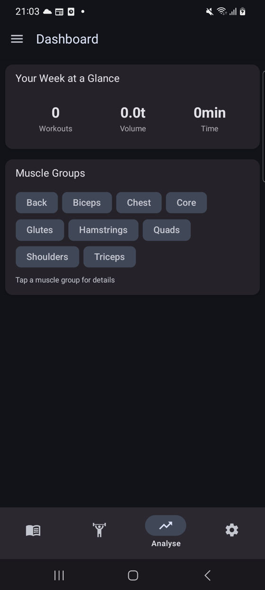
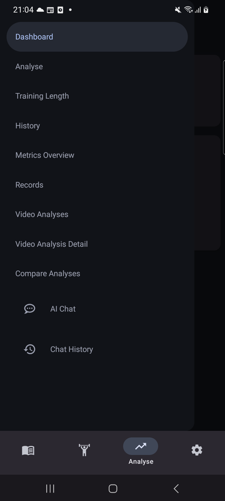

| # | Screen | Zustand dokumentiert | Screenshot |
|---|---|---|---|
| 1 | Dashboard | leer (kein Training diese Woche), leerer Store | 26, 31 |
| 2 | Analyse (Graph) | blockiert, leer, befüllt, Punkt-Detail, Übung ohne Historie | 03, 06, 08, 09, 30 |
| 3 | Training Length | leer, befüllt (Day), befüllt (Month), Bucket-Detail, Edit-Dialog | 16–20 |
| 4 | History | befüllt, leerer Store | 33, 32 |
| 5 | Metrics Overview | leer, befüllt | 10, 11 |
| 6 | Records | leer, befüllt, Liste, „By muscle" | 12–15 |
| 7 | Video Analyses | befüllt | 21 |
| 8 | Video Analysis Detail | befüllt, **Absturz aus dem Drawer** | 22, 24, 25 |
| 9 | Compare Analyses | **Sackgasse aus dem Drawer** | 23 |

---

## 2. Objektive Metriken

### 2.1 Interaktionen bis zur Antwort

Gezählt wird jede diskrete Nutzeraktion (Tap, Texteingabe als 1).

| Frage | Interaktionen | Antwort erreicht? |
|---|---|---|
| Q1 „Wie hat sich mein Squat-1RM entwickelt?" | **15** | Ja — aber erst nach Umweg über den Zeitraum |
| Q2 „Welche Muskelgruppe vernachlässige ich?" | **2 → Sackgasse**, danach 8 weitere | Nein, nicht sauber |
| Q3 „Was war mein letzter PR und wann?" | **9** | Teilweise (Liste nach Gewicht, nicht nach Datum sortiert) |

**Q1 im Detail** — Analyse-Tab → Drawer → Analyse → Selektor aufklappen → Suchfeld → „squat" tippen →
Tap (verpufft, schliesst nur die Tastatur) → „Squat" wählen → Selektor zuklappen → **leerer Kasten**
→ Zeitraum-Button → Startfeld → Datum tippen → Endfeld → Datum tippen → Speichern → Chart.
Neun der 15 Interaktionen sind reine Konfiguration; der entscheidende Hinweis, *dass* der Zeitraum
schuld war, fehlt komplett (siehe H3/H5).

**Q2 im Detail** — Dashboard → Tap auf Muskel-Chip „Back". Laut Beschriftung „Tap a muscle group for
details". Ergebnis: Metrics Overview mit `0 selected` und zurückgesetztem Zeitraum, also **ohne** den
angetippten Muskel und ohne Daten (H4). Selbst nach manueller Zeitraumkorrektur (8 weitere
Interaktionen) gibt es keine Rangliste „am wenigsten trainiert" — der Nutzer muss eine Tabelle mit
9 Muskeln und zweistelligen Nachkommazahlen selbst vergleichen.

**Q3 im Detail** — Analyse-Tab → Drawer → Records → leer → Zeitraum-Button → Start → tippen → Ende →
tippen → Speichern → 40 Records, „TOP PR THIS PERIOD". Die Frage „**letzter** PR" bleibt offen: Die
Liste ist nach geschätztem Gewicht absteigend sortiert (Dec 2, Jan 27, Dec 6, Feb 25 …), eine
chronologische Sortierung gibt es nicht.

### 2.2 Ladezeiten

Gemessen per `screenrecord` (20 fps, Frame-Differenz) bzw. `am start -W`.

| Vorgang | Messwert | Methode |
|---|---|---|
| Kaltstart der App (native Activity) | **762 / 776 / 797 ms** (3 Läufe) | `am start -W`, `TotalTime` |
| Drawer-Wechsel → Records (befüllt, 40 Records + Heatmap) | erste sichtbare Änderung **0,2 s**, ruhig ab **0,4 s** | Frame-Differenz |
| Drawer-Wechsel → Metrics Overview (leer) | ruhig ab **0,4 s** | Frame-Differenz |

**Bewertung:** Die Diagramme sind auf diesem Gerät **nicht langsam**. Der Drawer hält alle Screens
gemountet, deshalb sind Wechsel faktisch sofort. Es wurde an keiner Stelle ein Spinner, ein
Skeleton oder ein spürbares Ruckeln beobachtet — auch nicht beim Chart über 3 Monate Tagesdaten.

> **Nicht gemessen / bewusst ausgeschlossen:** die Zeit bis zum ersten fertigen JS-Frame. Das Bundle
> wird in diesem Setup über `adb reverse` von einem Host-Server geladen (Metro liess sich in dieser
> WSL-Instanz nicht starten, siehe Anhang), was diese Zahl unrealistisch aufbläht. Sie wäre kein
> Produktbefund und wird darum nicht berichtet.

**Nebeneffekt der schnellen Renders:** Weil es *nirgends* eine Ladeanzeige gibt, ist ein leeres
Diagramm optisch nicht von einem noch rechnenden zu unterscheiden. Das verschärft H3.

### 2.3 Sackgassen, fehlende Rückwege, verlorene Filter

| Beobachtung | Schwere |
|---|---|
| `Video Analysis Detail` aus dem Drawer → Absturz → weisser Screen ohne Rückweg, App muss beendet werden | H1 |
| `Compare Analyses` aus dem Drawer → „One or both analyses not found.", keine Aktion, kein Rückweg ausser Drawer | H2 |
| Dashboard-Muskel-Chip verliert den Muskel **und** den Zeitraum | H4 |
| Zurück-Taste bei offener Tastatur verlässt den Screen, statt nur die Tastatur zu schliessen (2× reproduziert) | L8 |
| Filter/Zeitraum überleben **keinen** App-Neustart (lokaler State, nicht persistiert) | M1 |
| Jeder Screen hat einen **eigenen** Zeitraum; Analyse, Metrics, Records, Training Length und Video Analyses teilen ihn nicht | M2 |

**Positiv:** Innerhalb einer Sitzung bleiben Filter, Zeitraum *und sogar der markierte Datenpunkt*
beim Navigieren im Drawer erhalten.

### 2.4 Zeitformate

Im Analyse-Bereich wurden **sechs** verschiedene Datumsdarstellungen gefunden:

| Format | Beispiel | Ort |
|---|---|---|
| `EEE, DD/MM/YY` | `Sun, 14/06/26 to Sun, 20/09/26` | Zeitraum-Button (alle Screens) |
| `MM/DD/YYYY` | `06/14/2026` | Editor-Felder desselben Pickers |
| `DD. MMM` (deutsch) | `06 Dez.`, `18 Dez.` | Chart-X-Achsen |
| `DD MMM YYYY` | `12 Jan 2026` | Training-Length-Bucket |
| `DD/MM/YYYY HH:mm` | `12/01/2026 22:00` | Edit-Training-Times-Dialog |
| `D.M.YYYY, HH:mm:ss` | `17.9.2025, 19:14:14` | Video Analysis Detail |

`14/06/26` und `06/14/2026` stehen dabei **im selben Dialog** übereinander (Screenshot 07).

---

## 3. Leerzustände

Der Analyse-Bereich behandelt Leere **inkonsistent** — von vorbildlich bis wortlos.

### 3.1 Ohne Daten (frischer Store)

App-Daten geleert, danach Baseline wieder importiert.

| Screen | Verhalten |
|---|---|
| Dashboard | `0 / 0.0t / 0min`, graue Chips — **identisch zum Zustand mit 2,3 Jahren Historie** |
| History | „No workouts yet." — schlicht, aber klar |


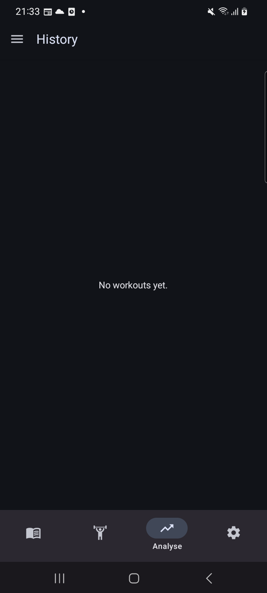

Ein **neuer Nutzer** bekommt im gesamten Analyse-Tab keinerlei Orientierung: kein Onboarding, kein
„importiere deine Daten", kein „logge dein erstes Training". Das Dashboard sieht exakt so aus wie
bei einem Rückkehrer mit voller Historie (Screenshot 26 vs. 31).

### 3.2 Zeitraum ohne Trainings

Das ist der **Default-Zustand** beim Öffnen (letzte 3 Monate).

| Screen | Leerzustand | Bewertung |
|---|---|---|
| Training Length | „No completed trainings in this range" + „Pick a different date range to compare average completed training duration." | **Vorbild** — benennt Problem *und* Lösung |
| Records | „No PRs this week yet", 0-KPIs, gestrichelte Heatmap, „No records in this range yet." | **Gut** |
| Analyse (Graph) | **leerer umrandeter Kasten**, keine Achsen, kein Text | **Ungenügend** |
| Metrics Overview | **nur Tabellenköpfe**, keine Zeile, kein Text | **Ungenügend** |
| Dashboard | Nullen ohne Erklärung, 3 von 5 Karten verschwinden lautlos | **Ungenügend** |

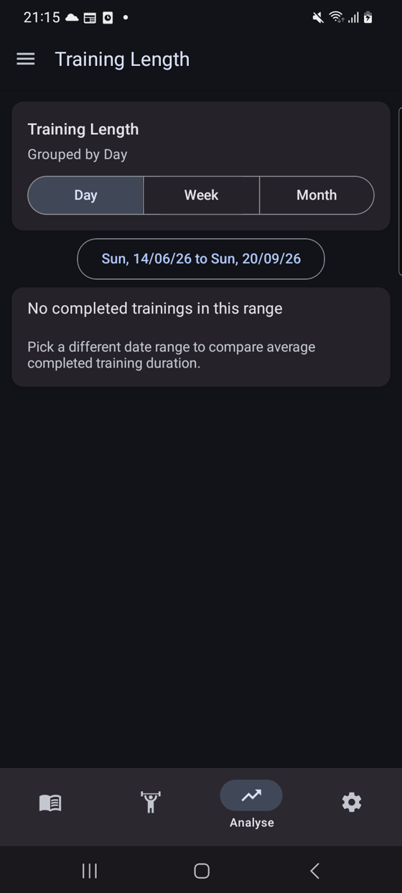
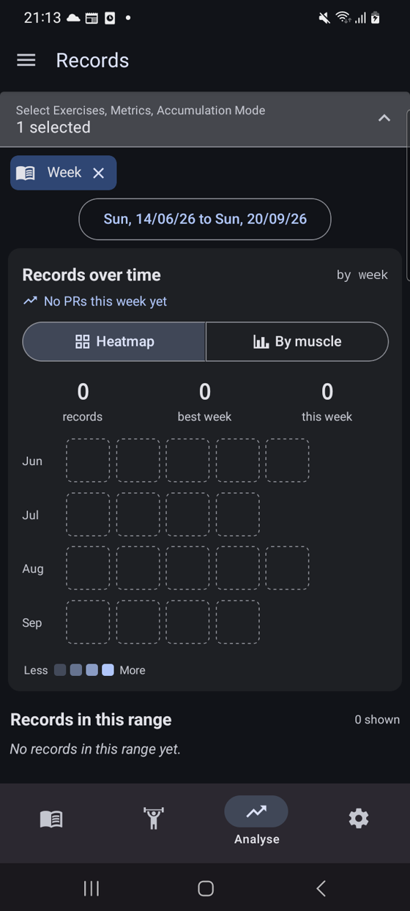


### 3.3 Übung ohne Historie

Übung `Mmkv` (die einzige Übung im Katalog ohne einen einzigen Satz), Zeitraum bewusst auf einen
Bereich **mit** Daten gesetzt:

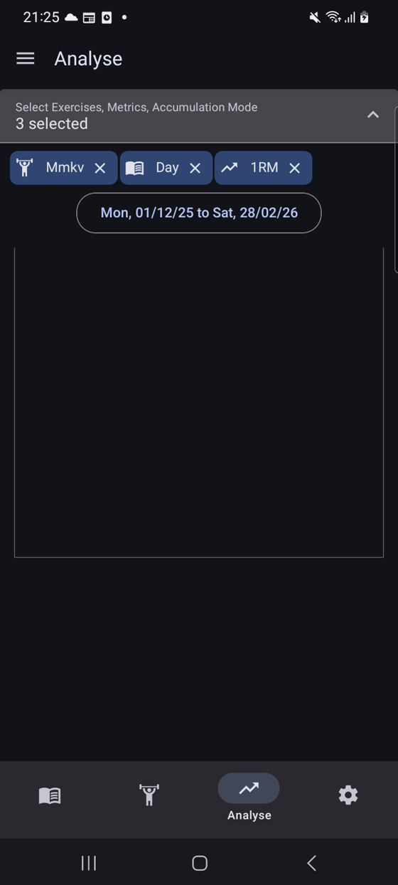

Das Ergebnis ist **pixelgleich** zum Zustand „Zeitraum ohne Trainings" (Screenshot 06). Derselbe
leere Kasten steht für drei völlig verschiedene Situationen:

1. Der gewählte Zeitraum enthält nichts.
2. Die gewählte Übung wurde nie trainiert.
3. Es ist etwas schiefgegangen.

Der Nutzer kann nicht entscheiden, was er ändern müsste.

---

## 4. Findings

Jedes Finding: *Was* · *Warum es ein Problem ist (Heuristik)* · *Screenshot* · *Vorschlag*.
Heuristiken nach Nielsen (H1–H10).

### 4.1 Hoch

---

#### H1 — „Video Analysis Detail" aus dem Drawer stürzt ab und hinterlässt einen weissen Screen

**Was:** Drawer → `Video Analysis Detail` ohne vorher eine Analyse gewählt zu haben →
`TypeError: Cannot read property 'analysisId' of undefined`. Nach dem Schliessen der Fehlermeldung
bleibt ein **komplett weisser Screen** ohne Navigation zurück; die App muss über den Task-Switcher
beendet werden.

**Warum:** Verstoss gegen H5 (Fehlervermeidung) und H9 (Fehler erkennen und beheben). Ein
Menüeintrag, der die App in einen unbenutzbaren Zustand bringt, ist der schwerste Fehlertyp. Der
Eintrag ist zudem für jeden Nutzer jederzeit erreichbar.

> Die rote Box stammt vom Dev-Support des Debug-Builds. Der zugrundeliegende `TypeError` steckt im
> minifizierten Production-Bundle — im Release-Build entfällt nur die rote Box, der weisse Screen
> bleibt. Der Nutzer landet dort also **direkt**.

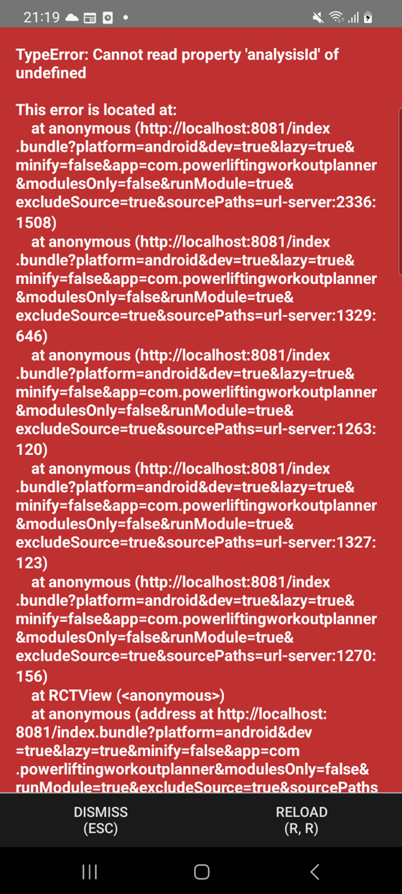
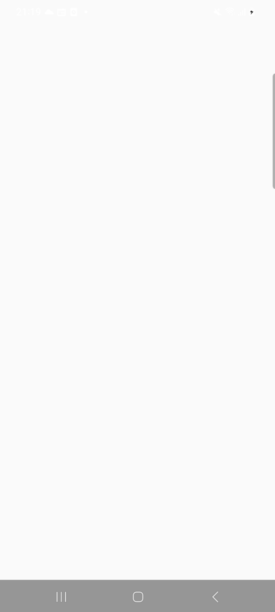

**Vorschlag:** `Video Analysis Detail` und `Compare Analyses` aus dem Drawer entfernen — beide sind
Detailscreens, die aus einer Liste heraus geöffnet werden. Zusätzlich Route-Parameter defensiv
behandeln und einen Error-Boundary um den Analyse-Drawer legen, damit ein Render-Fehler nie den
gesamten Navigationsbaum mitnimmt.

---

#### H2 — „Compare Analyses" aus dem Drawer ist eine Sackgasse

**Was:** Drawer → `Compare Analyses` zeigt auf leerem Screen nur „One or both analyses not found."
Keine Erklärung, keine Aktion, kein Weg vorwärts.

**Warum:** H9 — die Meldung ist in Systemsprache formuliert, nennt weder Ursache noch Ausweg. H1
(Systemstatus): Der Nutzer erfährt nicht, dass er dafür erst zwei Analysen auswählen muss.

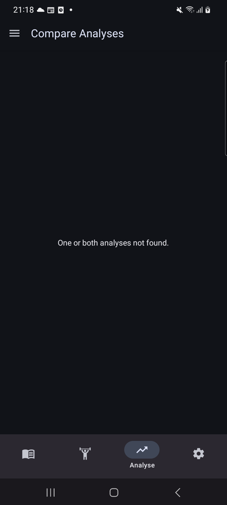

**Vorschlag:** Aus dem Drawer entfernen (siehe H1). Solange er existiert: Leerzustand „Wähle in
*Video Analyses* eine Analyse und tippe *Compare*" plus Button, der direkt dorthin führt.

---

#### H3 — Das zentrale Analyse-Diagramm zeigt einen leeren Kasten ohne jede Erklärung

**Was:** Sind Übung, Metrik und Modus gewählt, aber liegen im Zeitraum keine Daten, rendert die App
ein **leeres Rechteck** — keine Achsen, kein Text, kein Hinweis. Identisch für „Zeitraum leer" und
„Übung nie trainiert".

**Warum:** H1 (Sichtbarkeit des Systemstatus) klar verletzt: Der Nutzer kann „lädt noch", „keine
Daten" und „kaputt" nicht unterscheiden — verschärft dadurch, dass es **nirgends** Ladeindikatoren
gibt. Zusätzlich H9: kein Hinweis, welche Stellschraube zum Ergebnis führt.

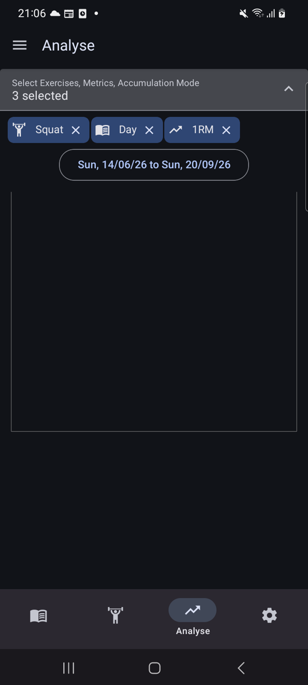

**Vorschlag:** Den Kasten durch einen echten Leerzustand ersetzen, der die *Ursache* benennt:
„Keine Sätze für **Squat** zwischen 14.06. und 20.09.26" — plus zwei konkrete Aktionen:
„Zeitraum auf letzte 12 Monate erweitern" und „Auf letztes Training dieser Übung springen"
(das Datum ist bekannt). Den Wortlaut von Training Length übernehmen, der genau das schon richtig macht.

---

#### H4 — „Tap a muscle group for details" verliert Muskel *und* Zeitraum

**Was:** Der Dashboard-Hinweis verspricht Details pro Muskel. Der Tap landet in der Metrics Overview
mit `0 selected` — der Muskel wird verworfen — und mit auf die aktuelle Woche zurückgesetztem
Zeitraum, also auf einer leeren Tabelle.

**Warum:** H2 (Übereinstimmung System ↔ Erwartung) und H4 (Konsistenz): Die Beschriftung sagt
ausdrücklich „for details", geliefert wird ein leerer, ungefilterter Screen. Es ist die **einzige**
Drill-down-Möglichkeit des Dashboards.

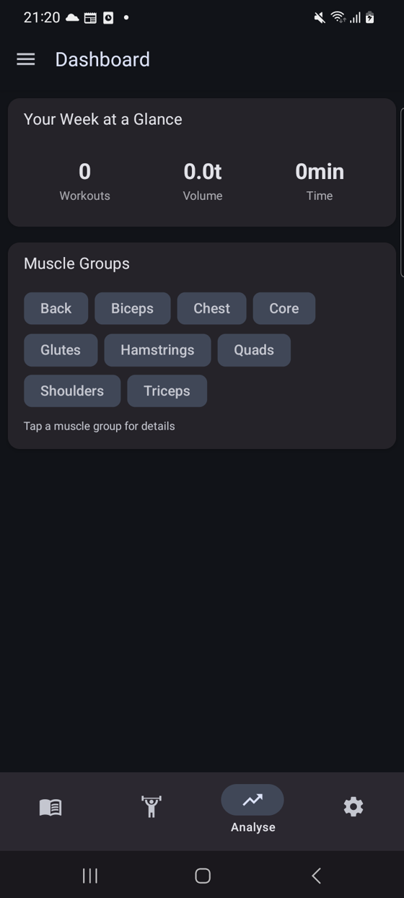
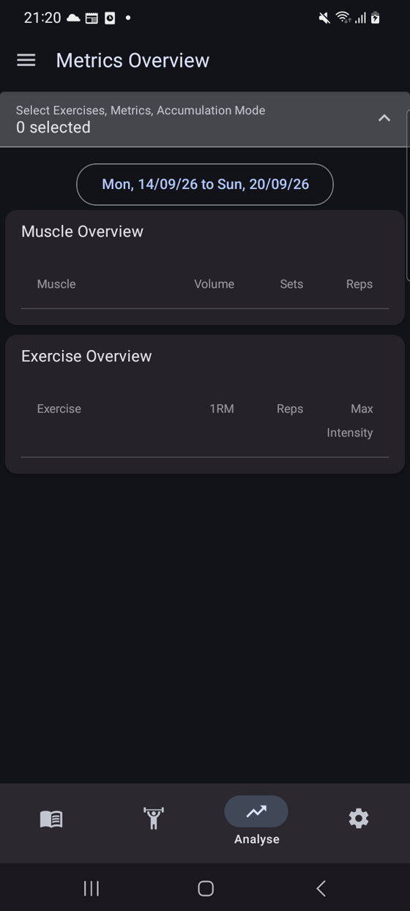

**Vorschlag:** Den angetippten Muskel als Filter mitgeben und den Zeitraum des Dashboards
(oder den zuletzt genutzten) übernehmen, sodass die Zieltabelle den Muskel vorselektiert zeigt.

---

#### H5 — Der Default-Zeitraum ist für Rückkehrer leer, ohne jeden Hinweis

**Was:** Alle Analyse-Screens starten mit einem Default-Zeitraum (meist „letzte 3 Monate", Metrics
Overview „aktuelle Woche", Video Analyses „letztes Jahr"). Wer länger pausiert hat, sieht überall
Leere. Nichts weist darauf hin, dass Daten existieren — nur eben früher.

**Warum:** H1 und H6 (Wiedererkennen statt Erinnern): Der Nutzer muss selbst auf die Idee kommen,
dass der Zeitraum das Problem ist, und ihn auf fünf Screens **einzeln** korrigieren.


**Vorschlag:** Default auf „alles" oder auf einen Zeitraum setzen, der das letzte Training
einschliesst. Mindestens: Wenn im Default nichts liegt, aber Daten existieren, einen Banner zeigen —
„Dein letztes Training war am 28.02.2026. Zeitraum anpassen?" mit Ein-Tap-Aktion.

---

#### H6 — Training Length wird von Ausreissern unbrauchbar gemacht

**Was:** Ein nicht beendetes Training vom 12.01.2026 zählt **44 h 27 min**. Dadurch skaliert die
Y-Achse auf 2.500 Minuten und alle echten Einheiten (~60–90 min) schrumpfen zu einem unlesbaren
Streifen am Boden. In der Monatsansicht verseucht der Ausreisser die Mittelwerte (Januar ≈ 350 min).
Korrigieren lässt er sich nur über einen **Long-Press** ohne jede Affordanz — ein Tap tut nichts.

**Warum:** Der einzige Zweck des Screens ist „wie lange trainiere ich?" — und genau diese Antwort ist
nicht ablesbar (H8, ästhetisches und minimalistisches Design / Signal-Rausch). Der versteckte
Long-Press verletzt H6 (Sichtbarkeit von Aktionen).

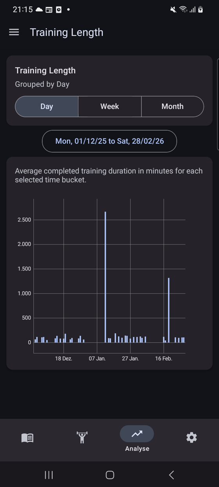
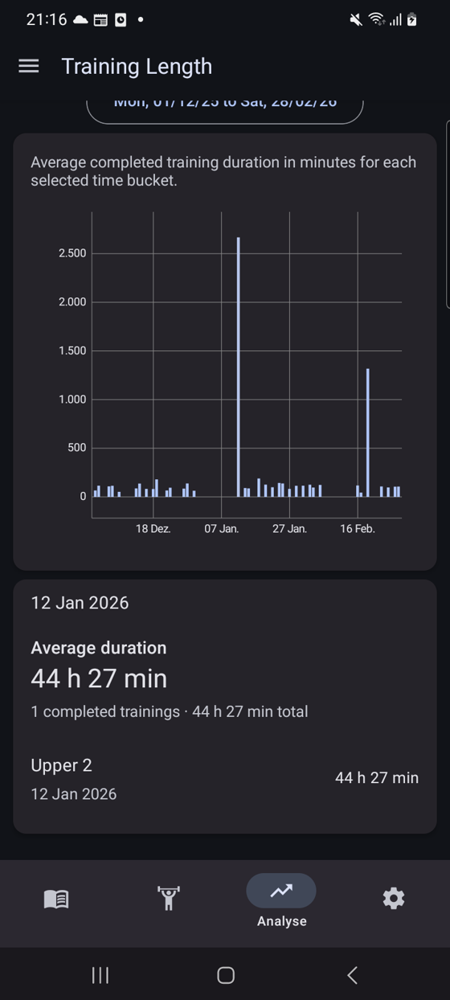
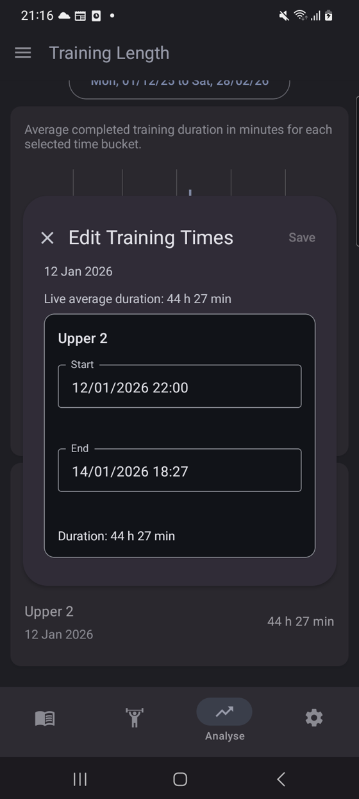

**Vorschlag:** Ausreisser erkennen (z. B. > 4 h) und standardmässig aus der Skalierung nehmen, mit
sichtbarem Hinweis „1 Training über 4 h ausgeblendet — anzeigen/korrigieren". Median statt
arithmetischem Mittel als Linie ergänzen. Den Edit-Dialog über ein sichtbares Stift-Icon erreichbar
machen.

---

#### H7 — Metrics Overview zeigt gebrochene Sätze und Wiederholungen ohne Einheiten

**Was:** In der Muskel-Tabelle steht bei Biceps `104.40` Sets und `1078.55` Reps — gebrochene
Zählwerte. Ursache ist die prozentuale Muskelzuordnung (Biceps zählt z. B. mit 70 % eines Satzes).
Zusätzlich steht über jedem Wert ein **grosses rotes Delta** (`-176680.58`), das betragsmässig weit
über dem eigentlichen Wert liegt. Einheiten fehlen vollständig.

**Warum:** H2 (Systemsprache statt Nutzersprache): „104,40 Sätze" existiert in der Realität des
Nutzers nicht. H8: Das auffälligste Element der Zelle (grosse rote Zahl) ist die *unwichtigere*
Information. Ohne Einheit ist `90937.50` nicht interpretierbar — das Dashboard nennt Volumen an
anderer Stelle in Tonnen (`0.0t`).


**Vorschlag:** Zählwerte (Sets, Reps) ganzzahlig runden, oder sie als „gewichtete Sätze" beschriften
und einmalig erklären. Einheiten an jede Spalte (`kg`, `Sätze`, `Whlg.`). Delta kleiner und *unter*
den Wert setzen, Bezugszeitraum benennen („vs. vorherige 3 Monate").

---

### 4.2 Mittel

---

#### M1 — Filter und Zeitraum überleben keinen App-Neustart

**Was:** Nach Neustart sind Übungs-Chip und Zeitraum auf Default zurück — die ~15 Interaktionen aus
Q1 sind verloren. (H6)
**Screenshot:** 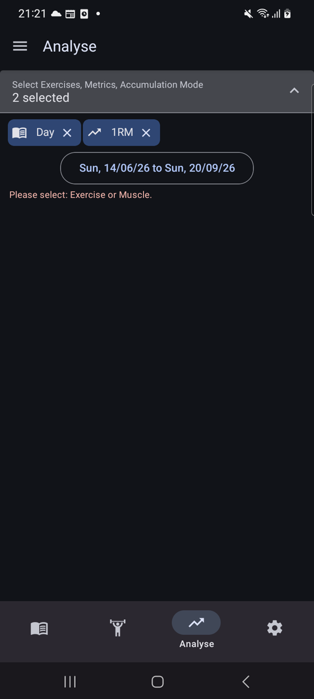
**Vorschlag:** Zuletzt genutzten Zeitraum und Auswahl persistieren (redux-persist wird im Projekt
bereits für andere Einstellungen genutzt).

#### M2 — Jeder Screen hat seinen eigenen Zeitraum

**Was:** Zeitraum auf Analyse gesetzt → Metrics Overview steht wieder auf „aktuelle Woche", Records
auf „letzte 3 Monate", Video Analyses auf „letztes Jahr". Vier verschiedene Defaults, kein
gemeinsamer Zustand. (H4)
**Vorschlag:** Einen Analyse-weiten Zeitraum einführen, den alle Screens teilen; pro Screen
optional überschreibbar.

#### M3 — Sechs verschiedene Datumsformate

**Was:** Siehe Tabelle 2.4. `14/06/26` (DD/MM/YY) und `06/14/2026` (MM/DD/YYYY) stehen im selben
Dialog untereinander — bei Tagen ≤ 12 ist die Angabe schlicht mehrdeutig. (H4)
**Screenshot:** 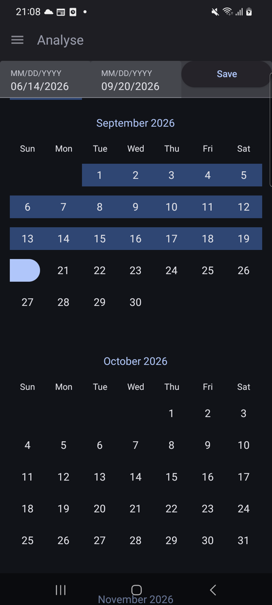
**Vorschlag:** Ein Format aus dem Geräte-Locale ableiten und überall verwenden; Chart-Achsen
denselben Locale nutzen (aktuell deutsch „Dez." in ansonsten englischer UI).

#### M4 — Leerzustände sind inkonsistent

**Was:** Training Length und Records erklären die Leere vorbildlich, Analyse, Metrics Overview und
Dashboard schweigen. (H4)
**Vorschlag:** Den Training-Length-Leerzustand als gemeinsame Komponente für alle Analyse-Screens.

#### M5 — Geschätzte 1RM werden als gemessene Werte präsentiert

**Was:** Der Chip heisst `1RM`, der Tooltip zeigt `215.83`, die Records-Karte `253.3 kg` — tatsächlich
gehoben wurden 175 kg × 5 bzw. 200 kg × 8. Nirgends steht „geschätzt". Extremfall: *Walking lunges*
`140.8 kg`, hochgerechnet aus `64 kg × 34` — eine 1RM-Formel ist bei 34 Wiederholungen ohne
Aussagekraft. (H2)
**Screenshot:** 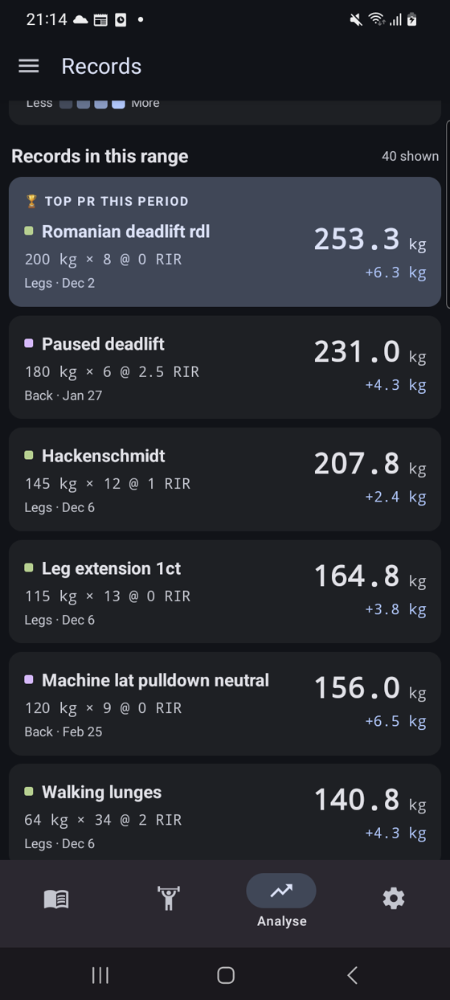
**Vorschlag:** Durchgängig `e1RM` bzw. „gesch. 1RM" beschriften, die Formel einmalig antippbar
erklären und bei Sätzen über ~12 Wiederholungen keinen e1RM-Record mehr bilden.

#### M6 — Records vermischt gewählten Zeitraum und echte aktuelle Woche

**Was:** Bei Zeitraum Dez–Feb steht dennoch „No PRs this week yet" und die KPI `this week 0` —
beides bezieht sich auf die reale Kalenderwoche ausserhalb des Zeitraums. (H4)
**Screenshot:** 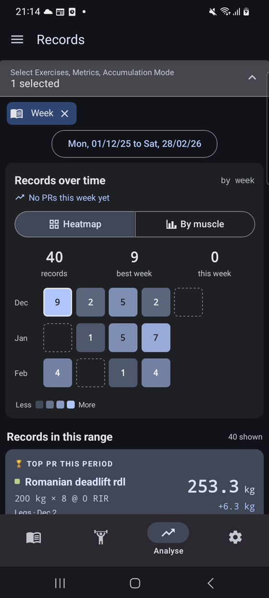
**Vorschlag:** Statusleiste und KPI auf den gewählten Zeitraum beziehen, oder klar als
„diese Woche (ausserhalb des Zeitraums)" kennzeichnen.

#### M7 — Der Selektor mischt vier Dinge in einer flachen Liste

**Was:** Übungen, Muskeln, Metriken und Akkumulationsmodi stehen alphabetisch gemischt in *einer*
Liste, unterscheidbar nur an einem kleinen Icon (`1RM`, `45 degree crunch machine free`, `Adductor`,
`Average Intensity`, `Back` …). Die Kopfzeile zählt „2 selected", obwohl das Metrik und Modus sind —
und der Screen verlangt gleichzeitig „Please select: Exercise or Muscle." (H4, H6)
**Screenshot:** 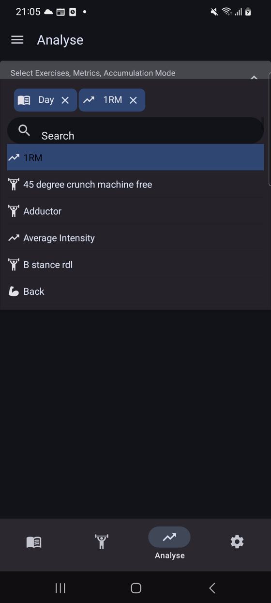
**Vorschlag:** Nach Abschnitten gruppieren (Übungen / Muskeln / Metrik / Modus) mit Überschriften;
Metrik und Modus als eigene, immer sichtbare Auswahl statt als Chips in derselben Liste.

#### M8 — Suche: erster Tap verpufft, exakter Treffer steht zuletzt

**Was:** Bei offener Tastatur wird der erste Tap auf ein Suchergebnis nur zum Schliessen der Tastatur
verbraucht — jede Auswahl kostet **zwei** Taps (reproduziert für „Squat" und „Adductor"). Zudem
sortiert die Trefferliste rein alphabetisch: Bei „squat" steht das exakte `Squat` an **letzter**
Stelle, hinter „Split squat db", und liegt hinter der Tastatur. (H7 Effizienz)
**Screenshot:** 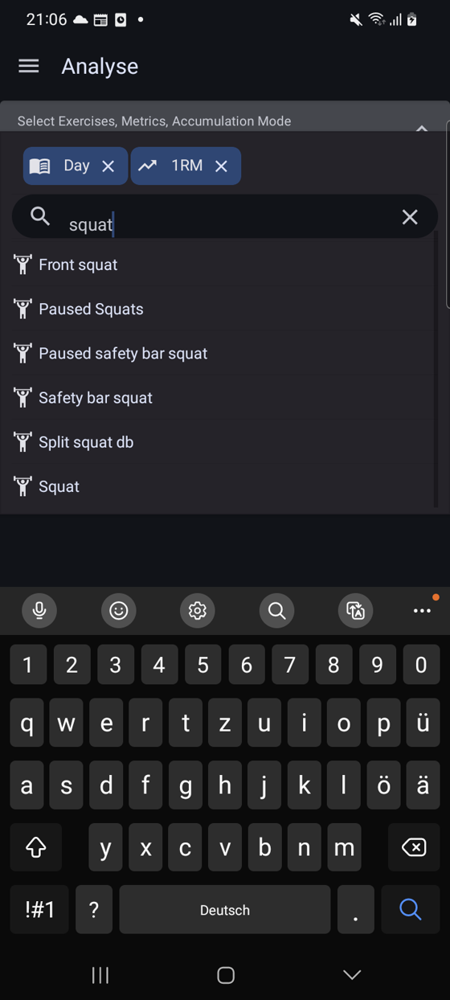
**Vorschlag:** `keyboardShouldPersistTaps="handled"` auf der Ergebnisliste; Treffer nach Relevanz
sortieren (exakt → Präfix → enthält).

#### M9 — Monatsansicht der Training Length hat kaputte X-Achse

**Was:** Bei `Month` erscheinen **8 Achsenbeschriftungen für 3 Balken**
(„Nov. 25 Dez. 25 Dez. 25 Dez. 25 Jan. 26 Jan. 26 Jan. 26 Feb. 26"), inklusive eines Monats ohne
Balken. Zuordnung Balken ↔ Monat unmöglich. (H1)
**Screenshot:** 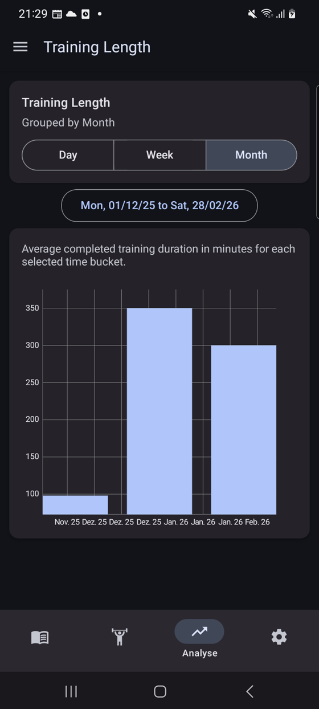
**Vorschlag:** Pro Bucket genau ein Tick; Labels aus denselben Buckets erzeugen wie die Balken.

#### M10 — Leerer Store sieht aus wie „diese Woche nichts"

**Was:** Das Dashboard eines neuen Nutzers ist identisch zu dem eines Rückkehrers mit 2,3 Jahren
Historie. Kein Onboarding, kein Call-to-Action. (H1)
**Vorschlag:** Bei komplett leerem Store eine eigene Startkarte: „Noch keine Daten — importiere
deine Historie oder starte dein erstes Training" mit beiden Buttons.

#### M11 — Y-Achse ohne Kontext überzeichnet kleine Schwankungen

**Was:** Beim Adductor spannt die Achse 147–154 kg. Eine Schwankung von 7 kg sieht aus wie ein
Einbruch; die flache Linie bei 147 wirkt wie Stillstand mit Abstürzen. (H8)
**Screenshot:** 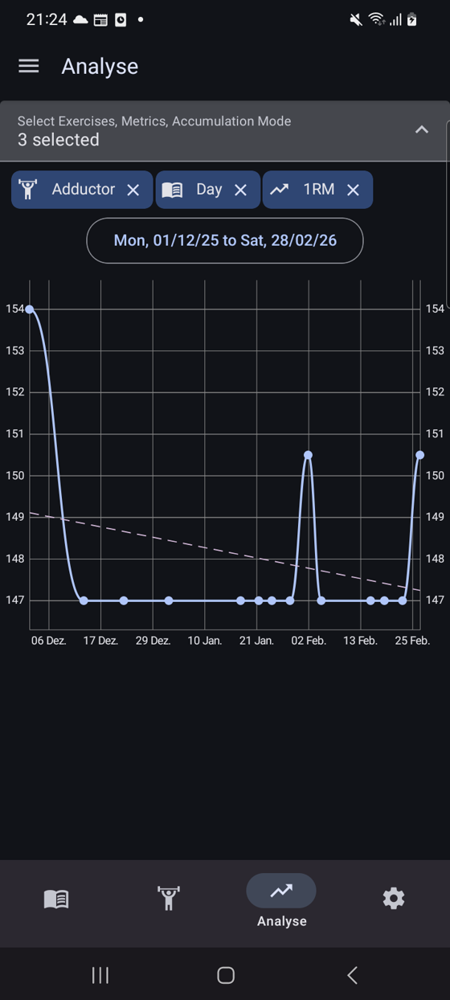
**Vorschlag:** Sinnvolle Mindestspanne erzwingen (z. B. ±10 % um den Median) oder optional bei 0
beginnen; Achse mit Einheit `kg` beschriften.

#### M12 — Die gestrichelte Trendlinie wird nirgends erklärt

**Was:** Jedes Analyse-Diagramm enthält eine gestrichelte Linie ohne Legende. Sie endet sichtbar
woanders als die Datenreihe (Trend ~213 vs. letzter Punkt 204), was zusätzlich verwirrt. (H1, H2)
**Screenshot:** 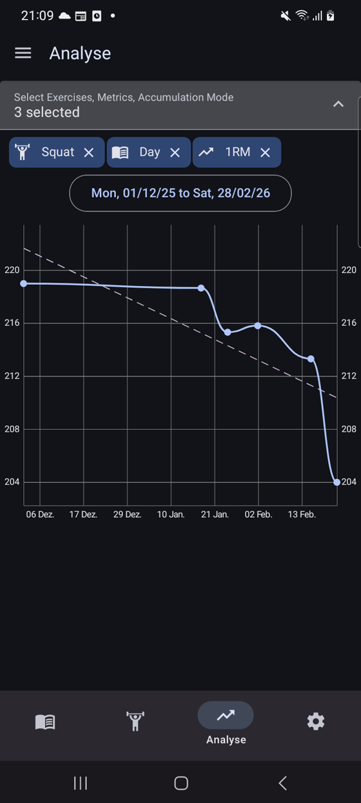
**Vorschlag:** Legende ergänzen („linearer Trend über den Zeitraum") und die Steigung als Klartext
danebenschreiben („−5,2 kg über 3 Monate").

---

### 4.3 Niedrig

| # | Was | Warum | Screenshot | Vorschlag |
|---|---|---|---|---|
| L1 | Dashboard verliert bei leerer Woche 3 von 5 Karten lautlos (Records-Badge, Top Exercises, Focus Exercises) | H1 | 26 | Karten mit Leerzustand statt `null` rendern |
| L2 | „1 completed **trainings**" | H2 | 18 | Singular/Plural korrekt bilden |
| L3 | Video Analysis Detail zeigt rohen Pfad `file:///sdcard/Download/squat-3reps.mp4`; „Status: done" widerspricht „No analysis result available yet." | H2, H4 | 22 | Nur Dateinamen zeigen; Status und Inhalt konsistent halten |
| L4 | Unerklärtes Fachvokabular: `VL 14.3%`, „Squat uses the global VL curve.", `RIR 3-4` | H2 | 22 | Begriffe einmalig per Info-Icon erklären |
| L5 | Viel ungenutzter vertikaler Raum (Dashboard ~40 %, Analyse, Metrics) | H8 | 01, 06, 10 | Inhalte höher ziehen oder Raum für Kontext nutzen |
| L6 | Drei Muskel-Taxonomien: 9 Chips (Dashboard), 6 Lanes (Records „By muscle"), 9 Zeilen (Metrics) | H4 | 26, 15, 11 | Eine gemeinsame Gruppierung |
| L7 | Abgeschnittener Text „Unlinked worko…" | H8 | 21 | Umbrechen oder kürzeren Text |
| L8 | Zurück-Taste bei offener Tastatur verlässt den Screen statt nur die Tastatur zu schliessen | H3 | — | Tastatur zuerst schliessen |
| L9 | Suchtext bleibt beim Zuklappen des Selektors erhalten, wird aber bei Auswahl geleert | H4 | — | Einheitlich beim Schliessen leeren |
| L10 | Keinerlei Ladeindikatoren im gesamten Bereich | H1 | — | Skeleton/Spinner bei Neuberechnung |

---

## 5. Interpretierbarkeit der Zahlen

Kernfrage: Welche Kennzahl versteht ein Nutzer **ohne Erklärung**?

### Verständlich ohne Erklärung

| Kennzahl | Warum es funktioniert |
|---|---|
| `Workouts`, `Time` (Dashboard) | Eindeutige Begriffe, Zeit mit Einheit (`0min`, `1h 20min`) |
| History-Zeilen `13 reps · 0 RIR · 45 kg` | Exakt die Sprache, in der der Nutzer das Training eingegeben hat |
| Records-Kontextzeile `200 kg × 8 @ 0 RIR` | Die tatsächlich gehobene Leistung, nachvollziehbar |
| Records-Heatmap und „By muscle"-Lanes | Rein qualitativ („viel/wenig"), keine Zahl nötig |
| `Average duration 44 h 27 min` | Formatierung mit Einheit, sofort als falsch erkennbar |
| Rep-Velocity-Beschriftung „Velocity Loss % per Rep (concentric, rel. Rep 1)" | **Vorbildlich** — Metrik, Einheit und Bezugspunkt in einer Zeile |

### Nicht verständlich ohne Erklärung

| Kennzahl | Problem |
|---|---|
| `1RM` / `215.83` / `253.3 kg` | Geschätzt, nicht gehoben — nirgends als Schätzung gekennzeichnet (M5). Der Nutzer glaubt, er hätte 253 kg gehoben |
| `140.8 kg` aus `64 kg × 34` | Formel ausserhalb ihres Gültigkeitsbereichs; Zahl ist faktisch bedeutungslos |
| `104.40` Sets, `1078.55` Reps | Gebrochene Zählwerte ohne Erklärung der Muskel-Gewichtung (H7) |
| `90937.50` (Volume, Metrics) | Ohne Einheit; anderswo in Tonnen (`0.0t`) — zwei Einheiten für dieselbe Grösse |
| `-285962.75` (rotes Delta) | Bezugszeitraum wird nicht genannt; optisch dominanter als der eigentliche Wert |
| `Max Intensity` / `Average Intensity` | „Intensität" ist im Kraftsport mehrdeutig (% 1RM? RPE? Tonnage?) — keine Einheit, keine Erklärung |
| `Frequency` | Pro Woche? Pro Zeitraum? Nicht angegeben |
| `VL 14.3%`, „global VL curve", `RIR 3-4` | Reines Fachvokabular ohne Legende |
| Gestrichelte Trendlinie | Keine Legende (M12) |
| `0.0t` | Tonnen-Abkürzung `t` bei kleinen Werten unklar; `0.0t` könnte auch „keine Daten" heissen |

**Muster:** Überall dort, wo die App die **Eingaben des Nutzers zurückspiegelt** (Sätze, Gewicht,
Reps, RIR, Dauer), sind die Zahlen sofort verständlich. Überall dort, wo sie **ableitet**
(e1RM, gewichtete Sätze, Deltas, Intensität, VL), fehlt die Erklärung — und genau diese abgeleiteten
Zahlen sind der eigentliche Mehrwert eines Analyse-Bereichs.

---

## 6. Gesamtaussage

**Beantwortet der Analyse-Bereich die Fragen, für die ein Nutzer ihn öffnet?**

**Teilweise — und fast nie beim ersten Versuch.**

Die Datenbasis, die Berechnungen und die Performance sind in Ordnung. Wo Daten im gewählten Zeitraum
liegen, rechnet die App korrekt, rendert in **unter einer halben Sekunde** und bietet stellenweise
richtig gute Interaktion: Der Tap auf einen Chart-Punkt, der die zugrundeliegenden Sätze aufklappt,
ist das stärkste Element des ganzen Bereichs — er macht eine abgeleitete Zahl sofort
nachvollziehbar. Auch Records und Training Length sind handwerklich gut gemacht.

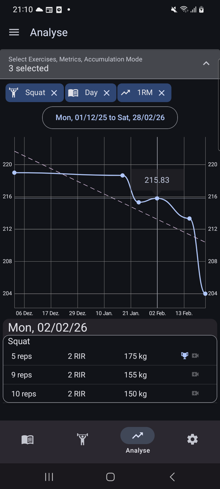

**Wo es abbricht — drei Stellen:**

1. **Beim Einstieg.** Der Default-Zeitraum ist für jeden, der pausiert hat, leer, und die zwei
   wichtigsten Screens (Analyse, Metrics Overview) schweigen dazu. Der Nutzer sieht einen leeren
   Kasten und hat keine Information, was er tun soll. Das ist die **häufigste** Sackgasse, weil sie
   bei jedem Öffnen auftritt und nach jedem Neustart erneut (M1). Von 15 Interaktionen in Q1 waren
   9 reine Konfiguration.

2. **Beim Drill-down.** Das Dashboard verspricht „Tap a muscle group for details" und liefert eine
   leere, ungefilterte Tabelle (H4). Zwei Drawer-Einträge führen in eine Sackgasse bzw. in einen
   Absturz mit weissem Screen (H1, H2). Der Bereich lädt zum Explorieren ein und bestraft es.

3. **Beim Verstehen.** Genau die abgeleiteten Kennzahlen, für die man einen Analyse-Bereich öffnet,
   sind unerklärt: geschätzte 1RM als gemessene Werte, gebrochene Satzzahlen, Deltas ohne Bezug,
   Volumen ohne Einheit. Ein Nutzer kann ablesen, **dass** sich etwas verändert hat, aber oft nicht
   sagen, **was** die Zahl bedeutet — und bei `140.8 kg` aus 34 Wiederholungen ist sie sogar falsch
   suggestiv.

**Kurz:** Der Analyse-Bereich ist kein Rechen-, sondern ein **Kommunikationsproblem**. Die Substanz
ist da; sie wird nur nicht erklärt, nicht verknüpft und hinter zu viel Konfiguration versteckt.
Die grössten Gewinne liegen nicht in neuen Auswertungen, sondern in Leerzuständen, Einheiten,
Beschriftungen und einem gemeinsamen Zeitraum.

---

## 7. Priorisierte Ticket-Vorschläge

Ein Problem = ein Vorschlag.

| Prio | Vorschlag | Deckt ab | Aufwand (geschätzt) |
|---|---|---|---|
| 1 | `Video Analysis Detail` und `Compare Analyses` aus dem Analyse-Drawer entfernen; Route-Parameter defensiv behandeln; Error-Boundary um den Drawer | H1, H2 | S |
| 2 | Aussagekräftige Leerzustände für Analyse-Chart, Metrics Overview und Dashboard — nach Vorbild von Training Length, inkl. Ursache und Ein-Tap-Aktion | H3, M4 | M |
| 3 | Zeitraum-Handling überarbeiten: ein geteilter Analyse-Zeitraum, Persistenz über Neustart, sinnvoller Default relativ zum letzten Training | H5, M1, M2 | M |
| 4 | Dashboard-Muskel-Chip gibt Muskel und Zeitraum an die Metrics Overview weiter | H4 | S |
| 5 | Training Length gegen Ausreisser robust machen: Erkennung > 4 h, Median-Linie, sichtbarer Edit-Einstieg statt Long-Press | H6 | M |
| 6 | Einheiten und Rundung in der Metrics Overview: ganzzahlige Zählwerte bzw. „gewichtete Sätze", Einheiten pro Spalte, Delta untergeordnet + Bezugszeitraum | H7 | M |
| 7 | Geschätzte 1RM konsequent als `e1RM` kennzeichnen, Formel erklären, keine Records aus Sätzen > 12 Wiederholungen | M5 | S |
| 8 | Ein einheitliches Datumsformat im gesamten Analyse-Bereich inkl. Chart-Achsen | M3 | S |
| 9 | Selektor nach Abschnitten gruppieren (Übungen / Muskeln / Metrik / Modus) | M7 | M |
| 10 | Suche: `keyboardShouldPersistTaps` und Relevanz-Sortierung | M8 | S |
| 11 | Records: Statusleiste und KPIs auf den gewählten Zeitraum beziehen | M6 | S |
| 12 | Training-Length-Monatsansicht: ein Achsen-Tick pro Balken | M9 | S |
| 13 | Onboarding-Leerzustand im Analyse-Tab für den komplett leeren Store | M10 | S |
| 14 | Chart-Y-Achse mit Mindestspanne und Einheit; Legende für die Trendlinie | M11, M12 | S |
| 15 | Sammel-Ticket Feinschliff: Plural, roher Dateipfad, Status-Widerspruch, VL-Glossar, Muskel-Taxonomie, Textabschneiden, Zurück-Taste, Ladeindikatoren | L1–L10 | M |

---

## Anhang A — Reproduktion

```bash
export ANDROID_SERIAL=R5CN30HWZFN

# Baseline-Daten importieren (Voraussetzung für alle befüllten Screenshots)
bash ./__tests__/e2e/scripts/run-maestro-from-wsl.sh --mode smoke \
    --device R5CN30HWZFN --driver-host-port 7070 \
    --suite ./__tests__/e2e/maestro/flows/00_import_baseline.yaml
```

Zustände, die für die Screenshots hergestellt wurden:

- **Befüllte Auswertungen:** Zeitraum manuell auf `12/01/2025`–`02/28/2026` (Eingabeformat MM/DD/YYYY)
- **Zeitraum ohne Trainings:** Default belassen (letzte 3 Monate ab 20.09.2026)
- **Übung ohne Historie:** Übung `Mmkv` — die einzige Übung im Katalog ohne einen einzigen Satz
- **Leerer Store:** `adb shell pm clear com.powerliftingworkoutplanner`, danach Baseline erneut
  importiert, damit das Gerät benutzbar zurückbleibt

## Anhang B — Grenzen dieses Audits

- Es ist ein **Experten-Audit**, kein Nutzertest. Die Interaktionszahlen sind die eines Auditors, der
  die App kennt; ein Erstnutzer braucht eher mehr.
- **AI Chat und Coach Insight wurden nicht auditiert** (Ticket-Vorgabe); es wurde kein einziger
  echter Modellaufruf ausgelöst.
- Die Zeit bis zum ersten JS-Frame ist in diesem Setup nicht repräsentativ messbar (Bundle wird über
  `adb reverse` von einem Host-Server geladen) und darum bewusst **nicht** berichtet. Alle anderen
  Messwerte sind gerätenativ.
- Die Fixture endet am 28.02.2026. Aussagen zu „aktuelle Woche"-Ansichten beziehen sich deshalb auf
  einen Rückkehrer-Fall, nicht auf einen aktiv trainierenden Nutzer.

## Anhang C — Bildverzeichnis

Alle Screenshots stammen vom Gerät `R5CN30HWZFN` (Samsung SM-G986B, Android 13) und sind für die
Darstellung auf 560 px Breite skaliert. Die Nummern entsprechen den Verweisen in Abschnitt 1 und 4.

| # | Datei | Zeigt |
|---|---|---|
| 01 | [01-dashboard-entry](images/GH-455/01-dashboard-entry.png) | Einstieg in den Analyse-Tab (Dashboard) |
| 02 | [02-analyse-drawer](images/GH-455/02-analyse-drawer.png) | Drawer mit allen Einträgen |
| 03 | [03-analyse-blocked-default](images/GH-455/03-analyse-blocked-default.png) | Analyse-Screen blockiert: „Please select: Exercise or Muscle." |
| 04 | [04-selector-flat-list](images/GH-455/04-selector-flat-list.png) | Selektor: flache Mischliste aus Übungen, Muskeln, Metriken |
| 05 | [05-search-squat-ranking](images/GH-455/05-search-squat-ranking.png) | Suche „squat" — exakter Treffer steht zuletzt |
| 06 | [06-chart-blank-no-message](images/GH-455/06-chart-blank-no-message.png) | Leerer Chart-Kasten ohne jede Meldung |
| 07 | [07-date-range-editor](images/GH-455/07-date-range-editor.png) | Zeitraum-Editor: MM/DD/YYYY neben DD/MM/YY |
| 08 | [08-chart-populated](images/GH-455/08-chart-populated.png) | Befülltes 1RM-Diagramm mit unerklärter Trendlinie |
| 09 | [09-chart-point-drilldown](images/GH-455/09-chart-point-drilldown.png) | Tap auf Datenpunkt zeigt die zugrundeliegenden Sätze |
| 10 | [10-metrics-empty-no-message](images/GH-455/10-metrics-empty-no-message.png) | Metrics Overview: nur Tabellenköpfe, keine Meldung |
| 11 | [11-metrics-fractional-sets](images/GH-455/11-metrics-fractional-sets.png) | Gebrochene Sätze/Reps, rote Deltas, keine Einheiten |
| 12 | [12-records-good-empty-state](images/GH-455/12-records-good-empty-state.png) | Records: guter Leerzustand |
| 13 | [13-records-populated](images/GH-455/13-records-populated.png) | Records befüllt; „this week" trotz Dez–Feb-Zeitraum |
| 14 | [14-records-list-e1rm](images/GH-455/14-records-list-e1rm.png) | Records-Liste mit geschätzten 1RM |
| 15 | [15-records-by-muscle](images/GH-455/15-records-by-muscle.png) | Records „By muscle" — 6 Muskel-Lanes |
| 16 | [16-training-length-best-empty-state](images/GH-455/16-training-length-best-empty-state.png) | Bester Leerzustand im Bereich |
| 17 | [17-training-length-outliers](images/GH-455/17-training-length-outliers.png) | Ausreisser zerstören die Skalierung |
| 18 | [18-training-length-44h](images/GH-455/18-training-length-44h.png) | 44 h 27 min als „Average duration" |
| 19 | [19-training-length-hidden-edit](images/GH-455/19-training-length-hidden-edit.png) | Edit-Dialog nur per Long-Press |
| 20 | [20-training-length-month-axis](images/GH-455/20-training-length-month-axis.png) | Monatsansicht: 8 Achsenlabels für 3 Balken |
| 21 | [21-video-analyses](images/GH-455/21-video-analyses.png) | Video Analyses mit Filter-Zusammenfassung |
| 22 | [22-video-detail-jargon](images/GH-455/22-video-detail-jargon.png) | Detail: roher Dateipfad, VL-Jargon, Status-Widerspruch |
| 23 | [23-compare-dead-end](images/GH-455/23-compare-dead-end.png) | „One or both analyses not found." |
| 24 | [24-detail-crash](images/GH-455/24-detail-crash.png) | Absturz beim Öffnen aus dem Drawer |
| 25 | [25-crash-blank-screen](images/GH-455/25-crash-blank-screen.png) | Weisser Screen ohne Rückweg |
| 26 | [26-dashboard-no-data-this-week](images/GH-455/26-dashboard-no-data-this-week.png) | Dashboard ohne Training in dieser Woche |
| 27 | [27-muscle-drilldown-loses-context](images/GH-455/27-muscle-drilldown-loses-context.png) | Muskel-Tap landet auf `0 selected` |
| 28 | [28-filters-lost-on-restart](images/GH-455/28-filters-lost-on-restart.png) | Filter nach App-Neustart zurückgesetzt |
| 29 | [29-yaxis-exaggerates](images/GH-455/29-yaxis-exaggerates.png) | Y-Achse 147–154 überzeichnet Schwankungen |
| 30 | [30-exercise-without-history](images/GH-455/30-exercise-without-history.png) | Übung ohne Historie — gleicher leerer Kasten |
| 31 | [31-empty-store-dashboard](images/GH-455/31-empty-store-dashboard.png) | Leerer Store: Dashboard identisch zu 26 |
| 32 | [32-empty-store-history](images/GH-455/32-empty-store-history.png) | Leerer Store: „No workouts yet." |
| 33 | [33-history-populated](images/GH-455/33-history-populated.png) | History befüllt (letzter Eintrag 28.02.26) |
