# UX-Audit: „Training anlegen" + „Training durchführen"

**Ticket:** GH-399
**Datum:** 2026-08-24
**Gerät:** Samsung SM-G986B (Galaxy S20+), Android 13, Serial `R5CN30HWZFN`, 6.7", 1440×3200 px physisch / 720×1600 dp Override, Dark Theme
**Datenbasis:** Baseline-Fixture importiert (`__tests__/testdata/…gains`) — Plan „Push pull", Meso 1, M1–M7 mit Historie
**Art:** Experten-/Heuristik-Audit (Nielsen). **Kein** Nutzertest mit echten Probanden.
**Scope:** kompletter Bogen von „ich lege ein Training an" bis „ich habe die Einheit durchtrainiert und beendet". Rein diagnostisch — **kein App-Code geändert** (Diff = nur dieser Report + Screenshots).

---

## 1. Was tatsächlich durchgespielt wurde

Beide Flows wurden vollständig auf dem realen Gerät ausgeführt, nicht simuliert:

**Flow A — Training anlegen.** Im Plan „Push pull" (Meso 1, Micro 6) über „Plan new Training"
zwei Übungen ausgewählt (Bankdrücken, Squat) und fünf Sätze angelegt
(Bankdrücken 3×8 @ 118 kg, Squat 2×5 @ 193 kg), gespeichert über „Done".
→ Vollprotokoll: [`flow-a-steps.md`](#anhang-a--interaktionsprotokoll-flow-a)

**Flow B — Trainieren.** Micro 7 / D1 („Push squat") über „Suggest based on last planned
Training" befüllt, Training gestartet, alle fünf Sätze real abgehakt, **zwei Mal
unterbrochen und fortgesetzt** (einmal Home-Taste/Hintergrund, einmal echter Prozess-Tod
per `am force-stop`), danach über „Finish Training" beendet.
Ergebnis: Duration 00:07:49, Volume 4762 kg, 5 Sätze, neuer Squat-1RM-Record 225,17 kg.
→ Vollprotokoll: [`flow-b-steps.md`](#anhang-b--interaktionsprotokoll-flow-b)

Alle Screenshots liegen unter `docs/ux/screenshots/gh399/`.

**Unabhängige Gegenprobe.** Damit die oben genannten Ergebniswerte nicht nur behauptet sind,
prüft ein Maestro-Flow (`audit_result_check.yaml`, read-only, ohne `clearState`) sie auf dem
Gerät nach — er assertet die **konkreten Werte**, nicht bloß die Sichtbarkeit von Elementen:
`Push squat`, `Meso 1 · M7 · D1 · today`, `4.762 kg`, `8m`, `193 kg × 5 @ RIR 0`,
`225.17 kg`. Ergebnis: **1/1 Flow Passed (17 s)**.

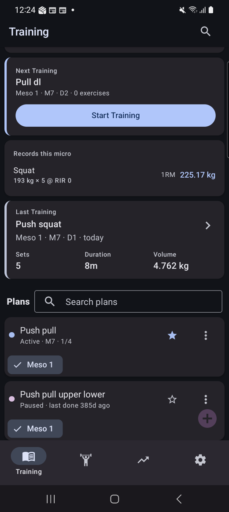

---

## 2. Objektive Metriken

### 2.1 Flow A — Training anlegen

| Metrik | Wert |
|---|---|
| Interaktionen bis gespeichertes Training (2 Übungen, 5 Sätze) | **36** |
| davon reine Fehler-Recovery (Picker-Bug H3) | **3** → ohne Bug **33** |
| Interaktionen pro **geplantem** Satz | **4** (Add set → Reps-Feld → Ziffer → Keyboard schließen); Weight wird automatisch vorgeschlagen |
| Minimalpfad 1 Übung / 1 Satz | **12** |
| Distinkte Screens/Zustände | **8** |
| Sackgassen | **1** (leerer Picker nach erster Auswahl) |
| Fehlende Abbrechen-Wege | **1** (im EDITING-PLAN-Modus nur „Done", kein „Abbrechen"/„Verwerfen") |

### 2.2 Flow B — Trainieren

| Metrik | Wert |
|---|---|
| Interaktionen bis Training **tatsächlich** gestartet | **6** — davon **3 verloren** durch den irreführenden „Start Training"-Button und die Train-Sackgasse; kürzester bekannter Weg: **3** |
| Interaktionen pro **geplantem** Satz | **1** (Tap auf ✓) — der mit Abstand schnellste Teil der App |
| Interaktionen pro **ungeplantem** Satz | **5–7** (Reps, RIR, Weight tippen + „Add") |
| Interaktionen Start → Finish (5 Sätze, 2 Übungen) | **13** |
| Distinkte Screens/Zustände | **9** |
| Sackgassen | **3** — „Start training to begin" ohne Start-Control; Analysis-Tab während des Trainings; Home nach Prozess-Tod ohne Resume-Hinweis |
| Fehlende Abbrechen/Zurück-Wege | **2** — „Pause session" deaktiviert; kein „Training abbrechen/verwerfen" (nur „Delete") |

### 2.3 Was gut funktioniert

Damit die Findings nicht das Gesamtbild verzerren — diese Dinge sind objektiv stark:

- **Satz abhaken = 1 Tap.** Der Kernvorgang beim Trainieren ist optimal kurz. ([B08](screenshots/gh399/B08-set1-logged.png))
- **Unterbrechen/Fortsetzen ist verlustfrei.** Nach Hintergrund **und** nach echtem
  Prozess-Tod waren Timer, Häkchen, Rest-Timer und sogar die Scroll-Position erhalten.
  ([B19](screenshots/gh399/B19-resumed.png), [B21](screenshots/gh399/B21-after-process-death.png))
- **Gewichtsvorschlag beim Planen.** Nach Eingabe der Reps wird das Arbeitsgewicht aus dem
  1RM automatisch gesetzt — spart pro Satz zwei bis drei Eingaben. ([A18](screenshots/gh399/A18-after-ok-key.png))
- **Kontext beim Trainieren.** „ESTIMATED 1RM / vs last training / NEW PR" liefert genau die
  Zahl, die zwischen den Sätzen interessiert. ([B12](screenshots/gh399/B12-squat-tab.png))
- **Record-Feedback in Echtzeit.** Toast „New Record!" direkt beim Abhaken. ([B16](screenshots/gh399/B16-squat-set1-logged.png))
- **Back verhält sich korrekt** (siehe §5, #338-H2 ist erledigt).

---

## 3. Findings

Priorisierung: **H** = hoch, **M** = mittel, **N** = niedrig.

### H1 — „Start Training" startet kein Training

**Was:** Auf der „Next Training"-Card der Startseite liegt der prominenteste Button der
gesamten App: „Start Training". Ein Tap darauf startet **kein** Training — er navigiert nur
in den Tab „Plan" des betreffenden Trainings. Kein Timer, kein Toast, kein Zustandswechsel.
Das eigentliche Starten liegt im ⋮-Overflow-Menü — **unter demselben Label „Start Training"**.

**Warum ein Problem:** Verletzt **#2 (Match between system and the real world)** und
**#4 (Consistency and Standards)**. Ein Button muss benennen, was er tut. Zwei Controls mit
identischem Text und unterschiedlicher Wirkung sind der Lehrbuchfall für erlernte
Unsicherheit — der Nutzer weiß nach dem dritten Mal immer noch nicht, welches der beiden
„Start Training" wirklich startet. Kostet im gemessenen Flow 3 von 6 Interaktionen.

**Screenshots:** [B01](screenshots/gh399/B01-home-next-training.png) (Button) →
[B02](screenshots/gh399/B02-after-start-training.png) (Ergebnis: Plan-Tab, kein Training) ·
[B05](screenshots/gh399/B05-overflow-menu.png) (das *echte* „Start Training")

| Der prominente Button … | … und was er bewirkt | Das *echte* Start-Control |
|---|---|---|
| 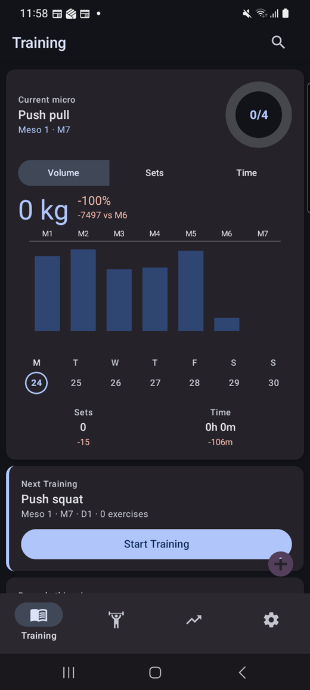 | 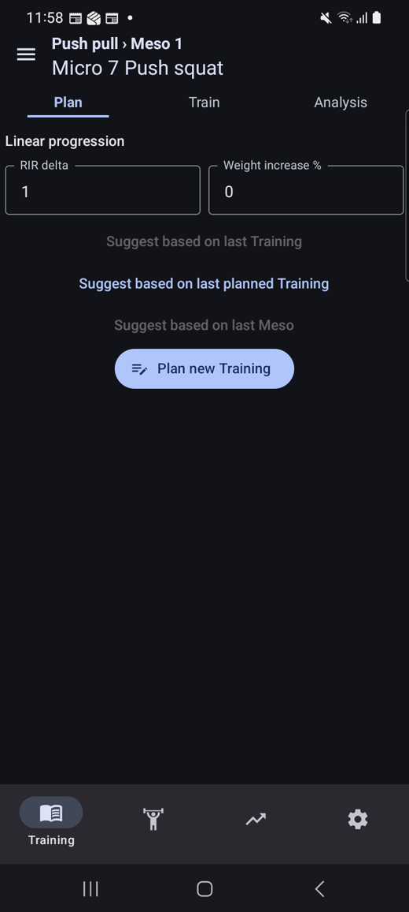 | 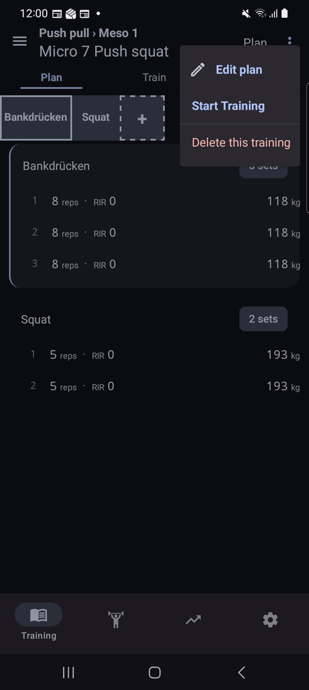 |

**Vorschlag:** Card-Button zustandsabhängig beschriften und verdrahten —
`0 exercises` → „Plan Training"; `PLANNED` → „Start Training" (und tatsächlich starten);
`STARTED` → „Continue Training". Den Menüeintrag entsprechend entdoppeln.

---

### H2 — „Start training to begin" — Sackgasse ohne Start-Control

**Was:** Der Tab „Train" eines noch nicht gestarteten Trainings zeigt exakt einen Satz Text:
„Start training to begin". Auf diesem Screen existiert **kein einziges Control zum Starten** —
kein Button, und in dieser Kopfzeile auch kein ⋮-Menü.

**Warum ein Problem:** Verletzt **#1 (Visibility of System Status)** und
**#6 (Recognition rather than Recall)**. Der Screen erteilt eine Handlungsanweisung und
verweigert gleichzeitig das Mittel, sie auszuführen. Der Nutzer muss raten, dass die Aktion
in einem Menü auf einem *anderen* Tab liegt.

**Screenshot:** [B03](screenshots/gh399/B03-train-tab-empty.png)

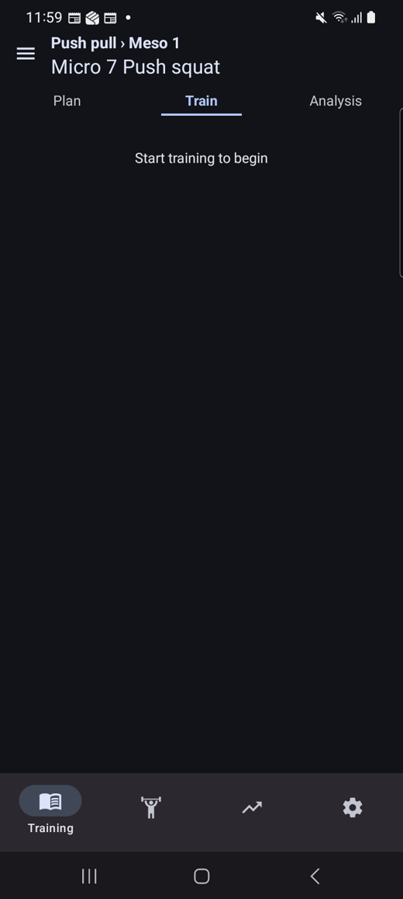

**Vorschlag:** Primären „Start Training"-Button in diesen Leerzustand setzen. Der Text darf
bleiben, aber die Aktion muss dort sein, wo sie gefordert wird.

---

### H3 — Übungs-Picker liefert nach der ersten Auswahl eine leere Liste

**Was:** Nach dem Auswählen der ersten Übung wird die Übungsliste im aufgeklappten Picker
leer — und bleibt leer. Auch die Suche liefert dann nichts: Eingabe „squat" → **0 Treffer**,
obwohl „Squat", „Bulgarian split squat", „Front squat" usw. existieren. Das Suchfeld bleibt
sichtbar, darunter steht eine leere Fläche von rund 450 px. Erst Ein- und Ausklappen des
Pickers stellt die Liste wieder her: **dieselbe** Sucheingabe „squat" liefert danach
**7 Treffer**.

**Warum ein Problem:** Verletzt **#1 (Visibility of System Status)** — der Nutzer bekommt
„es gibt keine Übungen" signalisiert, obwohl es sie gibt. Wer den Ein-/Ausklapp-Trick nicht
findet, kann keine zweite Übung hinzufügen und hält das Feature für kaputt.

**Screenshots:** [A08](screenshots/gh399/A08-picked-bankdruecken.png) /
[A09](screenshots/gh399/A09-after-select-settled.png) (Liste leer, stabil über 3 s) ·
[A10](screenshots/gh399/A10-picker-search-squat.png) („squat" → 0 Treffer) ·
[A13](screenshots/gh399/A13-picker-list-again.png) (**identische** Suche nach
Ein-/Ausklappen → 7 Treffer)

Der entscheidende Vergleich — links und rechts steht dieselbe Sucheingabe „squat":

| Nach der ersten Auswahl: 0 Treffer | Nach Ein-/Ausklappen: 7 Treffer |
|---|---|
| 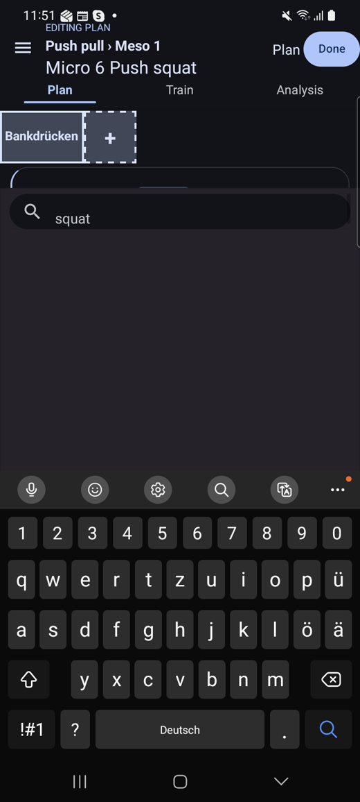 | 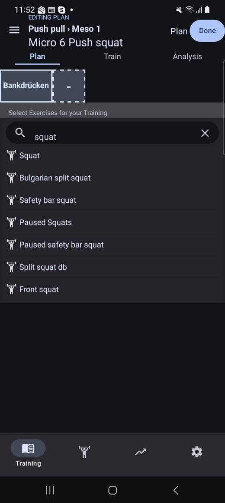 |

**Einschränkung — ehrlich benannt:** Der Effekt trat bei der **ersten** Auswahl aus einem
frisch geöffneten Picker auf. Bei der zweiten Auswahl
([A14](screenshots/gh399/A14-second-exercise-selected.png)) blieb die Liste befüllt. Er ist
also **nicht in jedem Durchlauf** reproduzierbar; der A10↔A13-Vergleich belegt aber
zweifelsfrei, dass die leere Liste ein Zustandsfehler war und nicht „keine Treffer".

**Vorschlag:** Beim Übernehmen einer Auswahl die Datenquelle der Liste nicht zurücksetzen.
Reproduktion gezielt gegen den ersten Selektionsvorgang nach dem Aufklappen fahren.

---

### H4 — Ein laufendes Training erscheint nach Prozess-Neustart als „Next Training"

**Was:** Wird die App während eines laufenden Trainings vom System beendet (getestet mit
`am force-stop`), landet der Nutzer beim nächsten Start auf der Startseite. Die Einheit, die
gerade läuft und in der bereits 5 Sätze protokolliert sind, wird dort als
„**Next Training** · Push squat · 2 exercises" mit dem Button „**Start Training**"
dargestellt. Nichts weist darauf hin, dass diese Einheit bereits läuft — kein Timer, kein
Badge, kein „Continue".

**Warum ein Problem:** Verletzt **#1 (Visibility of System Status)**. Die App kennt den
Zustand `STARTED` — die Daten sind ja vollständig erhalten — zeigt ihn aber nicht an. Der
Nutzer muss davon ausgehen, dass sein Training weg ist, oder fürchtet, mit „Start Training"
die bisherigen Sätze zu überschreiben. Dass ein Prozess-Tod mitten im Training real ist
(Telefon in der Tasche, Speicherdruck), macht das zum häufigen Fall.

**Screenshots:** [B21](screenshots/gh399/B21-after-process-death.png) (nach Neustart,
Sets = 5 sind erhalten) · [B22](screenshots/gh399/B22-next-training-card.png)
(„Next Training" + „Start Training" für die laufende Einheit)

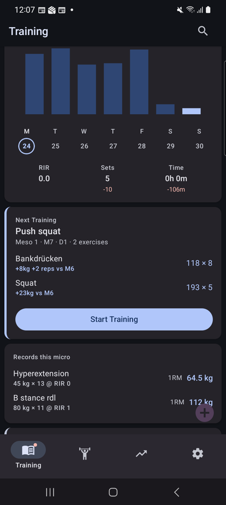

**Entwarnung:** Der Tap führt **nicht** zu Datenverlust — er navigiert korrekt in die
laufende Einheit (Timer 07:10, alle Häkchen da,
[B23](screenshots/gh399/B23-start-on-running-training.png)). Das Problem ist die
Darstellung, nicht die Logik.

**Vorschlag:** Bei `state === STARTED` die Card umschalten auf „Training läuft · seit
MM:SS" + „Continue Training", optisch abgesetzt.

---

### M1 — Rest-Timer liegt unter der Falz

**Was:** Der Pausen-Timer erscheint als Karte **unterhalb** der Satzliste und der
1RM-Karte. Beim Wechsel auf eine Übung ist er am unteren Rand angeschnitten
([B12](screenshots/gh399/B12-squat-tab.png)); um ihn zu lesen, muss gescrollt werden
([B13](screenshots/gh399/B13-rest-timer.png)).

**Warum ein Problem:** Verletzt **#1 (Visibility of System Status)**. Zwischen zwei Sätzen
ist die Restpause die einzige Information, auf die man schaut — und die einzige, die man
*wiederholt* und *nebenbei* abliest. Sie gehört nicht ans Ende einer Scroll-Liste.

**Vorschlag:** Rest-Timer sticky an den oberen oder unteren Rand des Train-Tabs heften,
sodass er unabhängig von der Scroll-Position sichtbar bleibt.

---

### M2 — Rest-Timer beschriftet die Abweichung als „elapsed" und zeigt negative Zeiten

**Was:** Die Karte zeigt `target 01:30 · elapsed -00:11`, kurz nach einem Satz sogar
`elapsed -01:27`, und nach Ablauf `elapsed +00:33` (rot). Der Wert ist offensichtlich die
**Abweichung vom Zielwert**, nicht die verstrichene Zeit — 3 Sekunden nach dem Satz sind
nicht „-01:27 verstrichen".

**Warum ein Problem:** Verletzt **#2 (Match between system and the real world)**. Das Label
sagt etwas anderes als der Wert bedeutet. Die tatsächlich verstrichene Pausenzeit wird
nirgends angezeigt — wer sie wissen will, muss `target + delta` im Kopf rechnen, ausgerechnet
zwischen zwei schweren Sätzen.

**Screenshots:** [B13](screenshots/gh399/B13-rest-timer.png) (`elapsed -00:11`) ·
[B16](screenshots/gh399/B16-squat-set1-logged.png) (`elapsed -01:27`, 3 s nach dem Satz) ·
[B15](screenshots/gh399/B15-rest-timer-later2.png) (`elapsed +00:33`, rot)

| 3 s nach dem Satz: „elapsed **-01:27**" | nach Ablauf: „elapsed **+00:33**" |
|---|---|
| 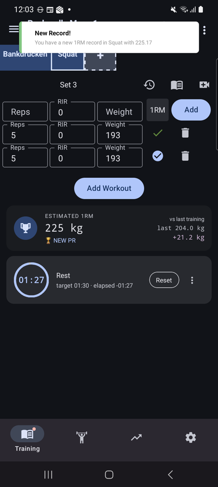 | 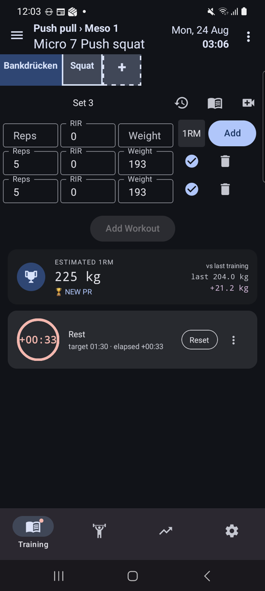 |

**Vorschlag:** Umbenennen in „remaining" / „over" — z. B. `01:19 remaining · target 01:30`,
nach Ablauf `+00:33 over`. Die große Ziffer im Kreis dupliziert den Wert derzeit exakt; dort
könnte stattdessen die echte verstrichene Pausenzeit stehen.

---

### M3 — Analysis-Tab ist während des Trainings eine Sackgasse

**Was:** Wer während der laufenden Einheit auf „Analysis" tippt, bekommt nur
„Analysis available after the training is finished".

**Warum ein Problem:** Verletzt **#1 (Visibility of System Status)**. Genau während des
Trainings ist der Fortschritt interessant: wie viele Sätze sind durch, wie viel Volumen
steht schon, wie lange läuft die Einheit. Diese Zahlen existieren bereits (nach dem Finish
werden sie sofort angezeigt) — sie werden nur zurückgehalten.

**Screenshot:** [B11](screenshots/gh399/B11-analysis-after-3sets.png)

**Vorschlag:** Live-Fortschritt statt Platzhalter: „3/5 Sätze · 2832 kg · 01:07".

---

### M4 — „Pause session" ist während des laufenden Trainings deaktiviert

**Was:** Im ⋮-Menü der laufenden Einheit steht „Pause session" — ausgegraut und nicht
tippbar. Eine Begründung wird nicht angezeigt.

**Warum ein Problem:** Verletzt **#3 (User Control and Freedom)**. Das Unterbrechen einer
Einheit (Telefonat, Gerät belegt, Toilette) ist ein Alltagsfall, und das einzige explizite
Control dafür ist gesperrt. Ein deaktivierter Eintrag ohne Erklärung ist zudem
**#1 (Visibility)**: der Nutzer erfährt nicht, was er tun müsste, um ihn freizuschalten.

**Screenshot:** [B24](screenshots/gh399/B24-overflow-during-training.png)

**Vorschlag:** Entweder aktivieren, oder den Eintrag ausblenden, oder mit Begründung
versehen („Pause erst nach dem ersten Satz möglich" o. ä.).

---

### M5 — Ein neuer Satz übernimmt die Werte des vorherigen nicht

**Was:** „Add set" erzeugt eine leere Zeile (Reps und Weight leer, RIR 0), auch wenn der
Satz davor bereits 8 / 0 / 118 enthält. Für ein klassisches 3×8 müssen alle Werte dreimal
neu getippt werden.

**Warum ein Problem:** Verletzt **#7 (Flexibility and Efficiency of Use)**. Gerade Sätze
(„straight sets") sind im Krafttraining der Normalfall; die App optimiert stattdessen den
Sonderfall. Das sind 4 statt 1 Interaktion pro Satz — bei 5 Sätzen 20 von 36 Interaktionen
des gesamten Flow A.

**Screenshots:** [A21](screenshots/gh399/A21-set2-added.png) (Satz 2 leer, obwohl Satz 1
gefüllt) · [A22](screenshots/gh399/A22-set2-filled.png)

**Vorschlag:** Neuen Satz mit den Werten des vorherigen vorbelegen (überschreibbar).
Optional „× N"-Eingabe, um mehrere identische Sätze auf einmal anzulegen.

---

### M6 — „Done" gibt kein Feedback und springt an eine sinnlose Scroll-Position

**Was:** Nach „Done" wechselt die Ansicht kommentarlos in den Read-View — ohne Snackbar,
Toast oder sonstige Bestätigung. Zusätzlich bleibt die Scroll-Position des Editors erhalten,
sodass der Nutzer auf zwei kontextlosen Satzzeilen landet: keine Übungsüberschrift, kein
Tab-Balken, darunter leere Fläche.

**Warum ein Problem:** Verletzt **#1 (Visibility of System Status)**. Nach der wichtigsten
Speicheraktion des Flows erfährt der Nutzer nicht, ob gespeichert wurde, und sieht einen
Screen, der wie ein Fehler aussieht.

**Screenshots:** [A28](screenshots/gh399/A28-after-done.png) (direkt nach „Done") ·
[A29](screenshots/gh399/A29-saved-training-top.png) (erst nach Hochscrollen erkennbar, dass
alles korrekt gespeichert ist)

**Vorschlag:** Snackbar „Training gespeichert" + Scroll-Position beim Moduswechsel auf
Anfang zurücksetzen.

---

### M7 — Übungs-Picker braucht zwei Stufen und zwei verschiedene Affordances

**Was:** Um eine Übung auszuwählen, sind zwei Taps auf zwei unterschiedlich aussehende
Elemente nötig: erst die gestrichelte „+"-Kachel, die nur eine graue Label-Row
(„Select Exercises for your Training / 0 selected") einblendet; dann diese Row, die erst die
eigentliche Liste öffnet. Die Row sieht nicht nach Button aus (kein Rahmen, kein Chevron,
kein Ripple).

**Warum ein Problem:** Verletzt **#6 (Recognition rather than Recall)**. Der erste Tap
erzeugt ein Ergebnis, das aussieht wie eine Überschrift, nicht wie ein weiterer Schritt. Wer
danach nicht nochmal tippt, kommt nicht an die Liste.

**Screenshots:** [A05](screenshots/gh399/A05-plan-new-training.png) („+"-Kachel) →
[A06](screenshots/gh399/A06-exercise-picker.png) (nur Label-Row) →
[A07](screenshots/gh399/A07-picker-row-right-tap.png) (Liste)

**Vorschlag:** „+" öffnet die Liste direkt. Die Zwischenstufe entfällt; der „x selected"-Zähler
kann als Kopfzeile der Liste weiterleben.

---

### M8 — Keine Notification für ein laufendes Training

**Was:** Während einer laufenden Einheit im Hintergrund existiert **keine** dauerhafte
Notification. Es gibt nur die transiente Meldung „Pause done! Time to start the next set!"
nach Ablauf des Rest-Timers.

**Warum ein Problem:** Verletzt **#1 (Visibility of System Status)**. Ein Training ist ein
langlaufender Vorgang mit mitlaufender Uhr — genau der Fall, für den Android Ongoing
Notifications vorsieht. Ohne sie gibt es keinen Hinweis, dass die Einheit läuft, und keinen
Ein-Tap-Weg zurück; das verschärft H4.

**Screenshot:** [B18](screenshots/gh399/B18-notification-shade.png)

**Vorschlag:** Ongoing Notification mit laufender Trainingszeit, aktueller Übung und
Tap-to-return; optional Rest-Timer und „Satz abhaken"-Action.

---

### N1 — Zahlenformatierung im Analysis-Tab

**Was:** „Sets **5.00**", „Volume **4762.00**" (ohne Einheit), in der Muscle Overview
„3.00" Sets und „24.00" Reps.

**Warum ein Problem:** **#2 (Match between system and the real world)** — es gibt keine
5,00 Sätze und keine 24,00 Wiederholungen. Volumen ohne „kg" ist zudem mehrdeutig.
(Die gebrochenen Werte bei anteiligen Muskelgruppen, z. B. Core „0.60", sind fachlich
gewollt, tragen aber dieselbe Spaltenüberschrift „Sets" wie die ganzzahligen.)

**Screenshot:** [B25](screenshots/gh399/B25-after-finish.png)

**Vorschlag:** Sets/Reps ganzzahlig, Volumen mit Einheit; anteilige Muskelwerte als eigene
Spalte oder mit klarer Kennzeichnung.

---

### N2 — Records mit zwei Nachkommastellen

**Was:** „New Record! … in Squat with **225.17**" bzw. „1RM **225.17 kg**".

**Warum ein Problem:** **#8 (Aesthetic and Minimalist Design)** — Scheingenauigkeit bei
einem geschätzten 1RM.

**Screenshots:** [B16](screenshots/gh399/B16-squat-set1-logged.png) ·
[B27](screenshots/gh399/B27-home-after-finish.png)

**Vorschlag:** auf 0,5 kg oder eine Nachkommastelle runden.

---

### N3 — Eingabezeile heißt „Set 4", bevor ein Satz gemacht wurde

**Was:** Beim Start des Trainings steht über der Eingabezeile „Set 4", obwohl drei Sätze
geplant und **null** absolviert sind.

**Warum ein Problem:** **#2 / #4** — die Zahl beschreibt eine interne Position, nicht den
Zustand des Nutzers, der gerade Satz 1 vor sich hat.

**Screenshot:** [B07](screenshots/gh399/B07-train-tab-clean.png)

**Vorschlag:** Zeile mit „Satz hinzufügen" beschriften statt mit einer laufenden Nummer.

---

### N4 — Zustands-Semantik der Satz-Häkchen ist invertiert

**Was:** Ein **noch nicht** abgehakter Satz zeigt einen **gefüllten blauen Kreis mit weißem
Haken**; ein **abgehakter** Satz zeigt einen **dünnen grünen Haken ohne Kreis**.

**Warum ein Problem:** Verletzt **#4 (Consistency and Standards)**. Der offene Zustand sieht
„erledigter" aus als der erledigte — ein gefüllter Kreis mit Häkchen ist plattformweit das
Symbol für „done". Zwischen den Sätzen, mit kurzem Blick, ist das eine echte Fehlerquelle.

**Screenshots:** [B07](screenshots/gh399/B07-train-tab-clean.png) (alle drei offen) ·
[B08](screenshots/gh399/B08-set1-logged.png) (Satz 1 erledigt — Vergleich in einem Bild) ·
[B10](screenshots/gh399/B10-set3-logged.png) (alle erledigt)

In diesem Bild ist Satz 1 **erledigt** (dünner grüner Haken), Sätze 2 und 3 sind **offen**
(gefüllter blauer Kreis mit Haken):

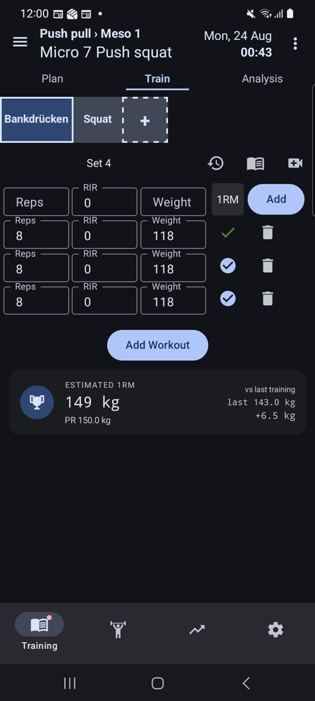

**Vorschlag:** offen = leerer Umriss-Kreis, erledigt = gefüllter grüner Kreis mit Haken.

---

### N5 — Satzzeilen scrollen ohne Hintergrund unter den Titel

**Was:** Beim Scrollen im Editor laufen die Reps/RIR/Weight-Felder sichtbar über die
Überschrift „Micro 6 Push squat" — der Header hat keinen deckenden Hintergrund.

**Screenshots:** [A26](screenshots/gh399/A26-scrolled-to-squat.png) ·
[A27](screenshots/gh399/A27-plan-complete.png)

**Vorschlag:** deckende Hintergrundfarbe für den Header bzw. korrektes Clipping.

---

### N6 — Neu hinzugefügte Satzzeile liegt hinter der unteren Tab-Bar

**Was:** „Add set" am Ende der Liste erzeugt eine Zeile, die von der Bottom-Tab-Bar verdeckt
wird; man muss erst scrollen, um sie auszufüllen.

**Screenshot:** [A25](screenshots/gh399/A25-squat-set2-added.png)

**Vorschlag:** unteres Padding in Höhe der Tab-Bar; automatisch zur neuen Zeile scrollen.

---

### N7 — Tastatur wechselt nach „OK" vom Ziffernblock auf QWERTY

**Was:** Das Reps-Feld öffnet einen Ziffernblock mit OK-Taste. Nach Tippen auf „OK"
erscheint die vollständige QWERTY-Tastatur. Wird das Weight-Feld direkt angetippt, ist es
wieder ein Ziffernblock.

**Warum ein Problem:** **#4 (Consistency and Standards)** — derselbe Feldtyp bekommt je nach
Weg unterschiedliche Tastaturen; die QWERTY-Variante verkleinert die Zifferntasten deutlich.

**Screenshots:** [A17](screenshots/gh399/A17-reps-focused-keyboard.png) (Ziffernblock) →
[A18](screenshots/gh399/A18-after-ok-key.png) (QWERTY nach OK) →
[A20](screenshots/gh399/A20-weight-focused.png) (Ziffernblock bei direktem Tap)

**Vorschlag:** `keyboardType` beim Fokuswechsel per OK beibehalten.

---

### N8 — FAB überlagert Karteninhalt

**Was:** Der „+"-FAB der Plans-Liste liegt über der „Meso 1"-Chip-Zeile der letzten
Plan-Card.

**Screenshots:** [A01](screenshots/gh399/A01-home-scrolled1.png) ·
[A30](screenshots/gh399/A30-back-from-training.png)

**Vorschlag:** unteres Listen-Padding in FAB-Höhe.

---

## 4. Bedienbarkeit **während** des Trainierens

Dieser Abschnitt betrachtet ausschließlich den Zustand „Einheit läuft, ich stehe zwischen
zwei Sätzen an der Hantel" — kurze Blicke, oft nur eine Hand frei, teils verschwitzte Finger.

### 4.1 Einhändigkeit / Reichweite

Das Gerät ist ein 6,7-Zoll-Telefon. Bei einhändiger Nutzung deckt der Daumen grob das untere
Drittel bis knapp über die Bildschirmmitte ab. Gemessene vertikale Lage der Controls, die
**während** des Trainings gebraucht werden (0 % = oben):

| Control | Position | Einhändig erreichbar? |
|---|---|---|
| ⋮ → „Finish Training" | **6 %** | nein — Griffwechsel nötig |
| Tabs Plan / Train / Analysis | **11 %** | nein |
| Übungs-Tabs (Bankdrücken / Squat) | **17 %** | nein |
| Satz-Häkchen ✓ | **27–43 %** | grenzwertig |
| Rest-Timer (nur nach Scrollen) | **57 %** | ja |
| Untere Tab-Bar (Training/Übungen/…) | **89 %** | ja — belegt aber die beste Zone mit Navigation, die man beim Trainieren nie braucht |

**Befund:** Sämtliche trainingsrelevanten Bedienelemente liegen im **oberen 43 %** des
Displays, die am besten erreichbare Zone ist mit globaler Tab-Navigation belegt. Der
Übungswechsel — im Supersatz-Betrieb ständig nötig — sitzt bei 17 % und damit ganz oben.
Das ist die Umkehrung dessen, was der Nutzungskontext verlangt.

**Vorschlag:** Während `state === STARTED` die untere Zone für die Trainingsaktionen nutzen —
Übungswechsel (Vor/Zurück), „Satz abhaken" und „Finish" als unterer Aktionsbereich, statt
die globale Tab-Bar dort zu belassen.

### 4.2 Zwischen den Sätzen

- Der **Rest-Timer** ist das meistgelesene Element und liegt unter der Falz (**M1**); seine
  Beschriftung ist irreführend (**M2**).
- Der **Fortschritt der Einheit** ist während des Trainings gar nicht abrufbar (**M3**) —
  „wie viele Sätze noch?" lässt sich nur durch Abzählen der Zeilen beantworten.
- Ein **Unterbrechen** ist nur implizit über die Home-Taste möglich; das explizite
  „Pause session" ist gesperrt (**M4**). Immerhin: der implizite Weg funktioniert
  verlustfrei (§2.3).
- Verlässt man die App, erinnert **nichts** an die laufende Einheit (**M8**).

### 4.3 Ablesbarkeit

- **Dark Theme, heller Text auf dunklem Grund** — für die Hallensituation die richtige Wahl;
  Kontrast der Werte ist gut.
- Die **eigentlichen Trainingswerte** (Reps / RIR / Weight) stehen in Eingabe-Boxen in
  normaler Textgröße und sind gegenüber den Rahmen und Feldbeschriftungen visuell nicht
  hervorgehoben. Aus Armlänge über einer Hantel ist „8 · 0 · 118" schwerer zu erfassen als
  nötig — die Zahl konkurriert optisch mit ihrem Label.
- Die **Statuserkennung „Satz erledigt / offen" ist invertiert** (**N4**) — beim kurzen Blick
  die problematischste Ablesbarkeitsfrage dieses Screens.
- Die **Ziffern des Rest-Timers** sind kleiner als die 1RM-Anzeige darüber, obwohl sie
  häufiger und flüchtiger gelesen werden.

**Vorschlag:** Im gestarteten Zustand die Satzwerte typografisch aufwerten
(größer/fetter als die Labels) und die Rest-Zeit als größtes Element des Screens setzen.

### 4.4 Nicht bewertbar

Haptisches Feedback (Vibration beim Abhaken) und exakte Antwortzeiten wurden **nicht**
gemessen: die Interaktion lief über `adb`-Injektion, und der Debug-Build mit Metro-Bundling
verfälscht Reaktionszeiten. Subjektiv gab es beim Abhaken keine spürbare Verzögerung.
Für eine belastbare Aussage zu Haptik und Latenz braucht es einen Release-Build und
Bedienung von Hand.

---

## 5. Abgleich mit dem Audit aus PR #338

Bezug: `docs/ux/create-training-plan-audit.md` (Branch `feature/UX-PLAN-001`, Flow „Neuen
Trainingsplan erstellen"). Die Datei existiert auf `master` noch nicht — PR #338 ist offen.

Der dortige Flow endet, wo dieser beginnt: #338 auditiert das **Anlegen eines Plans**,
GH-399 das **Befüllen eines Trainings und dessen Durchführung**. Überlappung gibt es nur im
Editor.

| #338 | Status in diesem Audit | Beleg |
|---|---|---|
| **H1** Done-Button bei leerem Plan-Namen nicht gesperrt | **nicht nachgeprüft** — dieser Audit legt keinen neuen Plan an | — |
| **H2** Back aus PlanSuggestion öffnet System-File-Picker | **erledigt / nicht reproduzierbar.** Back führte in jedem Versuch korrekt zur Plans-Liste. Zusätzlich per `dumpsys` verifiziert: 0 `PickActivity`-Instanzen. Der Effekt war mit hoher Wahrscheinlichkeit ein Werkzeug-Artefakt (gestapelte SAF-Picker-Activities aus vorangegangenen Import-Läufen, die Taps schluckten), kein App-Verhalten. | [A30](screenshots/gh399/A30-back-from-training.png) |
| **H3** Back speichert still ohne Feedback | **teilweise erledigt.** Es gibt jetzt einen expliziten „Done"-Button statt stillem Auto-Save beim Back. Das fehlende Bestätigungs-Feedback besteht aber unverändert → **M6**. | [A05](screenshots/gh399/A05-plan-new-training.png), [A28](screenshots/gh399/A28-after-done.png) |
| **M1** PlanSuggestion mit allen 3 Buttons deaktiviert | **kontextabhängig, nicht mehr allgemein gültig.** Bei einem Plan mit Historie sind 2 von 3 Vorschlägen aktiv und funktionieren („Suggest based on last planned Training" hat das Training korrekt befüllt). Für einen **frisch angelegten** Plan nicht erneut geprüft. | [A04](screenshots/gh399/A04-plan-open-retry.png), [B04](screenshots/gh399/B04-suggest-applied.png) |
| **M2** Picker-Trigger ohne Affordance; nur linke Hälfte tippbar | **teilweise erledigt.** Die rechte Hälfte der Row reagiert jetzt — der Tap bei 88 % Breite hat die Liste geöffnet. Der Kern bleibt: zwei Stufen, keine Button-Affordance → **M7**. | [A07](screenshots/gh399/A07-picker-row-right-tap.png) |
| **M3** Picker-Modal schließt bei Tap daneben, Auswahl verloren | **hinfällig.** Der Picker ist kein Overlay-Modal mehr, sondern eine inline aufklappende Liste; ein versehentliches Verwerfen der Auswahl ist nicht mehr möglich, ausgewählte Übungen erscheinen sofort als Tabs. | [A07](screenshots/gh399/A07-picker-row-right-tap.png), [A14](screenshots/gh399/A14-second-exercise-selected.png) |
| **M4** FAB erst nach Scrollen sichtbar | **erledigt.** Der FAB ist fixiert und sowohl am Listenanfang als auch heruntergescrollt sichtbar. Neu ist lediglich, dass er Karteninhalt überlagert → **N8**. | [A00](screenshots/gh399/A00-entry.png), [A01](screenshots/gh399/A01-home-scrolled1.png) |
| **M5** Plan-Struktur im Hamburger versteckt | **unverändert, aber nicht vertieft.** Das ≡-Menü ist weiterhin der einzige sichtbare Zugang zur Meso-/Training-Struktur; in den beiden auditierten Flows tauchte keine Alternative auf. Der Drawer selbst wurde diesmal nicht geöffnet. | [A04](screenshots/gh399/A04-plan-open-retry.png) |
| **N1** Copy-Fehler im Delete-Dialog | **nicht nachgeprüft** — kein Plan gelöscht | — |
| **N2** Drag-Handles ohne Affordance | **nicht nachgeprüft.** Die ≡-Handles sind unverändert vorhanden; Drag wurde nicht getestet (per `adb` nicht sinnvoll bewertbar). | [A16](screenshots/gh399/A16-add-set-1.png) |
| **N3** Doppelte „Plan"-Beschriftung (Header-Button vs. Tab) | **bestätigt, unverändert.** Header-Button „Plan" und Tab „Plan" existieren weiterhin nebeneinander. | [A29](screenshots/gh399/A29-saved-training-top.png), [B04](screenshots/gh399/B04-suggest-applied.png) |
| **N4** Kein Tastatur-Dismiss beim Set-Editing | **erledigt.** Das Reps-Feld öffnet einen Ziffernblock mit expliziter OK-Taste. Neu ist der Tastatur-Wechsel danach → **N7**. | [A17](screenshots/gh399/A17-reps-focused-keyboard.png) |

**Bilanz:** Von 11 #338-Findings sind **3 erledigt** (H2, M4, N4), **1 hinfällig** (M3),
**3 teilweise erledigt** (H3, M1, M2), **2 bestätigt** (M5, N3) und **3 außerhalb des
Scopes dieses Audits** (H1, N1, N2).

**Neu in diesem Audit** — überwiegend aus der Trainings-Durchführung, die #338 nicht
betrachtet hat: H1, H2, H3, H4, M1, M2, M3, M4, M5, M6, M8, N1, N2, N4, N6, N7 sowie der
gesamte Abschnitt §4 zur Bedienbarkeit während des Trainings.

---

## 6. Priorisierte Ticket-Vorschläge

Ein Problem = ein Vorschlag.

| # | Prio | Finding | Vorgeschlagenes Ticket |
|---|---|---|---|
| 1 | 🔴 HIGH | H1 | **„Start Training" auf der Next-Training-Card startet das Training wirklich (und beschriftet sich zustandsabhängig)** |
| 2 | 🔴 HIGH | H2 | **Train-Tab-Leerzustand bekommt einen „Start Training"-Button** |
| 3 | 🔴 HIGH | H3 | **Übungs-Picker: Liste bleibt nach der ersten Auswahl befüllt** |
| 4 | 🔴 HIGH | H4 | **Laufendes Training auf der Startseite als „läuft / Continue" statt „Next Training" anzeigen** |
| 5 | 🟠 MEDIUM | M1 | **Rest-Timer im Train-Tab sticky und ohne Scrollen sichtbar machen** |
| 6 | 🟠 MEDIUM | M2 | **Rest-Timer: „elapsed" korrekt als „remaining/over" beschriften** |
| 7 | 🟠 MEDIUM | M3 | **Live-Fortschritt im Analysis-Tab während des laufenden Trainings** |
| 8 | 🟠 MEDIUM | M4 | **„Pause session" aktivieren oder begründet ausblenden** |
| 9 | 🟠 MEDIUM | M5 | **Neuer Satz übernimmt die Werte des vorherigen Satzes** |
| 10 | 🟠 MEDIUM | M6 | **Speicher-Feedback und Scroll-Reset nach „Done"** |
| 11 | 🟠 MEDIUM | M7 | **Übungs-Picker: „+" öffnet die Liste direkt (Zwischenstufe entfernen)** |
| 12 | 🟠 MEDIUM | M8 | **Ongoing Notification für laufende Trainings** |
| 13 | 🟠 MEDIUM | §4.1 | **Trainingsaktionen in die einhändig erreichbare untere Bildschirmzone verlegen** |
| 14 | 🟡 LOW | N4 | **Satz-Häkchen: Zustands-Semantik umdrehen (offen = Umriss, erledigt = gefüllt)** |
| 15 | 🟡 LOW | N1 | **Zahlenformatierung im Analysis-Tab (ganzzahlige Sets/Reps, Einheit beim Volumen)** |
| 16 | 🟡 LOW | N3 | **Eingabezeile „Set N" in „Satz hinzufügen" umbenennen** |
| 17 | 🟡 LOW | N7 | **Tastaturtyp beim Fokuswechsel per OK beibehalten** |
| 18 | 🟡 LOW | N5 | **Deckender Header-Hintergrund im Trainings-Editor** |
| 19 | 🟡 LOW | N6 | **Unteres Padding, damit neue Satzzeilen nicht hinter der Tab-Bar liegen** |
| 20 | 🟡 LOW | N2 | **1RM-Records runden (keine zwei Nachkommastellen)** |
| 21 | 🟡 LOW | N8 | **FAB überlagert die letzte Plan-Card — Listen-Padding ergänzen** |
| 22 | 🟡 LOW | §4.3 | **Satzwerte gegenüber ihren Labels typografisch hervorheben** |

---

## 7. Methodik und Einschränkungen

- **Experten-Audit**, kein Nutzertest. Die Findings sind heuristisch begründet
  (Nielsen), nicht durch Probanden belegt.
- Bedienung erfolgte über `adb`-Eingabeinjektion auf Koordinaten, die aus den Screenshots
  abgelesen wurden — also auf sichtbare Ziele, wie ein Nutzer sie trifft.
  `uiautomator dump` funktioniert auf diesem Gerät nicht (liefert weder Datei noch Fehler),
  deshalb konnten **Touch-Target-Größen nicht ausgemessen** werden; die Angaben in §4.1
  beziehen sich auf die sichtbare Lage der Elemente.
- **Haptik und Reaktionszeiten** sind im Debug-Build mit Metro nicht belastbar messbar
  (§4.4).
- Beim ersten Öffnen eines Plans erschien einmalig ein **Dev-Red-Screen**
  („Element type is invalid" in `TrainingsPlanNode`,
  [A02](screenshots/gh399/A02-plan-opened.png)). Nach einem Kaltstart der App war der
  Zustand **nicht reproduzierbar**
  ([A04](screenshots/gh399/A04-plan-open-retry.png)); der Metro-Dev-Server lief zu dem
  Zeitpunkt seit Stunden mit `lazy=true`-Bundling. Das ist deshalb **als Werkzeug-Artefakt
  eingestuft und ausdrücklich kein Finding** — sollte es im Release-Build auftreten, wäre es
  separat zu untersuchen.
- Der Audit verändert keine App-Daten dauerhaft über das hinaus, was ein normaler Nutzer
  täte: es wurden ein Training geplant und eine Einheit absolviert. Der App-Code ist
  unverändert.

---

## Anhang A — Interaktionsprotokoll Flow A

Gerät: R5CN30HWZFN (SM-G986B, Android 13, 720x1600 dp-override), Baseline-Daten importiert.
Ziel: von Training-Tab bis gespeichertes Training mit 2 Übungen / 5 Sätzen.

| # | Interaktion | Typ | Resultat | Screenshot |
|---|---|---|---|---|
| 1 | Scroll Training-Home nach unten | Geste | Plans-Liste + FAB sichtbar | A01 |
| 2 | Tap Plan-Card "Push pull" | Tap | Plan-Detail, Tab "Plan" (PlanSuggestion) | A04 |
| 3 | Tap "Plan new Training" | Tap | EDITING PLAN, leerer Zustand + "+"-Kachel | A05 |
| 4 | Tap "+"-Kachel | Tap | Label-Row "Select Exercises for your Training / 0 selected" | A06 |
| 5 | Tap Label-Row (rechte Hälfte) | Tap | Übungsliste + Suchfeld klappt auf | A07 |
| 6 | Tap "Bankdrücken" | Tap | Übung als Tab übernommen — **Liste wird leer** | A08/A09 |
| 7 | Tap Suchfeld + "squat" tippen | Tap+Text | **0 Treffer** trotz vorhandener Übungen | A10 |
| 8 | Tap "-"-Kachel (einklappen) | Tap | Picker zu | A11 |
| 9 | Tap "+"-Kachel (aufklappen) | Tap | Row "1 selected", Übungskarte sichtbar | A12 |
| 10 | Tap Label-Row | Tap | Liste da, "squat" liefert **7 Treffer** | A13 |
| 11 | Tap "Squat" | Tap | 2. Übung übernommen | A14 |
| 12 | Tap "-"-Kachel | Tap | Beide Übungskarten, je "0 sets" | A15 |
| 13 | Tap "Add set" (Bankdrücken) | Tap | Satzzeile 1: Reps / RIR 0 / Weight / 1RM / Löschen | A16 |
| 14 | Tap Reps-Feld | Tap | Numerisches Keypad mit OK-Taste | A17 |
| 15 | "8" tippen | Text | Reps=8 | — |
| 16 | Tap "OK" | Tap | Weight **auto-befüllt 118**, Keyboard wechselt auf QWERTY | A18 |
| 17 | Keyboard schließen | Back | Satz 1 = 8 / 0 / 118 | A19 |
| 18 | Tap "Add set" | Tap | Satzzeile 2 **leer** (kein Übernehmen von Satz 1) | A21 |
| 19-21 | Reps tippen, "8", Keyboard zu | Tap+Text+Back | Satz 2 = 8 / 0 / 118 | A22 |
| 22-25 | "Add set", Reps, "8", Keyboard zu | 4 Interaktionen | Satz 3 = 8 / 0 / 118 | A23 |
| 26-29 | "Add set" (Squat), Reps, "5", Keyboard zu | 4 Interaktionen | Squat Satz 1 = 5 / 0 / 193 | A24 |
| 30 | Tap "Add set" (Squat) | Tap | Satzzeile 2 **hinter Tab-Bar verdeckt** | A25 |
| 31 | Scroll nach unten | Geste | Satzzeile 2 erreichbar; Satzfelder **überlappen den Titel** | A26 |
| 32-34 | Reps, "5", Keyboard zu | 3 Interaktionen | Squat Satz 2 = 5 / 0 / 193 | A27 |
| 35 | Tap "Done" | Tap | Read-View, **kein Bestätigungs-Feedback**, Scroll-Offset bleibt stehen | A28 |
| 36 | Scroll nach oben | Geste | Gespeichertes Training vollständig sichtbar | A29 |

## Metriken Flow A
- **Interaktionen bis gespeichertes Training (2 Übungen, 5 Sätze): 36**
- davon **3 reine Fehler-Recovery** (Schritte 8-10, Picker-Leerlauf) → ohne Bug: **33**
- **Interaktionen pro geplantem Satz: 4** (Add set → Reps-Feld → Ziffer → Keyboard schließen); Weight wird automatisch vorgeschlagen
- **Minimalpfad 1 Übung / 1 Satz: 12 Interaktionen**
- Distinkte Screens/Zustände: **8** (Training-Home, Plan-Detail/PlanSuggestion, EDITING-Leerzustand, Picker-Row, Picker-Liste, Editor mit Sätzen, Keyboard-Zustand, Read-View)
- Sackgassen: **1** (leerer Picker nach 1. Auswahl — nur durch Ein-/Ausklappen lösbar)
- Fehlende Abbrechen-Wege: **1** (im EDITING-PLAN-Modus gibt es nur "Done", kein "Abbrechen"/"Verwerfen")

## Anhang B — Interaktionsprotokoll Flow B

Gerät: R5CN30HWZFN (SM-G986B, Android 13). Ausgangspunkt: Training-Home mit Baseline-Daten.

| # | Interaktion | Resultat | Screenshot |
|---|---|---|---|
| 1 | Tap "Start Training" (Next-Training-Card, M7·D1, 0 exercises) | **Kein Training gestartet** — Navigation auf Tab "Plan" | B02 |
| 2 | Tap Tab "Train" | "Start training to begin" — **kein Start-Control auf dem Screen** | B03 |
| 3 | Tap Tab "Plan" | zurück zu PlanSuggestion | — |
| 4 | Tap "Suggest based on last planned Training" | Training befüllt (Bankdrücken 3×8@118, Squat 2×5@193), ⋮ erscheint | B04 |
| 5 | Tap ⋮ | Menü: Edit plan / **Start Training** / Delete this training | B05 |
| 6 | Tap "Start Training" | Toast "Training started!", Tab "Train", Timer läuft | B06/B07 |
| 7 | Tap ✓ Satz 1 (Bankdrücken) | Satz protokolliert (blauer Kreis → grüner Haken) | B08 |
| 8 | Tap ✓ Satz 2 | protokolliert | B09 |
| 9 | Tap ✓ Satz 3 | protokolliert | B10 |
| 10 | Tap Tab "Analysis" | "Analysis available after the training is finished" — **Sackgasse während des Trainings** | B11 |
| 11 | Tap Tab "Train" | zurück | — |
| 12 | Tap Übungs-Tab "Squat" | Squat-Sätze, NEW-PR-Badge, Rest-Card **unten angeschnitten** | B12 |
| 13 | Scroll nach unten | Rest-Timer sichtbar: "00:11 · target 01:30 · elapsed **-00:11**" | B13 |
| 14 | Tap ✓ Squat Satz 1 | protokolliert, Toast "New Record! … 225.17" | B16 |
| — | **Unterbrechen:** Home-Taste, ~30 s im Hintergrund | Notification "Pause done! Time to start the next set!"; **keine laufende Trainings-Notification** | B17/B18 |
| — | **Fortsetzen:** App über Launcher öffnen | **Zustand exakt erhalten**: Timer 05:40, Haken, Rest-Timer, Scroll-Position | B19 |
| 15 | Tap ✓ Squat Satz 2 | protokolliert | B20 |
| — | **Härtetest:** `am force-stop` + Neustart (Prozess-Tod) | Daten erhalten (5 Sätze), **aber Rückwurf auf Training-Home**; laufendes Training wird dort als "**Next Training**" mit "Start Training" angezeigt | B21/B22 |
| 16 | Tap "Start Training" (auf dem laufenden Training) | **kein Datenverlust**, navigiert in die laufende Einheit (Timer 07:10) | B23 |
| 17 | Tap ⋮ | Finish Training / **Pause session (deaktiviert)** / Edit training / Delete | B24 |
| 18 | Tap "Finish Training" | Analysis-Tab: Duration 00:07:49, Volume 4762.00, Sets 5.00, Muscle Overview | B25 |
| — | Timer nach Finish | korrekt eingefroren bei 07:49 | B26 |
| 19 | Back | Home: Tag abgehakt, "Last Training: Push squat · today", neuer Squat-Record | B27 |

## Metriken Flow B
- **Interaktionen bis Training tatsächlich gestartet: 6** (davon **3 verlorene** durch den irreführenden "Start Training"-Button + Train-Sackgasse); auf dem kürzesten bekannten Weg: **3** (Card → ⋮ → Start Training)
- **Interaktionen pro geplantem Satz beim Trainieren: 1** (Tap auf ✓) — der schnellste Teil der App
- Interaktionen pro **ungeplantem** Satz: **5-7** (Reps, RIR, Weight tippen + "Add")
- Interaktionen Start → Finish für 5 Sätze / 2 Übungen: **13**
- Distinkte Screens/Zustände: **9**
- **Sackgassen: 3** — (a) "Start training to begin" ohne Start-Control, (b) Analysis-Tab während des Trainings, (c) Home nach Prozess-Tod ohne Resume-Hinweis
- **Fehlende Abbrechen/Zurück-Wege: 2** — "Pause session" deaktiviert; kein "Training abbrechen/verwerfen" (nur "Delete")
