# UX-Audit: Flow „Neuen Trainingsplan erstellen"

**Ticket:** UX-PLAN-001  
**Datum:** 2026-06-22  
**Gerät:** Samsung SM-A505F, Android (serial R5CN30HWZFN), 720×1600 px  
**Scope:** Kompletter Flow „Neuen Trainingsplan erstellen" — von der Plan-Liste bis zum gespeicherten Plan mit Übungen/Sets. Rein diagnostisch, kein App-Code geändert.

---

## 1. Flow-Überblick & Objective Metrics

### 1.1 Screens/Zustände (end-to-end)

| # | Screen / Zustand | Screenshot |
|---|---|---|
| 1 | Training-Tab — Plan-Liste | 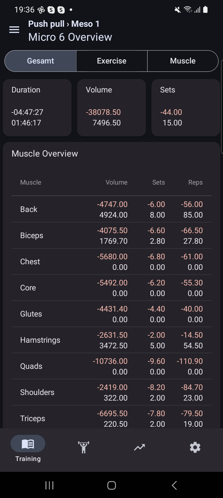 |
| 2 | FAB unter den Plan-Cards (erst nach Scrollen sichtbar) | 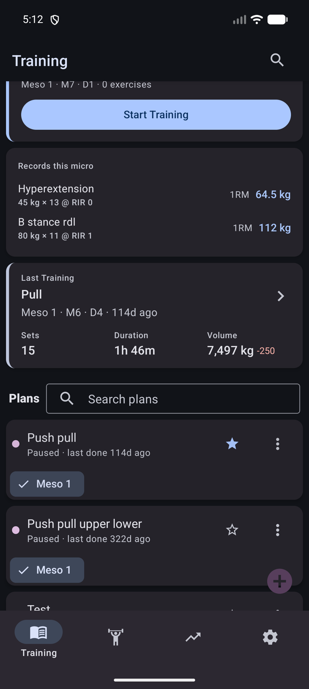 |
| 3 | „Neuer Plan"-Dialog (Name-Eingabe + Done) | 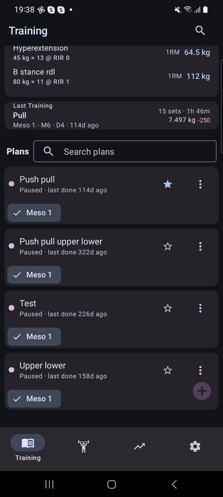 |
| 4 | Done-Button bei leerem Namen (kein Sperren) | 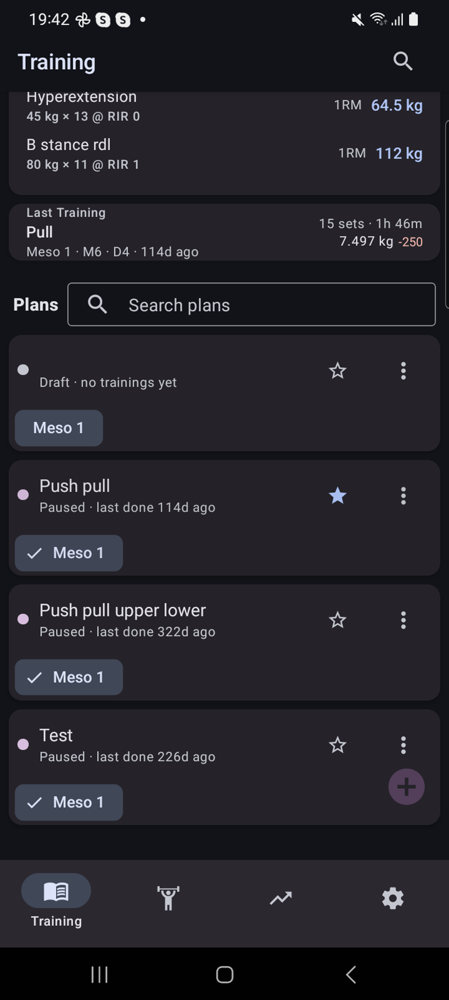 |
| 5 | Plan in der Liste — „Draft · planned, not started" | 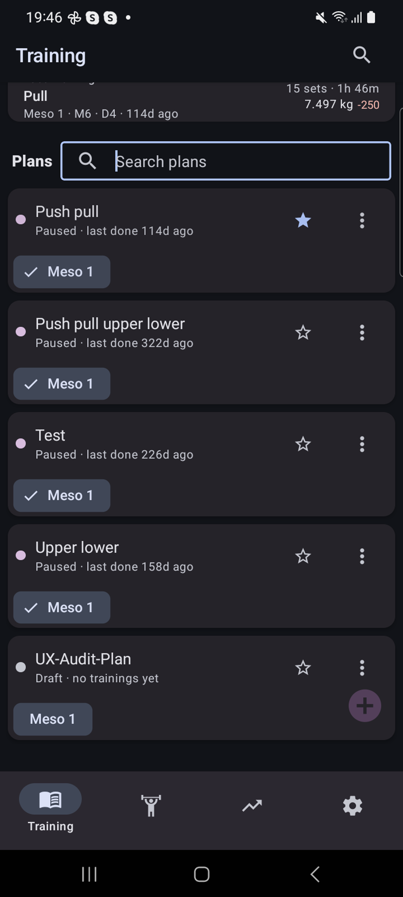 |
| 6 | Plan-Detail → PlanSuggestion (alle 3 Buttons grayed out) |  |
| 7 | Hamburger-Drawer — Meso-/Training-Struktur | 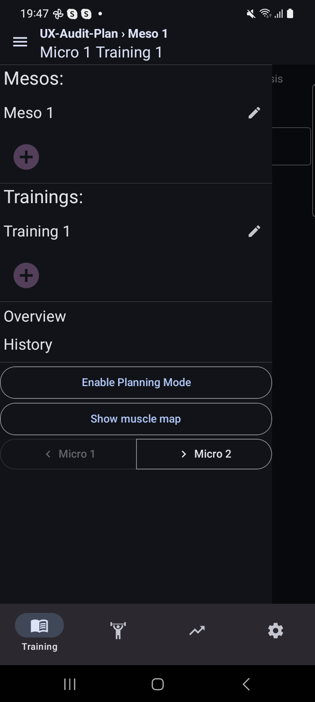 |
| 8 | PlanSuggestion mit „Plan new Training"-Button | 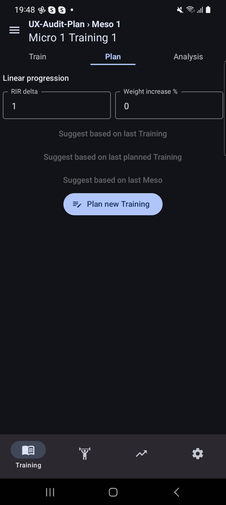 |
| 9 | fullEdit: Exercise-Picker kollabiert (Label-Row) | 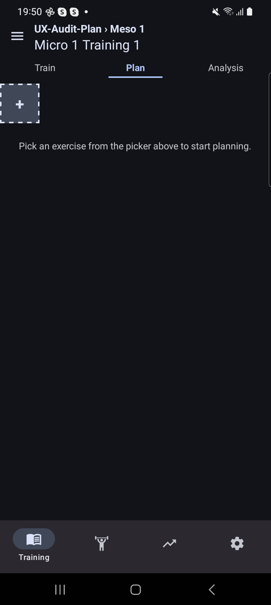 |
| 10 | Exercise-Picker-Modal offen (Such-Input + Liste) |  |
| 11 | Übung ausgewählt — Tab-Leiste mit „Adductor" + „+" | 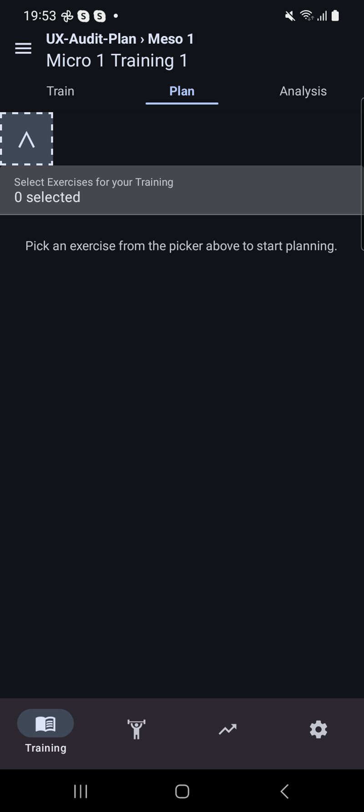 |
| 12 | Set hinzugefügt — Reps/RIR/Weight-Felder | 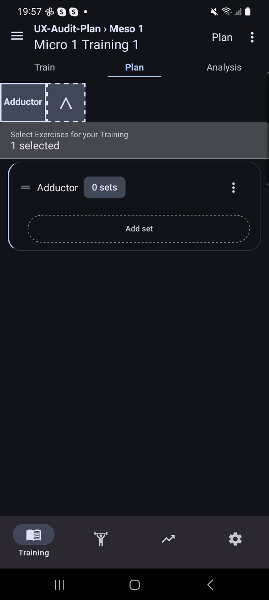 |
| 13 | Set-Karte mit Drag-Handle (≡) | 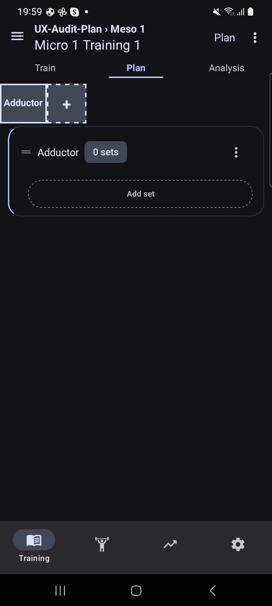 |
| 14 | Set-Werte + Tastatur (Eingabe-Modus) | 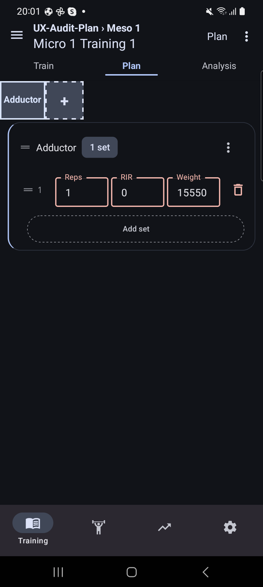 |
| 15 | Overflow-Menü (⋮): „Edit plan" / „Discard this training" | 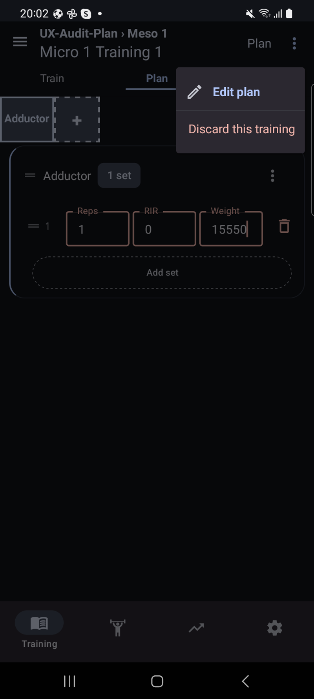 |
| 16 | Nach Back → Plan-Liste (Auto-Save, kein Feedback) | 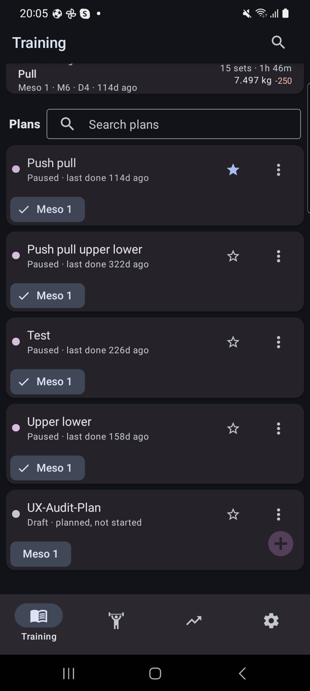 |
| 17 | Plan erneut geöffnet — Read-View mit gespeicherten Daten | 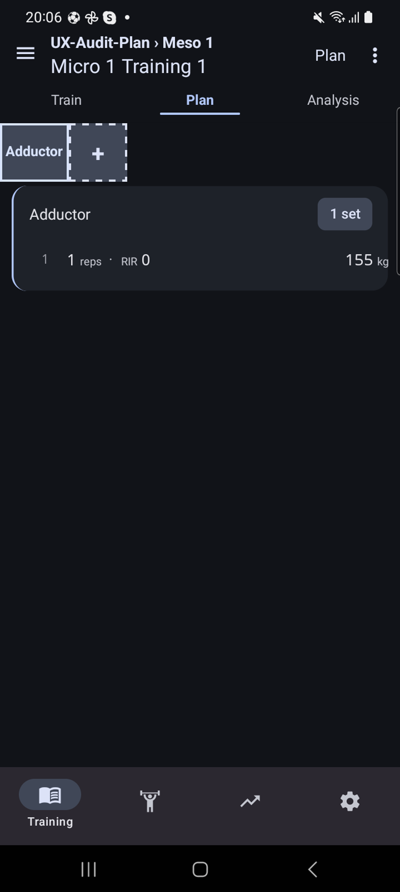 |

### 1.2 Objektive Metriken

| Metrik | Wert |
|---|---|
| Anzahl Screens/Zustände | **17** distinct states |
| Minimale Taps bis Plan mit 1 Übung, 1 Set erstellt | **≈ 22–26 Interaktionen** (Taps + Texteingaben + Gesten) |
| Sackgassen (Dead Ends) | **3** (siehe §2.1, §2.2, §2.3) |
| Fehlende Abbrechen/Zurück-Wege | **2** (kein Cancel im Dialog; kein explizites Discard beim Back) |
| Navigation-Bugs | **1** (Back aus PlanSuggestion öffnet System-File-Picker) |
| Copy-Fehler | **1** (Delete-Dialog) |

**Tap-Zählung im Detail (Happy Path mit Baseline-Daten):**

1. Training-Tab öffnen (1)
2. Zur FAB nach unten scrollen (1 Scroll-Geste)
3. FAB tippen → Dialog öffnet (1)
4. Plan-Name eingeben (mind. 3–5 Tasten + Keyboard-Dismiss)
5. „Done" tippen → Plan erstellt (1)
6. Automatische Navigation in Plan-Detail (0)
7. „Plan new Training" tippen → fullEdit (1)
8. Picker-Label-Row antippen (links) → Modal öffnet (1)
9. Übung suchen/scrollen (2–4 Taps)
10. Übung auswählen (1)
11. Picker schließen (1)
12. „Add set" tippen (1)
13. Reps-Feld tippen + Wert eingeben (1 + 2 Tasten)
14. RIR-Feld tippen + Wert (1 + 1 Taste)
15. Weight-Feld tippen + Wert (1 + 2–3 Tasten)
16. Tastatur dismisssen (1)
17. Back → Auto-Save (1)

---

## 2. UX-Findings

Priorisierung: **H** = Hoch, **M** = Mittel, **N** = Niedrig

---

### H1 — Kein Sperren des „Done"-Buttons bei leerem Plan-Namen

**Was:** Der „Done"-Button im „Add Training Plan"-Dialog ist aktiv und klickbar, auch wenn das Namensfeld leer ist. Ein Tap erstellt einen Plan ohne Namen.

**Warum ein Problem:** Verletzt Nielsen-Heuristik **#5 (Error Prevention)** — der Fehler (unbenannter Plan) kann gar nicht erst entstehen, wenn der Button gesperrt ist. Unbenannte Pläne tauchen in der Liste auf und sind schwer zu identifizieren/löschen.

**Screenshot:** `22-done-empty-name.png`

**Vorschlag:** Done-Button deaktivieren solange `name.trim().length === 0`; optional Helper-Text „Name required" im leeren Feld.

---

### H2 — Back-Taste aus der PlanSuggestion-Ansicht öffnet System-File-Picker

**Was:** Drückt der Nutzer im PlanSuggestion-Screen (der nach Plan-Erstellung erscheint) die Android-Back-Taste, öffnet sich der System-Datei-Auswahl-Dialog statt zur Plan-Liste zurückzunavigieren.

**Warum ein Problem:** Verletzt **#4 (Consistency and Standards)** und **#3 (User Control and Freedom)**. Back soll immer zum vorherigen Screen führen. Das unerwartete Öffnen eines Betriebssystem-Dialogs weckt den Eindruck, die App sei abgestürzt oder verhalte sich falsch. Nutzer ohne Technikkenntnisse werden hier verloren.

**Vorschlag:** Back-Taste-Handler in PlanSuggestion/TrainingBase korrekt verdrahten, sodass er zur Trainingsplan-Liste navigiert.

---

### H3 — Back aus dem Plan-Editierungsmodus speichert still ohne Feedback

**Was:** Im fullEdit-Modus (Übungen/Sets bearbeiten) speichert die Back-Taste die Änderungen sofort und navigiert zur Plan-Liste — ohne Bestätigungsdialog, ohne Toast/Snackbar, ohne visuelles „Gespeichert"-Feedback.

**Warum ein Problem:** Verletzt **#1 (Visibility of System Status)** und **#5 (Error Prevention)**. Nutzer wissen nicht ob ihre Daten gespeichert wurden. Versehentlich falsche Werte (z. B. Weight=155 kg bei Adductor) werden kommentarlos persistiert. Der einzige Weg, Änderungen zu verwerfen, ist das schwer auffindbare „Discard this training" im ⋮-Menü.

**Screenshots:** `50-overflow-menu.png`, `55-ux-audit-plan-inside.png`

**Vorschlag:**  
- Option A: Bestätigungsdialog beim Back mit „Speichern" / „Änderungen verwerfen".  
- Option B: Auto-Save beibehalten, aber sichtbares „Gespeichert"-Feedback (Snackbar/Toast) einbauen und „Änderungen verwerfen" an prominenterer Stelle anbieten (z. B. Header-Button statt ⋮-Menü).

---

### M1 — Nach Plan-Erstellung landet Nutzer auf PlanSuggestion mit allen Buttons deaktiviert

**Was:** Unmittelbar nach dem Erstellen eines neuen Plans erscheint der PlanSuggestion-Screen mit drei Buttons: „Suggest based on last Training", „Suggest based on last planned Training", „Suggest based on last Meso" — alle drei sind grayed out/deaktiviert, weil noch keine Trainingsdaten existieren. Der einzige aktive Button „Plan new Training" ist visuell nicht prominent.

**Warum ein Problem:** Verletzt **#1 (Visibility of System Status)** und **#6 (Recognition rather than Recall)**. Drei nicht-klickbare Buttons vermitteln: „Diese Funktion ist kaputt" oder „Du kannst hier nichts tun". Kein erklärender Text warum die Buttons inaktiv sind. GH-240 hat einen Auto-Route eingebaut (`onEnterPlanMode()`), der feuert wenn ALLE drei Suggestions undefined sind — aber für neue Pläne triggert das scheinbar nicht konsistent.

**Screenshot:** `30-new-plan-detail.png`, `33-plan-new-training.png`

**Vorschlag:** Auf dem PlanSuggestion-Screen einen leeren Hinweis-Text einblenden wenn keine Suggestions verfügbar sind, z. B.: „Noch keine Trainingsdaten vorhanden. Erstelle deinen Plan manuell." + prominent platzierten „Plan new Training"-Button. Alternativ: Auto-Route für neue Pläne zuverlässig auslösen.

---

### M2 — Exercise-Picker-Trigger nicht erkennbar (fehlende Affordance)

**Was:** Der Exercise-Picker im fullEdit-Modus erscheint als Label-Row mit dem Text „Select Exercises for your Training" und einem Chevron-Icon-Button rechts. Das Antippen der gesamten Row (insbesondere der rechten Hälfte) tut nichts — nur das Antippen des linken Bereichs öffnet das Picker-Modal. Der Chevron-Button klappt den Picker aus/ein, öffnet aber nicht das Selection-Modal.

**Warum ein Problem:** Verletzt **#6 (Recognition rather than Recall)** und **Affordance-Prinzipien**. Eine Zeile mit Text und einem Pfeil-Icon sieht nicht wie ein anklickbarer Button aus. Kein Ripple-Effekt auf der Row. Nutzer tippen auf die Mitte oder rechts und es passiert nichts → Frustration. Bestätigt durch Issue #324: „die Auswahl des exercise pickers schließt oft nicht".

**Screenshots:** `35-exercise-picker-expanded.png`, `36-exercise-picker-open.png`

**Vorschlag:** Den Picker-Trigger als erkennbaren Button/Chip gestalten (Outlined-Button oder Paper's `Button` mit `icon="dumbbell"`). Alternativ: Gesamte Row als Touchable Area mit Ripple registrieren.

---

### M3 — Exercise-Picker-Modal wird unbeabsichtigt geschlossen

**Was:** Das Exercise-Picker-Modal (`sharingan-rn-modal-dropdown` / `MultiselectDropdown`) kann durch Tippen außerhalb des Modal-Bereichs geschlossen werden — dabei gehen alle Auswahlen verloren.

**Warum ein Problem:** Verletzt **#3 (User Control and Freedom)** und **#5 (Error Prevention)**. Bei einer langen Übungs-Liste, in der der Nutzer bereits mehrere Items markiert hat, führt ein Fehltippen neben den Modal zum kompletten Verlust der Auswahl. Explizit genannt in Issue #324.

**Screenshot:** `36-exercise-picker-open.png`

**Vorschlag:** `dismissable` / `backdropDismiss` Property des verwendeten Modal-Dropdowns deaktivieren; stattdessen expliziten „Done" / ✕-Button im Modal-Header nutzen.

---

### M4 — FAB-Button erst nach Scrollen sichtbar

**Was:** Der „+" FAB-Button zum Erstellen eines neuen Plans ist nicht fixed positioniert, sondern befindet sich unterhalb der Plan-Card-Liste. Auf Geräten mit mehreren Plänen ist er ohne Scrollen nicht sichtbar.

**Warum ein Problem:** Verletzt **#6 (Recognition rather than Recall)**. Material-Design-Konvention: FABs sollen persistent sichtbar sein. Der erste Nutzer-Instinkt, einen neuen Plan anzulegen, scheitert an der fehlenden Sichtbarkeit.

**Screenshots:** `08-training-home.png`, `05-training-home-bottom.png`

**Vorschlag:** FAB als `position: 'absolute'` / fixed über dem Scroll-Content platzieren (Standard-Pattern in React Native Paper für FABs in Listen).

---

### M5 — Plan-Struktur (Mesos/Trainings) versteckt im Hamburger-Drawer

**Was:** Die interne Plan-Struktur (Meso 1, Training 1 etc.) ist ausschließlich über den Hamburger-Button (≡) oben links zugänglich. Im Haupt-Screen ist kein Hinweis sichtbar, dass weitere Mesos oder Trainings existieren oder erstellt werden können.

**Warum ein Problem:** Verletzt **#6 (Recognition rather than Recall)**. Neue Nutzer wissen nicht, dass es eine Meso-/Training-Struktur gibt, geschweige denn wie man sie verwaltet. Das Breadcrumb „Meso 1 › Training 1" im Header ist nicht als klickbar erkennbar.

**Screenshot:** `31-hamburger-menu.png`

**Vorschlag:** Hamburger-Inhalt (Meso-/Training-Auswahl) alternativ als Side-Panel oder Segmented Control in der Plan-Detailansicht exponieren; oder zumindest einen expliziten „+ Add Meso" / „+ Add Training" Button in der sichtbaren UI.

---

### N1 — Copy-Fehler im Delete-Dialog: „the training" statt „training plan"

**Was:** Der Bestätigungsdialog beim Löschen eines Plans sagt „Are you sure you want to delete the training?" anstatt „... delete the training plan?".

**Warum ein Problem:** Verletzt **#4 (Consistency and Standards)**. Kleiner, aber sichtbarer Copy-Fehler, der Nutzern Unsicherheit gibt, was genau gelöscht wird (der Plan oder ein einzelnes Training innerhalb des Plans?).

**Screenshot:** `23-unnamed-plan-menu.png`

**Vorschlag:** String im Dialog-Component auf „training plan" korrigieren.

---

### N2 — Drag-Handles (≡) auf Sets haben keine erkennbare Affordance

**Was:** Set-Karten zeigen links ein „≡"-Icon als Drag-Handle zum Umsortieren. Es gibt keinen visuellen Hinweis darauf, dass dieses Icon interaktiv ist (kein Ripple, keine Hervorhebung). Issue #324 bestätigt: „verschieben Sets/exercises funktioniert nicht über zwei Striche Markierung".

**Screenshot:** `47-add-set-result.png`

**Vorschlag:** Drag-Handle visuell hervorheben (Icon-Farbe, Long-Press-Animation, oder initiales Tutorial-Tooltip). Sicherstellen, dass der Drag-Mechanismus auf dem Touch-Target korrekt reagiert.

---

### N3 — Doppelte „Plan"-Beschriftung (Header-Button vs. Tab-Leiste)

**Was:** Im Plan-Detail-Screen gibt es sowohl einen „Plan"-Button im Action-Header (oben rechts) als auch eine „Plan"-Tab in der Inhalt-Tab-Leiste (Train | Plan | Analysis). Beide heißen „Plan", haben aber unterschiedliche Funktionen.

**Screenshots:** `30-new-plan-detail.png`, `55-ux-audit-plan-inside.png`

**Vorschlag:** Header-Button umbenennen, z. B. zu „Edit" (Stift-Icon) oder „Bearbeiten" wenn der App-Kontext deutsch ist; oder durch ein Icon-Only ersetzen.

---

### N4 — Kein Tastatur-Dismiss-Affordance beim Set-Editing

**Was:** Beim Tippen in Reps/RIR/Weight-Felder erscheint die Software-Tastatur, aber es gibt keine „Done"-Taste auf der Tastatur und keinen sichtbaren Button zum Schließen. Nutzer müssen außerhalb der Felder antippen — was versehentlich andere UI-Elemente treffen kann.

**Screenshot:** `49-set-filled.png`

**Vorschlag:** `returnKeyType="done"` auf den Text-Inputs setzen; alternativ `KeyboardAvoidingView` mit Scroll-to-dismiss konfigurieren.

---

## 3. Abgleich mit GitHub Issue #324 „Plan training"

Issue #324 listet vier Probleme:

| #324-Punkt | Status im Audit |
|---|---|
| „1RM suggestion button soll immer angezeigt werden" | Nicht direkt beobachtet (Scope: Plan-Erstellung, nicht Workout-Logging). Liegt außerhalb dieses Audits. |
| „Add exercise auch wenn nichts an weight/reps eingetragen wurde" | **Bestätigt — zusätzlicher Kontext:** Übungen können ohne Reps/Weight hinzugefügt werden (kein Pflichtfeld), aber Felder zeigen Standardwerte die nicht gecleart werden → Nutzer sieht implizite Werte als korrekt. Kein Fehler beim Speichern mit leerem/falschem Wert. → Entspricht Finding **H3** (auto-save ohne Feedback). |
| „Verschieben Sets/exercises funktioniert nicht über zwei Striche Markierung" | **Bestätigt** → Finding **N2** (Drag-Handles ohne erkennbare Affordance). |
| „Die Auswahl des exercise pickers schließt oft nicht" | **Bestätigt** → Finding **M2** (Picker-Trigger nicht erkennbar) und **M3** (Modal-Dismissal). Der Audit ergänzt: das Problem liegt teilweise in der fehlenden Touchable-Affordance der gesamten Picker-Row, nicht nur im Schließen. |

**Neue Findings, die in #324 nicht genannt sind:**
- H1 (Kein Name-Validation im Dialog)
- H2 (Navigation-Bug Back → File-Picker)
- H3 (Auto-Save ohne Feedback beim Back)
- M1 (PlanSuggestion Landing mit allen Buttons deaktiviert)
- M4 (FAB erst nach Scrollen sichtbar)
- M5 (Plan-Struktur versteckt im Hamburger)
- N1, N3, N4 (Copy-Fehler, doppeltes Label, Tastatur)

---

## 4. Priorisierte Ticket-Vorschläge

| Prio | Finding | Vorgeschlagenes Ticket |
|---|---|---|
| 🔴 HIGH | H1 | **Fix: Plan-Name-Validation — Done-Button sperren bei leerem Namen** |
| 🔴 HIGH | H2 | **Fix: Navigation-Bug — Back aus PlanSuggestion öffnet System-File-Picker** |
| 🔴 HIGH | H3 | **UX: Save/Discard-Feedback beim Verlassen des Plan-Editierungsmodus** |
| 🟠 MEDIUM | M1 | **UX: Onboarding-Leer-Zustand auf PlanSuggestion für neue Pläne verbessern** |
| 🟠 MEDIUM | M2 + M3 | **Fix: Exercise-Picker Affordance und Accidental-Dismissal** (aus #324, neue Details) |
| 🟠 MEDIUM | M4 | **UX: FAB-Button im Training-Plan-Tab fixed positionieren** |
| 🟠 MEDIUM | M5 | **UX: Plan-Struktur (Mesos/Trainings) zugänglicher machen** |
| 🟡 LOW | N2 | **Fix: Drag-Handle (Sets/Exercises) Affordance** (aus #324) |
| 🟡 LOW | N1 | **Fix: Copy-Fehler im Delete-Confirmation-Dialog** |
| 🟡 LOW | N3 | **UX: „Plan"-Label-Ambiguität in Plan-Detail-Header auflösen** |
| 🟡 LOW | N4 | **UX: Tastatur-Dismiss-Affordance in Set-Editing-Feldern** |

---

## 5. Methodik

- **Gerät:** Physisches Android-Gerät (R5CN30HWZFN) mit importierten Baseline-Daten
- **Steuerung:** ADB-Taps (`adb shell input tap`) + UIAutomator-Dumps für exakte Element-Bounds
- **Screenshots:** `adb shell screencap -p` + `adb pull` + ffmpeg-Resize auf 800px Breite
- **Heuristiken:** Nielsen's 10 Usability Heuristics (H1–H10)
- **Scope:** Flow „Neuen Trainingsplan erstellen" end-to-end (Plan anlegen → Übung picker → Set hinzufügen → Speichern)
- **Kein App-Code geändert** — rein diagnostisch

---

*Erstellt im Rahmen von Ticket UX-PLAN-001 · Branch feature/UX-PLAN-001*
