# UX-Audit Runde 3: „Trainingsplan anlegen + erstes Training planen“

**Ticket:** [GH-498](https://github.com/julimetzger/Gainalytics/issues/498) · Runde 3 nach [GH-399](https://github.com/julimetzger/Gainalytics/issues/399), [GH-426](https://github.com/julimetzger/Gainalytics/issues/426) und [GH-436](https://github.com/julimetzger/Gainalytics/issues/436) (Abschnitt B)
**Datum:** 11.10.2026
**Gerät:** R5CN30HWZFN, Samsung SM-G986B (Galaxy S20+), Android 13, 720 × 1600 Override (physisch 1440 × 3200)
**Build:** installiertes Debug-APK 0.178, JS-Bundle **live aus diesem Worktree** über Metro (Host-Port 8089, `adb reverse tcp:8081 tcp:8089`). Der Branch ist identisch mit `origin/master` (`e989d0d5`). Vor dem Audit zeigte der Reverse auf den Metro eines anderen Workers (Port 8088); ich habe ihn umgestellt, und nach dem Kaltstart hat Metro das Bundle nachweislich neu ausgeliefert.
**Theme:** Dark als Hauptdurchgang, Light als Stichprobe
**Art:** Experten-/Heuristik-Audit (Nielsen). **Kein** Nutzertest, read-only, **keine** Code-Änderung (der Diff enthält nur diesen Report und Screenshots).

Alle Screenshots liegen unter [`screenshots/gh498/`](screenshots/gh498/). Präfix `P1-` = leere App, `P2-` = Baseline-Daten, `P3-` = Nachtests, `L-` = Light-Stichprobe, `M0x` = Maestro-Gegenprobe.

---

## 1. Was durchgespielt wurde

**Durchgang 1: leere App** (`pm clear`, danach `POST_NOTIFICATIONS` erteilt). Ausgangslage „ich habe noch keinen Plan“. Ich habe Plan „Kraftblock“ angelegt, ihn geöffnet und Micro 1 Training 1 geplant: Squat 3 × 5 @ 100 kg und Bench Press 2 × 3 @ 60 kg. Dann den Train-Tab bis „Start Training“ geprüft. Außerdem getestet: Save mit leerem Namen, IME-„OK“ im Dialog, deaktivierte Suggest-Buttons, Stern auf der Plan-Karte, FAB-Überlappung, Drawer.

**Durchgang 2: Baseline-Daten** (`baseline.gains` über den regulären Import-Flow `00_import_baseline.yaml`, Maestro über einen eigenen adb-Filter-Proxy; das gesteuerte Gerät ist im Log mit 720 × 1600 belegt). Perspektive „erfahrener Nutzer legt einen neuen Plan an“: Plan „Hypertrophie“, Squat 3 × 8 @ 120 kg und Bankdrücken 2 × 10 @ 113 kg (Gewicht aus dem 1RM-Vorschlag). Außerdem getestet: Übungssuche mit vielen Treffern, Gewichtsvorschlag überschreiben, Zurück ohne „Done“, „Discard“-Dialog, Edit- und Löschdialog des Plans, Stern für den aktuellen Plan.

**Nachtests (P3):** Tastaturverhalten bei einem langen Plan, Wischen unterhalb des Pickers, erneuter Tap auf den Training-Tab.

**Light-Stichprobe (L):** Startseite, Edit-Modus und Picker.

**Gegenprobe:** Ein read-only Maestro-Flow (ohne `clearState`, nur Navigation) prüft die **konkreten Werte** des Endzustands: Plan `Hypertrophie`, Slot `Meso 1 · M1 · D1 · 2 exercises`, Ziele `120 × 8` und `113 × 10`, danach im Train-Tab `Start Training` und die Erklärzeile. Ergebnis: **1/1 Flow Passed (19 s)**.

| Startseite (Maestro) | Train-Tab „startklar“ (Maestro) |
|---|---|
| 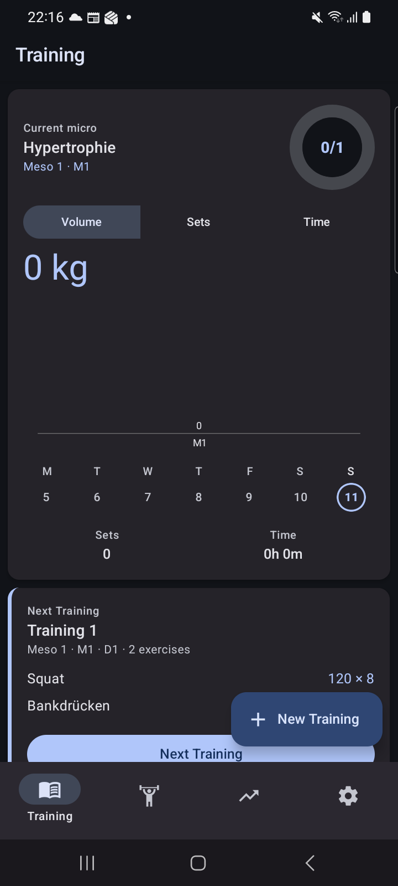 | 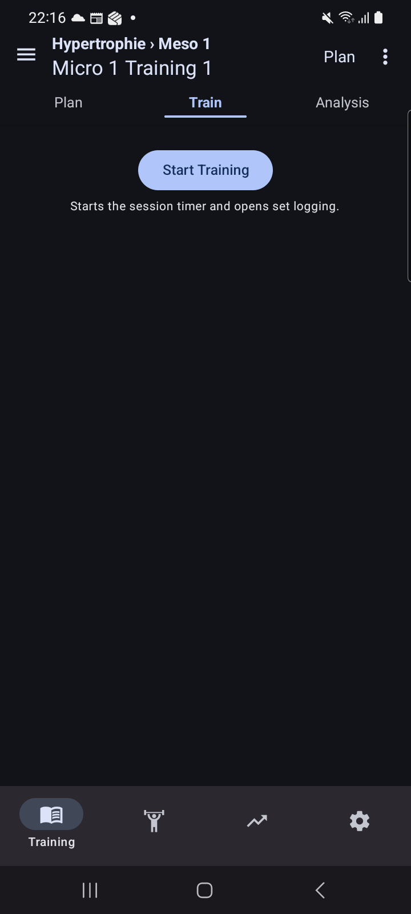 |

---

## 2. Metriken

Zählweise wie in Runde 2: **Touch** = Tap, Wischgeste oder erzwungenes Schließen der Tastatur. Tastenanschläge zähle ich getrennt. Bewusst ausgelöste Testaktionen (z. B. Save mit leerem Namen, Tap auf einen deaktivierten Button) sind nicht mitgezählt.

### 2.1 Bis „erstes Training startklar“ (= „Start Training“ im Train-Tab sichtbar)

| Metrik | Leere App (P1) | Baseline, neuer Plan (P2) |
|---|---|---|
| **Minimalpfad** 1 Übung / 1 Satz, eigenes Gewicht | **15 Touch** (FAB → Feld → Save → Plan-Karte → Plan new Training → „+“ → Übung → „−“ → Add set → Reps → OK → Weight → OK → Done → Train) | **16 Touch** (+1 Scrollen zur Planliste) |
| … mit akzeptiertem 1RM-Gewichtsvorschlag | (kein Vorschlag ohne Historie) | **14 Touch** |
| Gemessener Durchgang, 2 Übungen / 5 Sätze | **26 Touch** + 18 Anschläge | **26 Touch** realistisch, **30 Touch** beobachtet (+4 durch den Umweg über „Discard“ → ⋮ → Edit plan, siehe F6) |
| Zusätzlich, damit das Training auf der Startseite erscheint | **+2** (Zurück, Stern) | **+3** (Zurück, Scrollen, Stern) |
| Distinkte Screens/Zustände | **9** (Home leer → Dialog → Home mit Plan → Plan-Tab mit Suggest → Edit leer → Picker → Edit mit Sätzen → Leseansicht → Train-Tab) | **10** (+ Rückfrage „Discard plan changes?“) |
| Harte Sackgassen | **0** | **0** |
| Weiche Sackgassen | **3**: drei deaktivierte Suggest-Buttons ohne Begründung (F5); Tastatur verdeckt das Satzfeld, auch Scrollen hilft nicht (F1); Zurück bei offenem Drawer verlässt den Plan (F14) | **3**: wie P1 ohne Drawer, dazu „Discard“, das nicht verwirft (F6) |
| Verlorene Eingaben | **0** | **0**: Zurück fragt jetzt nach. „Discard“ hat die Eingaben sogar **behalten** (F6) |

### 2.2 Vergleich mit Runde 1/2 (nur Flow A „anlegen“)

| | Runde 1 (GH-399) | Runde 2 (GH-426) | Runde 3 |
|---|---|---|---|
| Minimalpfad 1 Übung / 1 Satz | 12 (ohne Plan anlegen) | 9 Touch + 3 Anschläge (ohne Plan anlegen) | 15 Touch inkl. Plan anlegen; **ohne** die 4 Plan-Schritte **11** |
| Sackgassen | 1 (leerer Picker) | 1 (tote Suggest-Buttons) | 0 hart / 3 weich |
| Fehlende Zurück-Wege | 1 | 1 („Done“ verschwindet) | 0 (Done bleibt, Zurück fragt) |

Die Zahl der Schritte ist im Kern gleich geblieben. Besser geworden sind die Zustände **um** die Schritte herum: Picker, Validierung, Rückfrage und Done.

---

## 3. Status der alten Findings

Gelistet sind nur Findings, die **diesen Ablauf** betreffen (Plan anlegen → Training planen → startklar). Was ausschließlich die Durchführung oder die Analyse betrifft, steht am Ende des Abschnitts.

Legende: **behoben** · **teilweise** · **offen** · **Regression** (war als erledigt gemeldet und ist wieder kaputt) · **nicht mehr relevant**

### 3.1 GH-399 (Runde 1)

| Finding | Status | Beleg |
|---|---|---|
| H1 „Start Training“ auf der Next-Training-Karte startet nichts | **teilweise**: Der Button heißt jetzt „Next Training“ und führt in den Train-Tab zu „Start Training“, das doppelte, irreführende Label ist weg. Er ist aber nicht zustandsabhängig: Auch bei „0 exercises“ heißt er „Next Training“ statt z. B. „Training planen“ | [P1-36](screenshots/gh498/P1-36-after-card-button.png), [P2-00](screenshots/gh498/P2-00-home-baseline.png) |
| H2 Train-Tab „Start training to begin“ ohne Control | **behoben**: Ungeplant zeigt der Tab „Plan this Training“, geplant „Start Training“ mit Erklärzeile | [P1-09](screenshots/gh498/P1-09-train-tab-unplanned.png), [P1-32](screenshots/gh498/P1-32-train-tab-ready.png) |
| H3 Picker leer nach erster Auswahl | **behoben**: Die Liste bleibt nach jeder Auswahl befüllt | [P1-13](screenshots/gh498/P1-13-squat-picked.png), [P1-16](screenshots/gh498/P1-16-keyboard-closed-picker.png) |
| M5 Neuer Satz übernimmt Werte nicht | **behoben**: Satz 2 kopiert 5 / 0 / 100 | [P1-22](screenshots/gh498/P1-22-set2-added.png) |
| M6 „Done“ ohne Feedback, sinnlose Scroll-Position | **teilweise**: Die Scroll-Position stimmt (Leseansicht von oben), eine Speicherbestätigung gibt es weiterhin nicht | [P1-30](screenshots/gh498/P1-30-after-done.png), [P1-31](screenshots/gh498/P1-31-after-done-settled.png) |
| M7 Picker zweistufig | **behoben**: „+“ öffnet die Liste direkt | [P1-11](screenshots/gh498/P1-11-picker-open-empty.png) |
| N5 Satzzeilen scrollen ohne Hintergrund unter den Titel | **nicht beobachtet** in diesem Ablauf | [P1-29](screenshots/gh498/P1-29-bench-2sets.png) |
| N6 Neue Satzzeile hinter der Tab-Bar | **behoben** ohne Tastatur (die neue Zeile liegt über der Tab-Bar). Mit Tastatur siehe GH-426 H2 | [P1-24](screenshots/gh498/P1-24-bench-add-set.png) |
| N7 Tastatur springt nach „OK“ auf QWERTY | **behoben**: „OK“ schließt die Tastatur. Neu ist, dass es nicht ins nächste Feld springt (F18) | [P1-20](screenshots/gh498/P1-20-reps-ok.png) |
| N8 FAB überlagert Karteninhalt | **offen**: Der FAB liegt über Stern und ⋮ der letzten Plan-Karte und über der Next-Training-Karte (F2) | [P2-03](screenshots/gh498/P2-03-found-new-plan.png), [P1-34](screenshots/gh498/P1-34-home-plan-starred.png) |

### 3.2 GH-426 (Runde 2)

| Finding | Status | Beleg |
|---|---|---|
| H1 „Save“ mit leerem Namen legt namenlosen Plan an | **behoben**: Inline-Fehler „Please enter a name for the training plan.“ | [P1-02](screenshots/gh498/P1-02-save-empty-name.png) |
| H2 Fokussiertes Feld liegt hinter der Tastatur | **Regression**: Mit GH-428 / PR #430 als erledigt gemeldet. Heute auf dem Gerät in **beiden** Durchgängen und bei kurzem wie langem Plan kaputt, siehe **F1** | [P1-25](screenshots/gh498/P1-25-bench-reps-keyboard.png), [P1-27](screenshots/gh498/P1-27-manual-scroll-with-keyboard.png), [P2-19](screenshots/gh498/P2-19-bench-reps-hidden-by-keyboard.png), [P3-01](screenshots/gh498/P3-01-long-plan-focus-bottom-field.png) |
| H3 Gewichtsvorschlag aus dem 1RM (Teil „beim Planen“) | **teilweise**: Beim Planen füllt der 1RM-Vorschlag das Feld weiterhin automatisch (8 Reps → 178 kg, 10 Reps → 113 kg). Er ist aber als „1RM“ markiert, wird beim Fokus selektiert und mit einer Eingabe ersetzt. Der Trainings-Teil von H3 gehört nicht zu diesem Ablauf | [P2-12](screenshots/gh498/P2-12-reps8-suggestion.png), [P2-13](screenshots/gh498/P2-13-weight-focused.png), [P2-14](screenshots/gh498/P2-14-weight-typed.png) |
| H5 FAB überlagert „Next/Continue Training“ und schluckt den Tap | **offen**: Ein Tap in die Überlappung öffnet „Add New Training Plan“. Mit Baseline-Daten verdeckt der breite FAB sogar das Label („Next Trainin…“) | [P1-35](screenshots/gh498/P1-35-tap-overlap-zone.png), [P2-00](screenshots/gh498/P2-00-home-baseline.png) |
| M4 Picker-Liste unter der Tastatur | **behoben**: Das Panel endet oberhalb der Tastatur, alle sichtbaren Treffer sind antippbar | [P1-12](screenshots/gh498/P1-12-search-squat.png), [P2-07](screenshots/gh498/P2-07-search-squat.png) |
| M5 Suche wird nach jeder Auswahl zurückgesetzt | **offen** | [P1-13](screenshots/gh498/P1-13-squat-picked.png), [P2-09](screenshots/gh498/P2-09-squat-selected.png) |
| M6 Exakter Treffer zuletzt | **offen**: „Squat“ steht hinter sechs Teiltreffern, angeschnitten am Panelrand, und ist erst nach Scrollen erreichbar (Ticket GH-431 offen) | [P2-07](screenshots/gh498/P2-07-search-squat.png), [P2-08](screenshots/gh498/P2-08-picker-scrolled.png) |
| M7 Löschdialog eines Plans spricht von „training“ | **teilweise**: Der Titel lautet jetzt „Delete Hypertrophie“, der Text sagt weiterhin „This action will delete the training …“ | [P2-29](screenshots/gh498/P2-29-delete-plan-confirm.png) |
| M8 Drei deaktivierte Suggest-Aktionen ohne Begründung | **offen**: unverändert, auch bei vorhandener Historie in anderen Plänen. Ein Tap bewirkt nichts | [P1-07](screenshots/gh498/P1-07-tap-plan-card.png), [P1-08](screenshots/gh498/P1-08-tap-disabled-suggest.png), [P2-04](screenshots/gh498/P2-04-new-plan-opened.png) |
| M9 Erste Auswahl verlässt still den „EDITING PLAN“-Modus | **teilweise**: Kicker und „Done“ bleiben stehen. Daneben erscheinen aber das Lese-Label „Plan“ und (unsichtbar unter „Done“) das ⋮ des Lesemodus. Done bestätigt nicht (Ticket GH-431 offen) | [P1-14](screenshots/gh498/P1-14-header-after-pick.png), [P1-17](screenshots/gh498/P1-17-picker-closed.png), [P1-30](screenshots/gh498/P1-30-after-done.png) |
| M10 Wisch unterhalb des Pickers schließt ihn | **offen**: ohne Datenverlust | [P3-04](screenshots/gh498/P3-04-picker-open-before-swipe.png), [P3-05](screenshots/gh498/P3-05-after-swipe-below-picker.png) |
| N1 Erste Übungs-Kachel ohne linken Rand | **offen** | [P1-17](screenshots/gh498/P1-17-picker-closed.png) |
| N6 IME-„OK“ bestätigt den Anlegen-Dialog nicht | **offen** | [P1-05](screenshots/gh498/P1-05-after-ime-ok.png) |
| N7 Anlegen-Dialog ohne Autofokus | **offen**: `mInputShown=false` nach dem Öffnen | [P1-01](screenshots/gh498/P1-01-new-training-dialog.png) |
| N8 Edit-Dialog heißt nur „Edit“ | **behoben**: „Edit Hypertrophie“ | [P2-28](screenshots/gh498/P2-28-plan-edit-dialog.png) |
| N9 Zahlenfeld setzt Cursor ans Ende | **behoben** beim Planen: Der Vorschlag wird beim Fokus selektiert, „120“ ersetzt „178“ | [P2-13](screenshots/gh498/P2-13-weight-focused.png), [P2-14](screenshots/gh498/P2-14-weight-typed.png) |

### 3.3 GH-436, Abschnitt B

| Finding | Status | Beleg |
|---|---|---|
| B1 Header verliert „Done“, Zurück verwirft offenen Satz | **teilweise**: „Done“ bleibt, und Zurück fragt „Discard plan changes?“. Der Button „Discard“ **speichert** die offene Zeile aber (F6), und der Header zeigt einen Mischzustand (siehe GH-426 M9) | [P2-15](screenshots/gh498/P2-15-after-back-no-done.png), [P2-16](screenshots/gh498/P2-16-after-discard.png) |
| B3 Neuer Plan ohne Historie zeigt drei „Suggest“-Buttons | **offen** (= GH-426 M8) | [P1-07](screenshots/gh498/P1-07-tap-plan-card.png) |
| B4 Nach dem Anlegen keine Orientierung | **teilweise**: Ein neuer Plan wird jetzt **oben** in der Planliste einsortiert, und ein Tap auf die Karte öffnet direkt Micro 1 Training 1. Mit Daten liegt die Planliste aber unter dem Dashboard: Nach „Save“ ändert sich auf dem sichtbaren Screen nichts, kein Sprung, keine Meldung | [P1-06](screenshots/gh498/P1-06-after-save.png), [P2-02](screenshots/gh498/P2-02-after-save.png), [P2-03](screenshots/gh498/P2-03-found-new-plan.png) |
| B5 „Plan new Training“ öffnet den Picker nicht; Text „picker above“ | **offen**: Text unverändert, zusätzlich überlappt die „+“-Kachel den Text (F12) | [P1-10](screenshots/gh498/P1-10-after-plan-this-training.png) |
| B6 Picker ohne Abschluss-Button | **offen**: Schließen nur über die „−“-Kachel, Zurück oder Wischen | [P1-16](screenshots/gh498/P1-16-keyboard-closed-picker.png) |
| B7 Chip „1 set“ zählt die unbestätigte Zeile | **offen** | [P1-18](screenshots/gh498/P1-18-add-set-squat.png) |
| B11 Namensfeld ohne Autofokus | **offen** (= GH-426 N7) | [P1-01](screenshots/gh498/P1-01-new-training-dialog.png) |
| B13 testIDs `plan-pending-set-*` über Übungen geteilt | **offen**: Mit zwei offenen Zeilen (Squat und Bench) liefert der Hierarchie-Dump zweimal `plan-pending-set-reps-input` | [P1-28](screenshots/gh498/P1-28-after-keyboard-close.png) |

**Nicht in diesem Ablauf** und deshalb nicht bewertet: GH-399 H4, M1–M4, M8, N1–N4 (Durchführung). GH-426 H4, M1–M3, M11, M12, N2–N5, N10 (Durchführung). GH-436 B2, B8, B9, B10, B12 (Analyse/Durchführung).

### 3.4 Bilanz

Von **34** bewerteten Findings sind **10 behoben**, **7 teilweise**, **15 offen**, **1 Regression** und 1 nicht beobachtet. Von den sechs „hoch“-Findings aus Runde 1/2, die diesen Ablauf betreffen, sind drei behoben (399 H2, 399 H3, 426 H1) und eines teilweise (399 H1). 426 H5 (FAB) ist offen, 426 H2 (Tastatur) ist **regressiert**.

---

## 4. Neue Findings

Neu = in keinem der drei früheren Reports beschrieben. F1 steht hier, weil der Rückfall in dieser Form (Liste springt nach oben, auch Scrollen hilft nicht) neu ist.

| # | Prio | Kurz | Beleg |
|---|---|---|---|
| F1 | hoch | Tastatur verdeckt das Satzfeld beim Planen; bei langem Plan springt die Liste sogar nach oben (Regression von GH-426 H2) | P1-25…27, P2-19, P3-01 |
| F3 | hoch | Ein neu angelegter und geplanter Plan erscheint nicht auf der Startseite, bis man den unerklärten Stern setzt | P1-33, P1-34, P2-25…27 |
| F4 | mittel | Leere App: Startseite ohne Erklärung; der FAB heißt „New Training“, legt aber einen **Plan** an | P1-00, P1-01 |
| F6 | mittel | „Discard plan changes?“ → „Discard“ verwirft nicht, sondern speichert; Text ist Entwicklerjargon | P2-15, P2-16 |
| F12 | niedrig | Leerer Editor: „+“-Kachel überdeckt den Hinweistext, „Done“ ist rechts angeschnitten, „EDITING PLAN“ klebt an der Statusleiste | P1-10 |
| F14 | niedrig | Zurück bei offenem Plan-Drawer verlässt den ganzen Plan-Screen statt den Drawer zu schließen | P1-37, P1-38 |
| F15 | niedrig | Drawer: „+“-Knöpfe ohne Beschriftung, in einer Akzentfarbe außerhalb des Themes | P1-37 |
| F18 | niedrig | IME-„OK“ in der Satzzeile schließt die Tastatur, statt zum nächsten Feld (RIR/Weight) zu springen | P1-20 |
| F19 | niedrig | Der Train-Tab „startklar“ zeigt nicht, was geplant ist | P1-32 |
| F20 | niedrig | Neue Satzzeilen starten mit RIR 0, und der Gewichtsvorschlag rechnet auf RIR 0 (10 × 113 kg Bankdrücken) | P2-20 |

---

## 5. Findings im Detail (priorisiert)

Jedes Finding nennt: **Was** · **Warum ein Problem** · **Beleg** · **Vorschlag**. Eine F-Nummer ohne „neu“ ist ein alter, weiterhin offener Befund, der hier wegen seiner Bedeutung für den Ablauf ausformuliert wird.

### Hoch

#### F1 — Tastatur verdeckt das Satzfeld beim Planen (Regression von GH-426 H2)

**Was.** In beiden Durchgängen liegt ab der zweiten Übung das fokussierte Reps-Feld hinter der Tastatur (Feld y = 1084–1154, Tastatur ab y ≈ 940). Die Seite scrollt nicht mit. Auch eine Wischgeste bei offener Tastatur bewegt nichts, weil der Inhalt ohne Tastatur auf den Screen passt ([P1-27](screenshots/gh498/P1-27-manual-scroll-with-keyboard.png)). Die getippte „3“ war nicht zu sehen ([P1-26](screenshots/gh498/P1-26-bench-reps-typed-blind.png)). Bei einem **langen** Plan, nach unten gescrollt, springt die Liste beim Fokus sogar **nach oben**. Das Feld rutscht dabei von y = 1133 auf y = 1357, noch tiefer unter die Tastatur ([P3-00](screenshots/gh498/P3-00-long-plan-before-focus.png) → [P3-01](screenshots/gh498/P3-01-long-plan-focus-bottom-field.png)).

**Warum ein Problem.** Nielsen #1 (Sichtbarkeit des Systemzustands): Man tippt Zahlen, die man nicht sieht, und kann den automatischen Gewichtsvorschlag nicht kontrollieren. Das betrifft genau den Schritt, den jeder Nutzer für jedes Training ausführt. GH-428 hat das als erledigt gemeldet, und TODOS.md vermerkt, dass GH-418 deshalb „nicht noch einmal umbauen“ soll. Der Stand auf dem Gerät widerspricht dem.

| Leere App: Feld verdeckt | Auch Scrollen hilft nicht | Langer Plan: Liste springt nach oben |
|---|---|---|
| 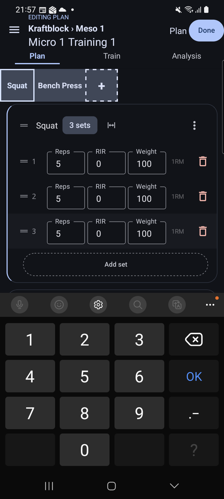 |  | 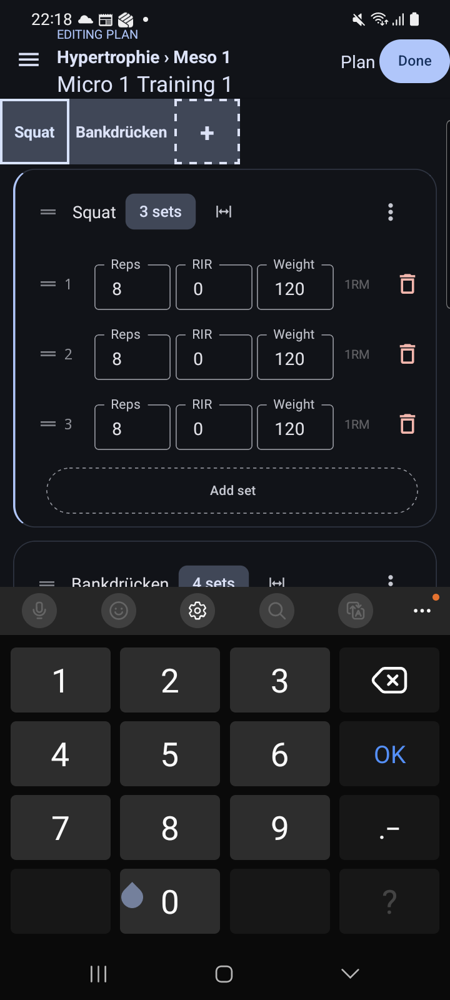 |

**Vorschlag.** Als Regression behandeln. Das fokussierte Feld über die Tastatur scrollen, auch wenn die Seite ohne Tastatur nicht scrollbar ist (Platzhalter in Tastaturhöhe am Listenende). Kein Sprung an den Listenanfang beim Fokus. Mit einem Maestro-/uiautomator-Check absichern, der die Feld-Bounds gegen die Tastaturoberkante prüft, damit es nicht wieder unbemerkt bricht.

#### F2 — Der FAB überdeckt die Next-Training-Karte und schluckt den Tap (GH-426 H5, offen)

**Was.** Der breite FAB „New Training“ liegt über dem unteren Teil der Next-Training-Karte. Er verdeckt den Zielwert der zweiten Übung („60 × 3“) und den Button, mit Daten bis zum abgeschnittenen Label „Next Trainin…“. Ein Tap in die Überlappung öffnet den Dialog „Add New Training Plan“. Auf der Planliste liegt er über Stern und ⋮ der letzten Karte.

**Warum ein Problem.** Die primäre Aktion des Screens wird von einer sekundären verdeckt und verliert den Tap (Fitts, Nielsen #5). Der Nutzer landet in einem Dialog, den er nicht wollte.

| FAB verdeckt Ziel und Button | Tap in die Überlappung | Mit Daten: Label abgeschnitten |
|---|---|---|
| 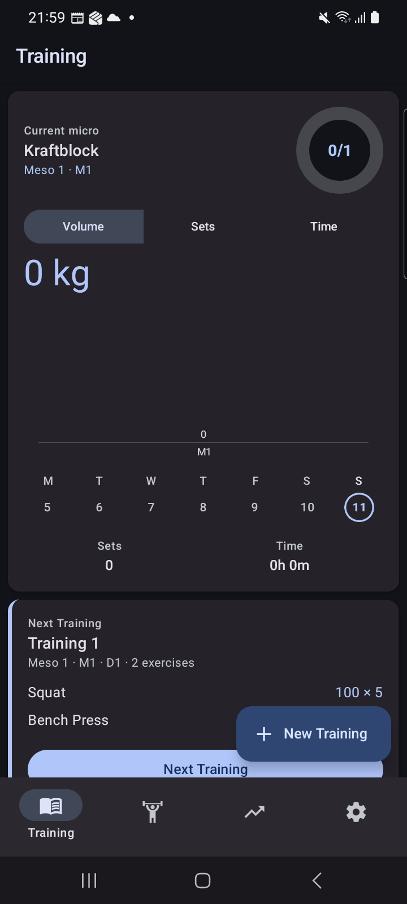 | 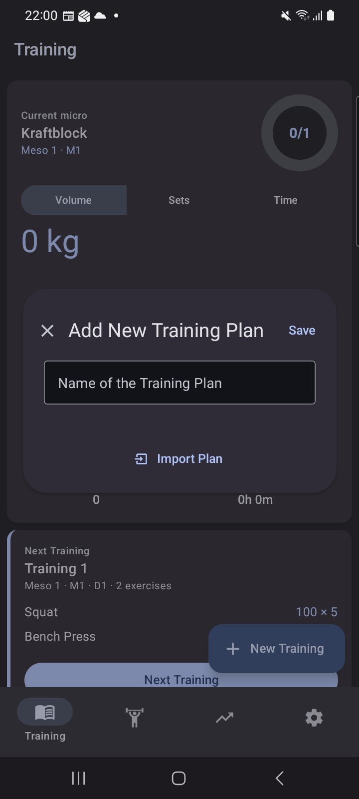 | 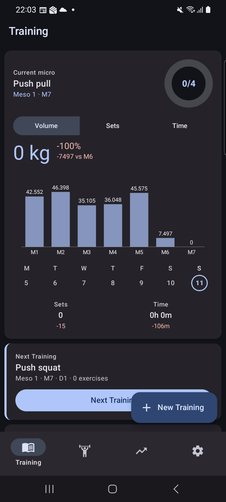 |

**Vorschlag.** Der Scroll-Liste unten Padding in FAB-Höhe geben und den FAB beim Scrollen zur Icon-Variante einklappen, damit er nie über interaktivem Inhalt liegt.

#### F3 — Ein neuer Plan erscheint nicht auf der Startseite, bis man den Stern setzt (neu)

**Was.** Nach dem Planen des ersten Trainings zeigt die Startseite der **leeren** App nur die Planliste: Plan „Kraftblock · Draft · planned, not started“, kein Dashboard, keine Next-Training-Karte ([P1-33](screenshots/gh498/P1-33-home-after-planning.png)). Mit **Baseline-Daten** bietet die Startseite weiter das leere „Push squat · 0 exercises“ aus dem alten Plan an ([P2-25](screenshots/gh498/P2-25-home-top-next-training.png)). Erst ein Tap auf den **Stern** der Plan-Karte macht den Plan zum aktuellen. Der Stern hat kein Label und keinen Tooltip, und der Wechsel kommt ohne Rückmeldung ([P2-26](screenshots/gh498/P2-26-after-star.png)). Danach erscheinen Dashboard und Next-Training-Karte mit den geplanten Zielen ([P1-34](screenshots/gh498/P1-34-home-plan-starred.png), [P2-27](screenshots/gh498/P2-27-home-new-plan-current.png)).

**Warum ein Problem.** Nielsen #1 und #6 (Wiedererkennen statt Erinnern): Der Nutzer hat gerade sein erstes Training geplant, und die Startseite tut so, als gäbe es das nicht. Mit Daten zeigt sie sogar ein anderes, leeres Training als „Next Training“. Dass der Stern „aktueller Plan“ bedeutet, muss man erraten.

| Leere App nach dem Planen | Baseline: alter Plan bleibt „Next“ | Erst nach dem Stern |
|---|---|---|
| 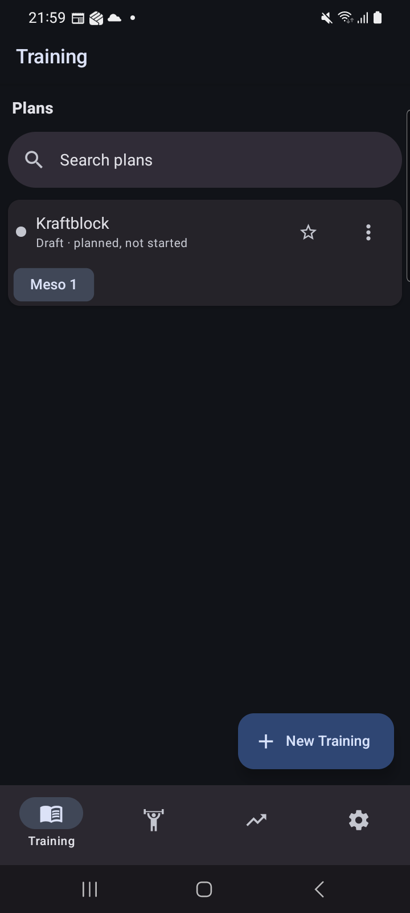 |  |  |

**Vorschlag.** Den ersten Plan bzw. einen neu angelegten Plan automatisch zum aktuellen machen (oder nach „Save“ fragen: „Als aktuellen Plan verwenden?“). Den Stern beschriften („Aktueller Plan“, Long-Press-Tooltip) und den Wechsel mit einer Snackbar bestätigen.

### Mittel

#### F4 — Leere App: keine Erklärung, und „New Training“ legt einen Plan an (neu)

**Was.** Der erste Screen besteht aus „Plans“, einem Suchfeld für null Pläne und dem FAB „New Training“ ([P1-00](screenshots/gh498/P1-00-first-launch.png)). Ein Tap öffnet „Add New Training **Plan**“ ([P1-01](screenshots/gh498/P1-01-new-training-dialog.png)). Nirgends steht, was ein Plan, ein Meso oder ein Micro ist, und dass der Plan automatisch Meso 1 / Micro 1 / Training 1 bekommt.

**Warum ein Problem.** Nielsen #2 (Übereinstimmung mit der realen Welt) und #4 (Konsistenz): Button und Dialog benennen verschiedene Dinge. Der leere Zustand ist die Stelle, an der ein neuer Nutzer am meisten Führung braucht, und gibt keine.

**Vorschlag.** Den Leerzustand mit einem Satz und einem primären Button füllen („Noch kein Plan. Ein Plan enthält deine Trainingsblöcke (Meso) und Wochen (Micro). → Plan anlegen“). Den FAB „New Plan“ nennen. Das größere Onboarding ist bereits **GH-497**.

#### F5 — Plan-Tab eines neuen Plans: drei tote Suggest-Buttons und „Linear progression“ (GH-426 M8 / GH-436 B3, offen)

**Was.** Der erste Screen im neuen Plan wird von „Linear progression“ (RIR delta 1, Weight increase % 0) und drei grauen „Suggest based on …“ dominiert. Die Buttons sind `enabled=false`, aber `clickable=true`, und ein Tap bewirkt nichts ([P1-08](screenshots/gh498/P1-08-tap-disabled-suggest.png)). Mit Baseline-Daten ist es dasselbe, obwohl es in anderen Plänen genug Historie gäbe ([P2-04](screenshots/gh498/P2-04-new-plan-opened.png)). „Plan new Training“ ist inzwischen ein deutlicher Button, steht aber an vierter Stelle.

**Warum ein Problem.** Drei stumme No-Ops und zwei unerklärte Fachfelder vor der einzigen Aktion, die geht (Nielsen #1, #8 ästhetisch-minimalistisches Design).

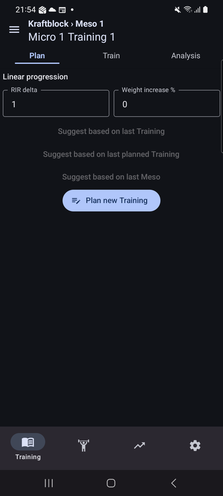

**Vorschlag.** Ohne Vorgänger im Plan den Progressions-Block und die Suggest-Buttons ausblenden und nur „Plan new Training“ zeigen. Sonst die Bedingung nennen („braucht ein geplantes Training in diesem Plan“).

#### F6 — „Discard plan changes?“: „Discard“ speichert (neu)

**Was.** Zurück im Edit-Modus mit einer offenen Satzzeile (8 / 0 / 120) fragt „Discard plan changes? Discard the structural plan changes made in full edit and return to read mode.“ mit „Keep editing“ und „Discard“ ([P2-15](screenshots/gh498/P2-15-after-back-no-done.png)). Nach „Discard“ ist **alles gespeichert**: beide Übungen und der Satz 8 × 120 ([P2-16](screenshots/gh498/P2-16-after-discard.png)).

**Warum ein Problem.** Nielsen #3 (Kontrolle und Freiheit) und #2: Wer „verwerfen“ wählt, rechnet mit Verwerfen. Hier tritt das Gegenteil ein. Das ist zufällig das gutmütige Gegenteil, untergräbt aber das Vertrauen in den Dialog. „Structural plan changes made in full edit“ ist Entwicklersprache.

| Rückfrage | Nach „Discard“: alles gespeichert |
|---|---|
| 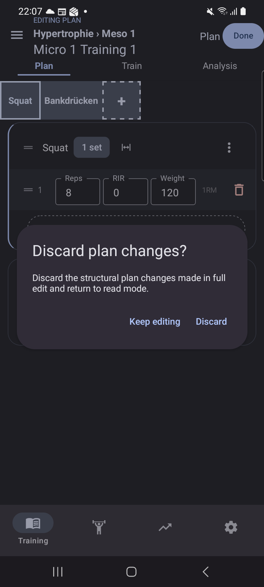 | 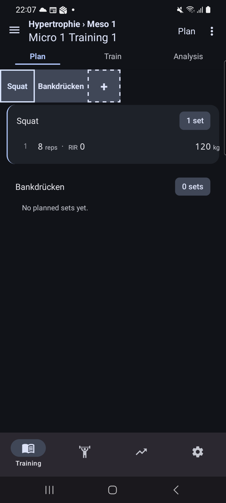 |

**Vorschlag.** Den Dialog an das tatsächliche Verhalten anpassen: „Änderungen speichern?“ mit „Speichern“ / „Verwerfen“ / „Weiter bearbeiten“, und „Verwerfen“ muss wirklich verwerfen. Den Text in Nutzersprache schreiben.

#### F7 — Picker: Suche wird nach jeder Auswahl zurückgesetzt (GH-426 M5, offen)

**Was.** Nach der Auswahl von „Squat“ aus „squat“ ist das Suchfeld leer und die Liste wieder A–Z ([P2-07](screenshots/gh498/P2-07-search-squat.png) → [P2-09](screenshots/gh498/P2-09-squat-selected.png)).

**Warum ein Problem.** Der Picker ist mehrfachauswahlfähig („2 selected“), das Zurücksetzen arbeitet dagegen. Für verwandte Übungen muss man neu tippen.

**Vorschlag.** Suchbegriff nach der Auswahl stehen lassen. Ein „ד zum Leeren gibt es bereits.

#### F8 — Picker: exakter Treffer zuletzt, abgeschnitten (GH-426 M6, offen → GH-431)

**Was.** „squat“ liefert sieben Treffer, „Squat“ steht als siebter am Panelrand und ist nur zu einem Strich sichtbar. Erreichbar ist er erst nach Scrollen in der Liste ([P2-07](screenshots/gh498/P2-07-search-squat.png), [P2-08](screenshots/gh498/P2-08-picker-scrolled.png)).

**Vorschlag.** Wie in **GH-431** beschrieben (exakt → Präfix → Teilstring). Hier kein neues Ticket.

#### F9 — Header im Edit-Modus zeigt Lese- und Edit-Chrome gleichzeitig; „Done“ ohne Bestätigung (GH-426 M9 teilweise → GH-431)

**Was.** Nach der ersten Übungsauswahl steht neben „Done“ das Label „Plan“ des Lesemodus. Laut Dump liegt der ⋮-Button des Lesemodus deckungsgleich unter „Done“ ([P1-14](screenshots/gh498/P1-14-header-after-pick.png), [P1-17](screenshots/gh498/P1-17-picker-closed.png)). Im Light Theme ist es genauso ([L-03](screenshots/gh498/L-03-edit-mode-light.png)). Nach „Done“ erscheint keine Bestätigung ([P1-30](screenshots/gh498/P1-30-after-done.png)).

**Vorschlag.** In **GH-431** (Akzeptanzkriterium „Überschrift und Done bleiben“) den Mischzustand mit abdecken: Im Edit-Modus nur Kicker und „Done“, kein „Plan“-Label, kein verstecktes ⋮. Die Bestätigung nach „Done“ ist dort bereits gefordert.

#### F10 — Löschdialog eines Plans spricht weiter von „training“ (GH-426 M7, teilweise)

**Was.** Titel „Delete Hypertrophie“ ist richtig. Der Text lautet: „This action will delete the training. The workouts done in this training will not be deleted … Are you sure you want to delete this training?“ ([P2-29](screenshots/gh498/P2-29-delete-plan-confirm.png)).

**Warum ein Problem.** Bei einer unwiderruflichen Aktion beschreibt der Text den falschen Gegenstand und den falschen Umfang.

**Vorschlag.** Eigener Text für Pläne: „Plan ‚Hypertrophie‘ mit N Trainings löschen? Bereits absolvierte Workouts bleiben in der History.“

### Niedrig

#### F11 — Picker: kein Abschluss-Button; Wischen unterhalb schließt (GH-436 B6 / GH-426 M10, offen)

**Was.** Schließen geht nur über die kleine „−“-Kachel, Zurück (bei offener Tastatur zweimal) oder versehentlich per Wischen in der leeren Fläche unter dem Panel ([P1-16](screenshots/gh498/P1-16-keyboard-closed-picker.png), [P3-04](screenshots/gh498/P3-04-picker-open-before-swipe.png) → [P3-05](screenshots/gh498/P3-05-after-swipe-below-picker.png)). Daten gehen nicht verloren.

**Vorschlag.** „Fertig (2)“-Button in der Kopfzeile „2 selected“. Wischen unterhalb schließt nicht mehr.

#### F12 — Leerer Editor falsch gesetzt (neu, Text-Teil = GH-436 B5)

**Was.** Direkt nach „Plan this Training“: Die gestrichelte „+“-Kachel überdeckt den Anfang des Hinweistexts („Pick an exercise …“), und der Text verweist auf einen „picker above“, der nicht offen ist. Der Pill-Button „Done“ ist am rechten Rand angeschnitten (Bounds bis x = 720). Der Kicker „EDITING PLAN“ sitzt direkt unter der Statusleiste ([P1-10](screenshots/gh498/P1-10-after-plan-this-training.png)).

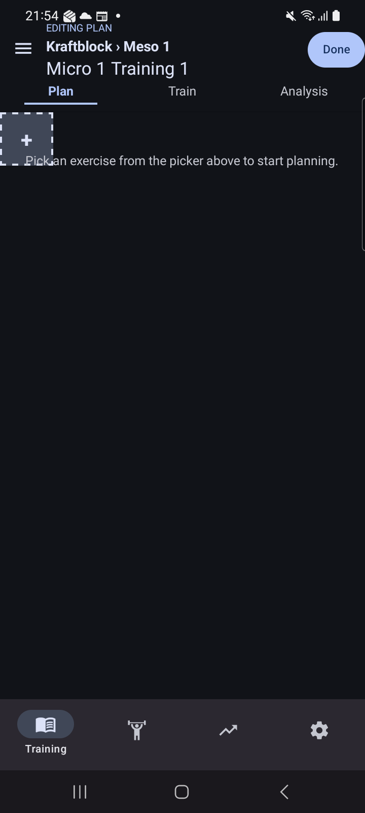

**Vorschlag.** Hinweistext unter die Kachelreihe setzen und auf die Kachel beziehen („Tippe auf +, um Übungen hinzuzufügen“), oder den Picker gleich öffnen. „Done“ mit rechtem Rand. Kicker mit Abstand zur Statusleiste.

#### F13 — Anlegen-Dialog: kein Autofokus, IME-„OK“ speichert nicht (GH-426 N6/N7, GH-436 B11, offen)

**Was.** Nach dem Öffnen ist die Tastatur zu (`mInputShown=false`, [P1-01](screenshots/gh498/P1-01-new-training-dialog.png)). „OK“ auf der Tastatur schließt sie nur, „Save“ muss man oben rechts treffen ([P1-05](screenshots/gh498/P1-05-after-ime-ok.png)).

**Vorschlag.** Zwei kleine Tickets, ein Problem je Ticket: `autoFocus` auf dem Namensfeld (Erfahrung aus GH-403: `focus()` im selben Commit öffnet die IME nicht), und `onSubmitEditing` → Save.

#### F14 — Zurück bei offenem Plan-Drawer verlässt den Plan (neu)

**Was.** Drawer im Plan-Screen offen ([P1-37](screenshots/gh498/P1-37-drawer.png)) → Zurück → man landet auf der Startseite, der Plan-Screen ist weg ([P1-38](screenshots/gh498/P1-38-after-drawer-back.png)).

**Warum ein Problem.** Android-Konvention: Zurück schließt zuerst das oberste Overlay. (Nicht zu verwechseln mit GH-420, das den Drawer im **Analyse**-Tab betrifft.)

**Vorschlag.** Zurück schließt den Drawer, wenn er offen ist.

#### F15 — Drawer: unbeschriftete „+“-Knöpfe in fremder Farbe (neu)

**Was.** Unter „Mesos:“ und „Trainings:“ steht je ein runder „+“-Knopf in Rosa, außerhalb des blauen Themes und ohne Label ([P1-37](screenshots/gh498/P1-37-drawer.png)).

**Vorschlag.** Beschriftete Text-Buttons („+ Meso“, „+ Training“) in der Theme-Farbe.

#### F16 — Chip „1 set“ zählt die offene Zeile (GH-436 B7, offen)

**Was.** Nach „Add set“ steht „1 set“, bevor etwas eingetragen ist ([P1-18](screenshots/gh498/P1-18-add-set-squat.png)). **Vorschlag:** nur übernommene Sätze zählen.

#### F17 — Erste Übungs-Kachel ohne linken Rand (GH-426 N1, offen)

**Was.** Die Kachelreihe beginnt bei x = 0 ([P1-17](screenshots/gh498/P1-17-picker-closed.png)). **Vorschlag:** gleicher Rand wie die Karten.

#### F18 — IME-„OK“ in der Satzzeile springt nicht weiter (neu)

**Was.** Nach Reps → „OK“ ist die Tastatur zu. Für RIR/Weight braucht es einen weiteren Tap ([P1-20](screenshots/gh498/P1-20-reps-ok.png)). Jedes Satzfeld kostet damit Tap + Eingabe + OK.

**Vorschlag.** `returnKeyType="next"` mit Fokus auf das nächste Feld, „done“ erst am letzten Feld.

#### F19 — Der Train-Tab „startklar“ zeigt nicht, was geplant ist (neu)

**Was.** Vor dem Start steht nur „Start Training“ und „Starts the session timer and opens set logging.“ auf einer sonst leeren Fläche ([P1-32](screenshots/gh498/P1-32-train-tab-ready.png)). Die Next-Training-Karte der Startseite zeigt dagegen Übungen und Ziele.

**Vorschlag.** Unter dem Button eine kompakte Vorschau „Squat 3 × 5 @ 100 · Bench 2 × 3 @ 60“.

#### F20 — Neue Satzzeilen starten mit RIR 0 (neu, Beobachtung)

**Was.** Jede neue Zeile hat RIR 0 vorbelegt, und der Gewichtsvorschlag rechnet darauf: 10 Reps Bankdrücken → 113 kg bei RIR 0 ([P2-20](screenshots/gh498/P2-20-bench-reps10-suggestion.png)). Für einen neuen Nutzer heißt das ohne Zutun „bis zum Muskelversagen“.

**Vorschlag.** Fachlich mit dem Nutzer klären. Möglich wäre ein Default von RIR 2 oder ein leeres RIR-Feld, aus dem der Vorschlag dann nicht rechnet.

#### F21 — Card-Button „Next Training“ nicht zustandsabhängig (GH-399 H1, teilweise)

**Was.** Statuszeile und Button heißen beide „Next Training“, auch bei „0 exercises“ ([P2-00](screenshots/gh498/P2-00-home-baseline.png)). **Vorschlag:** „Training planen“ bei 0 Übungen, sonst „Zum Training“.

#### F22 — Geteilte testIDs der offenen Satzzeilen (GH-436 B13, offen)

**Was.** Zwei offene Zeilen in verschiedenen Übungen haben beide `plan-pending-set-reps-input` usw. (Dump zu [P1-28](screenshots/gh498/P1-28-after-keyboard-close.png)). **Vorschlag:** Exercise-ID ins Präfix aufnehmen. Das betrifft nur die Testbarkeit.

---

## 6. Light-Stichprobe

Startseite, Edit-Modus und Picker im Light Theme ([L-02](screenshots/gh498/L-02-home-light.png), [L-03](screenshots/gh498/L-03-edit-mode-light.png), [L-04](screenshots/gh498/L-04-picker-light.png)): Kontraste und Flächen sind in Ordnung. Light-spezifische Probleme habe ich nicht gefunden. Der Header-Mischzustand (F9) und die FAB-Überlappung (F2, N8) sind identisch. Danach habe ich das Theme wieder auf Dark gestellt ([L-05](screenshots/gh498/L-05-settings-back-to-dark.png)).

---

## 7. Gesamtaussage

**Ja, ein neuer Nutzer kommt heute ohne Hilfe zu einem geplanten, startklaren ersten Training**, minimal in **15 Taps**, ohne harte Sackgasse und ohne verlorene Eingaben. Gegenüber Runde 1/2 hat sich das Gerüst deutlich verbessert: Validierung beim Anlegen, ein Tap auf die Plan-Karte führt direkt ins erste Training, der Picker öffnet direkt und bleibt befüllt, Sätze werden kopiert, „Done“ bleibt stehen, Zurück fragt nach, und der Train-Tab hat in jedem Zustand eine Aktion.

**Wo es bricht oder zu brechen droht:**

1. **Am Anfang (leere App):** Die Startseite erklärt nichts, und „New Training“ legt einen Plan an (F4). Wer nicht neugierig auf den FAB tippt, kommt nicht weiter. Gemildert dadurch, dass der FAB die einzige Aktion ist.
2. **Beim Eintragen der Sätze:** Ab der zweiten Übung tippt man blind, weil die Tastatur das Feld verdeckt und sich die Seite nicht scrollen lässt (F1, Regression). Das ist der wahrscheinlichste Punkt, an dem ein Nutzer aufgibt oder falsche Werte speichert.
3. **Nach dem Planen:** Die Startseite zeigt das geplante Training nicht. In der leeren App zeigt sie gar nichts, mit Daten ein altes, leeres Training, bis man den unbeschrifteten Stern findet (F3). Der Nutzer muss sich merken, dass er über die Planliste wieder hineinkommt. Und wenn die Karte erscheint, verdeckt der FAB ihren Button (F2).

**Kurz:** Der Weg *durch* die Planung trägt. Die Schwachstellen liegen am Eingang (Erklärung), in der Mitte (Tastatur) und am Ausgang (Startseite kennt den neuen Plan nicht).

---

## 8. Priorisierte Ticket-Vorschläge

Ein Problem = ein Vorschlag. Bestehende offene Tickets werden referenziert statt neu vorgeschlagen.

| # | Prio | Vorschlag | Finding | Bestehendes Ticket |
|---|---|---|---|---|
| 1 | hoch | **Regression:** fokussiertes Satzfeld im Plan-Editor über der Tastatur halten, kein Sprung an den Listenanfang | F1 | **GH-418** (offen, AC 1–3 decken genau das). Dort priorisieren und den TODOS-Hinweis „H2 für GH-418 erledigt“ korrigieren. Ursprung GH-428 / PR #430 |
| 2 | hoch | FAB darf keine interaktiven Inhalte überdecken (Next-Training-Karte, letzte Plan-Karte): Listen-Padding plus Einklappen beim Scrollen | F2 | neu |
| 3 | hoch | Neu angelegten bzw. ersten Plan automatisch zum aktuellen machen; Stern beschriften und den Wechsel bestätigen | F3 | neu |
| 4 | mittel | Leerzustand der Training-Startseite mit Erklärung und primärem Button | F4 | **GH-497** (Onboarding) |
| 5 | mittel | FAB/Dialog einheitlich benennen („New Plan“ statt „New Training“) | F4 | neu |
| 6 | mittel | Plan-Tab ohne Vorgänger: Progressions-Block und Suggest-Buttons ausblenden oder Bedingung nennen | F5 | neu (aus GH-426 M8 / GH-436 B3, bisher ohne Ticket) |
| 7 | mittel | Rückfrage beim Verlassen des Edit-Modus: Labels müssen zur Wirkung passen („Speichern“ / „Verwerfen“ / „Weiter bearbeiten“), Text in Nutzersprache | F6 | neu |
| 8 | mittel | Suchbegriff im Übungs-Picker nach der Auswahl beibehalten | F7 | neu (aus GH-426 M5) |
| 9 | mittel | Exakter Treffer zuerst in der Übungssuche | F8 | **GH-431** |
| 10 | mittel | Edit-Modus-Header ohne Lese-Chrome; Bestätigung nach „Done“ | F9 | **GH-431** (Mischzustand dort ergänzen) |
| 11 | mittel | Eigener Bestätigungstext für „Plan löschen“ | F10 | neu (Rest von GH-426 M7) |
| 12 | niedrig | Abschluss-Button „Fertig (n)“ im Übungs-Picker | F11 | neu (GH-436 B6) |
| 13 | niedrig | Picker nicht durch Wischen unterhalb schließen | F11 | neu (GH-426 M10) |
| 14 | niedrig | Leerer Editor: Hinweistext unter die Kachelreihe und auf „+“ beziehen, „Done“ nicht anschneiden, Kicker mit Abstand | F12 | neu |
| 15 | niedrig | `autoFocus` auf dem Namensfeld im Anlegen-Dialog | F13 | neu |
| 16 | niedrig | IME-„OK“ im Anlegen-Dialog speichert | F13 | neu |
| 17 | niedrig | Zurück schließt zuerst den offenen Plan-Drawer | F14 | neu (nicht GH-420, das ist der Analyse-Drawer) |
| 18 | niedrig | Drawer-„+“-Knöpfe beschriften und an das Theme anpassen | F15 | neu |
| 19 | niedrig | Satz-Chip zählt nur übernommene Sätze | F16 | neu |
| 20 | niedrig | Linker Rand für die Übungs-Kachelreihe | F17 | neu |
| 21 | niedrig | IME-„OK“ in der Satzzeile springt ins nächste Feld | F18 | neu |
| 22 | niedrig | Plan-Vorschau im Train-Tab vor dem Start | F19 | neu |
| 23 | niedrig | Default-RIR für neue Satzzeilen fachlich klären | F20 | neu (Rückfrage an den Nutzer) |
| 24 | niedrig | Card-Button „Next Training“ zustandsabhängig beschriften | F21 | neu (Rest von GH-399 H1) |
| 25 | niedrig | Exercise-ID in die testIDs offener Satzzeilen | F22 | neu (GH-436 B13) |

---

## 9. Methodik und Einschränkungen

- Experten-Audit nach Nielsen auf dem echten Gerät. Kein Nutzertest, und ich behaupte keinen.
- Taps per `adb shell input` mit Vordergrund-Prüfung vor jeder Aktion. Screenshots per `adb exec-out screencap`, auf 720 px skaliert (= Tap-Koordinatenraum). Bounds und Zustände stammen aus `uiautomator dump`, die Tastatur aus `dumpsys input_method` (`mInputShown`).
- Einhändigkeit, Haptik und Reaktionszeiten sind nicht bewertet. Sie gehören zur Durchführung, nicht zu diesem Ablauf.
- Das Drag & Drop von Übungen/Sätzen ist nicht getestet. Per `adb` ist es nicht sinnvoll bewertbar.
- Der Baseline-Import lief wegen eines falsch gesetzten Report-Pfads zweimal (beide Male „1/1 Flow Passed“). Weil es ein Vollimport ist, ändert das am Datenstand nichts.
- Am Ende steht auf dem Gerät der Baseline-Stand plus Plan „Hypertrophie“ (aktueller Plan, Micro 1 Training 1 geplant, startklar), Theme Dark.

---

## Anhang — Bildprotokoll (jeder Schritt, jeder Zwischenzustand)

### Durchgang 1 — leere App

| # | Schritt / Zustand | Screenshot |
|---|---|---|
| 1 | Erster Start nach `pm clear`: Planliste leer, FAB „New Training“ | [P1-00](screenshots/gh498/P1-00-first-launch.png) |
| 2 | FAB → Dialog „Add New Training Plan“, Feld ohne Fokus | [P1-01](screenshots/gh498/P1-01-new-training-dialog.png) |
| 3 | Save bei leerem Namen → Inline-Fehler | [P1-02](screenshots/gh498/P1-02-save-empty-name.png) |
| 4 | Tap ins Feld → Tastatur | [P1-03](screenshots/gh498/P1-03-name-focused.png) |
| 5 | Name „Kraftblock“ getippt | [P1-04](screenshots/gh498/P1-04-name-typed.png) |
| 6 | IME-„OK“ → nur Tastatur zu, nicht gespeichert | [P1-05](screenshots/gh498/P1-05-after-ime-ok.png) |
| 7 | Save → Plan „Draft · no trainings yet“, Tastatur zu | [P1-06](screenshots/gh498/P1-06-after-save.png) |
| 8 | Tap Plan-Karte → Micro 1 Training 1, Plan-Tab | [P1-07](screenshots/gh498/P1-07-tap-plan-card.png) |
| 9 | Tap deaktivierter Suggest-Button → keine Reaktion | [P1-08](screenshots/gh498/P1-08-tap-disabled-suggest.png) |
| 10 | Train-Tab ungeplant: „Plan this Training“ | [P1-09](screenshots/gh498/P1-09-train-tab-unplanned.png) |
| 11 | → Edit-Modus leer (Kachel überdeckt Hinweis) | [P1-10](screenshots/gh498/P1-10-after-plan-this-training.png) |
| 12 | „+“ → Picker mit Standard-Übungen | [P1-11](screenshots/gh498/P1-11-picker-open-empty.png) |
| 13 | Suche „squat“ | [P1-12](screenshots/gh498/P1-12-search-squat.png) |
| 14 | Squat gewählt → Suche geleert, Header „Plan“ + „Done“ | [P1-13](screenshots/gh498/P1-13-squat-picked.png), [P1-14](screenshots/gh498/P1-14-header-after-pick.png) |
| 15 | Bench Press gewählt („2 selected“) | [P1-15](screenshots/gh498/P1-15-bench-picked.png) |
| 16 | Zurück → Tastatur zu, Picker noch offen | [P1-16](screenshots/gh498/P1-16-keyboard-closed-picker.png) |
| 17 | „−“ → Picker zu, zwei Übungskarten | [P1-17](screenshots/gh498/P1-17-picker-closed.png) |
| 18 | Add set (Squat) → offene Zeile, Chip „1 set“ | [P1-18](screenshots/gh498/P1-18-add-set-squat.png) |
| 19 | Reps fokussiert (Ziffernblock) | [P1-19](screenshots/gh498/P1-19-reps-focused.png) |
| 20 | Reps 5 + OK → Tastatur zu, kein Gewichtsvorschlag | [P1-20](screenshots/gh498/P1-20-reps-ok.png) |
| 21 | Weight 100 | [P1-21](screenshots/gh498/P1-21-set1-filled.png) |
| 22 | Add set → Satz 2 kopiert 5/0/100 | [P1-22](screenshots/gh498/P1-22-set2-added.png) |
| 23 | Satz 3 | [P1-23](screenshots/gh498/P1-23-squat-3sets.png) |
| 24 | Add set (Bench) | [P1-24](screenshots/gh498/P1-24-bench-add-set.png) |
| 25 | Bench-Reps fokussiert → Feld hinter der Tastatur | [P1-25](screenshots/gh498/P1-25-bench-reps-keyboard.png) |
| 26 | „3“ blind getippt | [P1-26](screenshots/gh498/P1-26-bench-reps-typed-blind.png) |
| 27 | Wischen bei offener Tastatur → nichts bewegt sich | [P1-27](screenshots/gh498/P1-27-manual-scroll-with-keyboard.png) |
| 28 | Tastatur zu → Wert 3 da, zwei offene Zeilen | [P1-28](screenshots/gh498/P1-28-after-keyboard-close.png) |
| 29 | Bench 2 × 3 @ 60 | [P1-29](screenshots/gh498/P1-29-bench-2sets.png) |
| 30 | Done → Leseansicht ohne Bestätigung | [P1-30](screenshots/gh498/P1-30-after-done.png), [P1-31](screenshots/gh498/P1-31-after-done-settled.png) |
| 31 | Train-Tab → „Start Training“ (**startklar**) | [P1-32](screenshots/gh498/P1-32-train-tab-ready.png) |
| 32 | Zurück → Startseite ohne Next-Training-Karte | [P1-33](screenshots/gh498/P1-33-home-after-planning.png) |
| 33 | Stern → Dashboard + Next-Training-Karte, FAB überdeckt | [P1-34](screenshots/gh498/P1-34-home-plan-starred.png) |
| 34 | Tap in die FAB-Überlappung → Anlegen-Dialog | [P1-35](screenshots/gh498/P1-35-tap-overlap-zone.png) |
| 35 | Card-Button „Next Training“ → Train-Tab | [P1-36](screenshots/gh498/P1-36-after-card-button.png) |
| 36 | Drawer | [P1-37](screenshots/gh498/P1-37-drawer.png) |
| 37 | Zurück bei offenem Drawer → Startseite | [P1-38](screenshots/gh498/P1-38-after-drawer-back.png) |

### Durchgang 2 — Baseline-Daten

| # | Schritt / Zustand | Screenshot |
|---|---|---|
| 1 | Startseite nach Import („Push pull“, „Push squat · 0 exercises“) | [P2-00](screenshots/gh498/P2-00-home-baseline.png) |
| 2 | FAB → Dialog, Name „Hypertrophie“ | [P2-01](screenshots/gh498/P2-01-dialog-name.png) |
| 3 | Save → sichtbarer Screen unverändert | [P2-02](screenshots/gh498/P2-02-after-save.png) |
| 4 | 1 × Scrollen → neuer Plan oben in der Planliste | [P2-03](screenshots/gh498/P2-03-found-new-plan.png) |
| 5 | Tap Plan-Karte → Plan-Tab mit drei toten Suggest-Buttons | [P2-04](screenshots/gh498/P2-04-new-plan-opened.png) |
| 6 | Plan new Training → Edit-Modus leer | [P2-05](screenshots/gh498/P2-05-plan-mode.png) |
| 7 | „+“ → Picker mit den Übungen der Baseline | [P2-06](screenshots/gh498/P2-06-picker-baseline.png) |
| 8 | Suche „squat“ → „Squat“ als 7. Treffer angeschnitten | [P2-07](screenshots/gh498/P2-07-search-squat.png) |
| 9 | In der Liste scrollen → „Squat“ erreichbar | [P2-08](screenshots/gh498/P2-08-picker-scrolled.png) |
| 10 | Squat gewählt → Suche geleert | [P2-09](screenshots/gh498/P2-09-squat-selected.png) |
| 11 | Suche „bank“ → Bankdrücken | [P2-10](screenshots/gh498/P2-10-search-bank.png) |
| 12 | Zwei Übungen, Picker zu | [P2-11](screenshots/gh498/P2-11-two-exercises.png) |
| 13 | Add set, Reps 8 + OK → Vorschlag 178 kg („1RM“) | [P2-12](screenshots/gh498/P2-12-reps8-suggestion.png) |
| 14 | Weight fokussiert → Vorschlag selektiert | [P2-13](screenshots/gh498/P2-13-weight-focused.png) |
| 15 | „120“ ersetzt den Vorschlag | [P2-14](screenshots/gh498/P2-14-weight-typed.png) |
| 16 | Zurück ohne Done → „Discard plan changes?“ | [P2-15](screenshots/gh498/P2-15-after-back-no-done.png) |
| 17 | „Discard“ → alles gespeichert | [P2-16](screenshots/gh498/P2-16-after-discard.png) |
| 18 | ⋮ → Edit plan / Clear planned training / Delete this Training | [P2-17](screenshots/gh498/P2-17-overflow-menu.png) |
| 19 | Edit plan → Edit-Modus | [P2-18](screenshots/gh498/P2-18-edit-plan-mode.png) |
| 20 | Bankdrücken-Reps → Feld hinter der Tastatur | [P2-19](screenshots/gh498/P2-19-bench-reps-hidden-by-keyboard.png) |
| 21 | Reps 10 → Vorschlag 113 kg bei RIR 0 | [P2-20](screenshots/gh498/P2-20-bench-reps10-suggestion.png) |
| 22 | Plan komplett im Edit-Modus | [P2-21](screenshots/gh498/P2-21-plan-complete-edit.png) |
| 23 | Done → Leseansicht | [P2-22](screenshots/gh498/P2-22-after-done.png) |
| 24 | Train-Tab → „Start Training“ (**startklar**) | [P2-23](screenshots/gh498/P2-23-train-tab-ready.png) |
| 25 | Zurück → Startseite, Planliste | [P2-24](screenshots/gh498/P2-24-home-after-new-plan.png) |
| 26 | Hochgescrollt → weiterhin „Push squat · 0 exercises“ als Next | [P2-25](screenshots/gh498/P2-25-home-top-next-training.png) |
| 27 | Stern auf „Hypertrophie“ → kein Feedback | [P2-26](screenshots/gh498/P2-26-after-star.png) |
| 28 | Startseite zeigt jetzt Hypertrophie / Training 1 mit Zielen | [P2-27](screenshots/gh498/P2-27-home-new-plan-current.png) |
| 29 | ⋮ der Plan-Karte → „Edit Hypertrophie“ | [P2-28](screenshots/gh498/P2-28-plan-edit-dialog.png) |
| 30 | Delete Plan → Rückfrage spricht von „training“ (abgebrochen) | [P2-29](screenshots/gh498/P2-29-delete-plan-confirm.png) |

### Nachtests, Light-Stichprobe, Gegenprobe

| Schritt / Zustand | Screenshot |
|---|---|
| Langer Plan, nach unten gescrollt, vor dem Fokus | [P3-00](screenshots/gh498/P3-00-long-plan-before-focus.png) |
| Fokus auf unterstes Feld → Liste springt nach oben, Feld unter der Tastatur | [P3-01](screenshots/gh498/P3-01-long-plan-focus-bottom-field.png) |
| Tastatur zu | [P3-02](screenshots/gh498/P3-02-long-plan-after-kb-close.png) |
| Erneuter Tap auf den Training-Tab aus dem Plan → Startseite (kein Befund) | [P3-03](screenshots/gh498/P3-03-retap-training-tab.png) |
| Picker offen / nach Wischen unterhalb geschlossen | [P3-04](screenshots/gh498/P3-04-picker-open-before-swipe.png), [P3-05](screenshots/gh498/P3-05-after-swipe-below-picker.png) |
| Settings: Theme Dark → Light | [L-00](screenshots/gh498/L-00-settings-theme-before.png), [L-01](screenshots/gh498/L-01-settings-light.png) |
| Light: Startseite, Edit-Modus, Picker | [L-02](screenshots/gh498/L-02-home-light.png), [L-03](screenshots/gh498/L-03-edit-mode-light.png), [L-04](screenshots/gh498/L-04-picker-light.png) |
| Zurück auf Dark | [L-05](screenshots/gh498/L-05-settings-back-to-dark.png) |
| Maestro-Gegenprobe: Startseite und Train-Tab | [M01](screenshots/gh498/M01-maestro-verify-home.png), [M02](screenshots/gh498/M02-maestro-verify-train-tab.png) |
