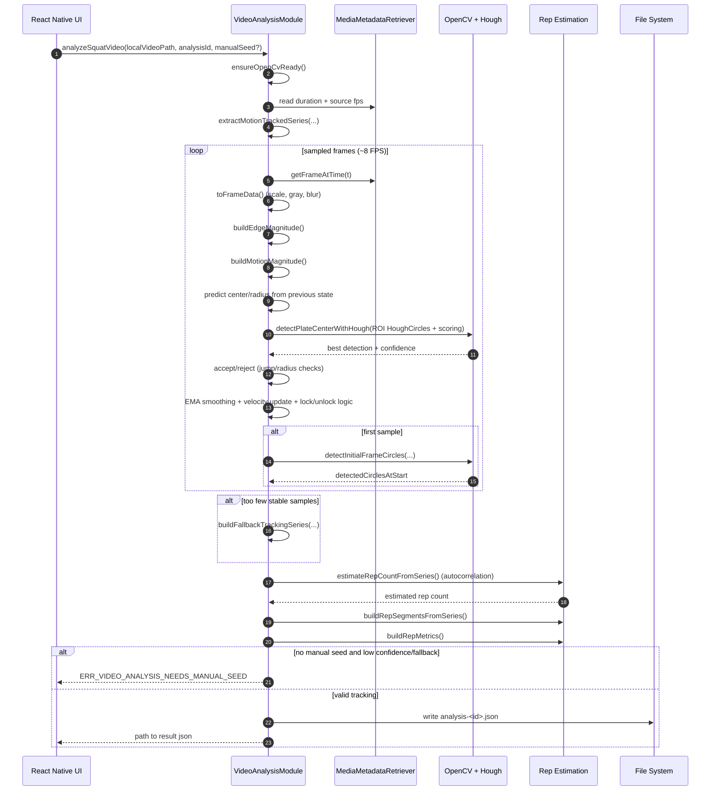
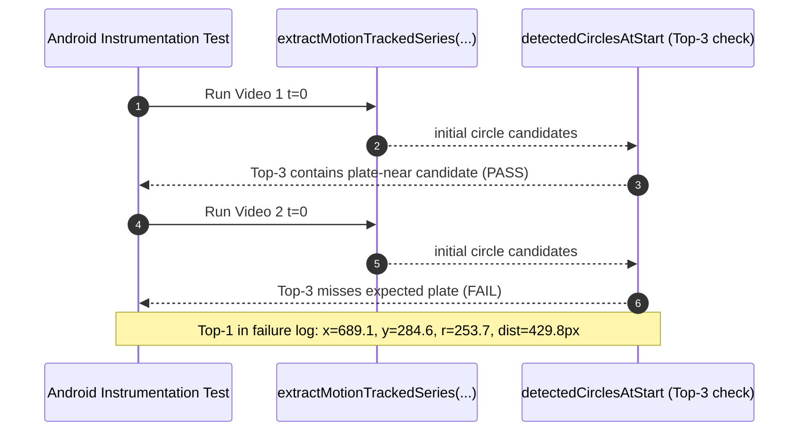

# Video Analysis Sequence Diagram

## Production flow (`VideoAnalysisModule`)

## Current behavior on your two videos (run on March 6, 2026)

## Related debug outputs

- `/tmp/hough-debug-tests/video1_t0-overlay.png`
- `/tmp/hough-debug-tests/video2_t0-overlay.png`
